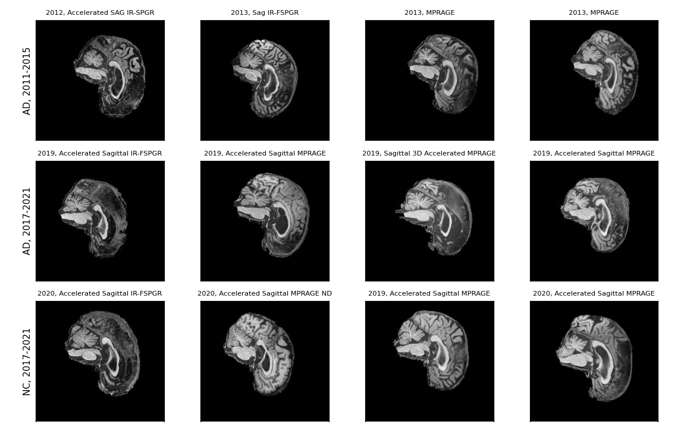
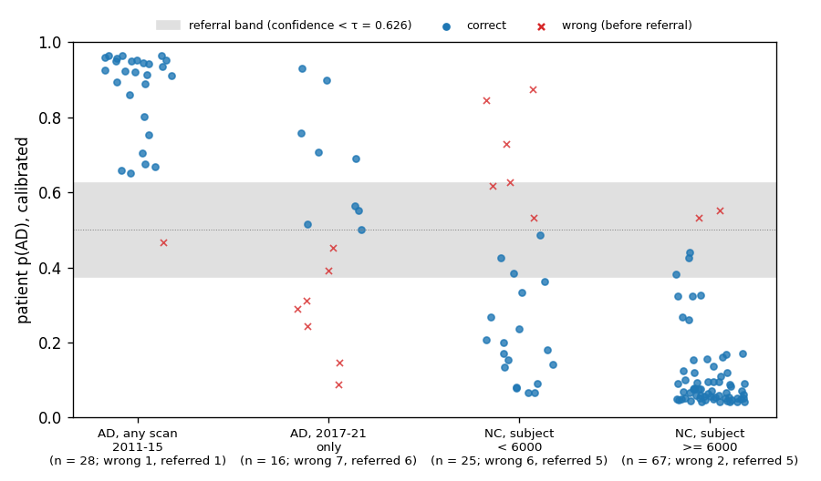
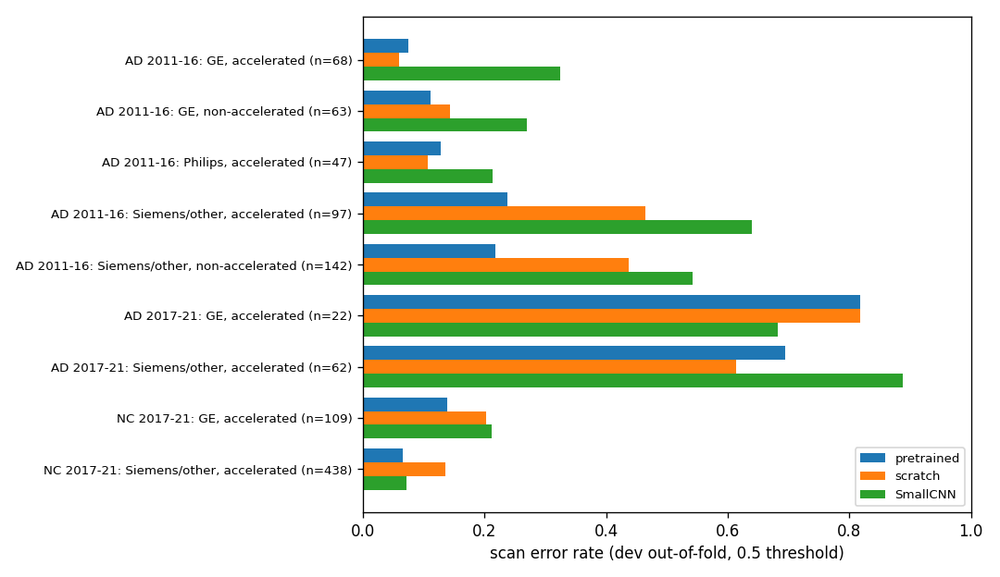

# ConvNeXt for Alzheimer's Disease Classification on ADNI Brain MRI

COMP3710 Pattern Recognition, recognition task: ConvNeXt (hard difficulty) on the
ADNI dataset, AD versus cognitively normal (NC). Student s4983666.

## Problem and algorithm

Alzheimer's disease (AD) causes progressive hippocampal and cortical atrophy and
ventricular enlargement that are visible on structural T1-weighted MRI. The task
is to classify 2D sagittal MRI slices of **previously unseen patients** as AD or NC,
while avoiding the main pitfall of this dataset: slices of one patient leaking
into both training and evaluation. The model is ConvNeXt (Liu et al., 2022), a
convolutional network that adopts design choices of vision transformers
(patchify stem, large 7x7 depthwise kernels, inverted bottlenecks, LayerNorm,
GELU and few activation/normalization layers). It is implemented from scratch in
PyTorch and trained either from random initialization or, as a cited
comparison, starting from the authors' ImageNet-1k ConvNeXt-Tiny weights
(allowed by the course staff when referenced). A four-block CNN is the baseline. Beyond accuracy, the project asks
whether the model's confidence can be trusted: a calibrated referral rule sends
low-confidence patients to a specialist instead of automating them.

## How it works


*Figure 1. Pipeline overview: three neighbouring sagittal slices enter the ConvNeXt-Tiny stem and four stages; each slice logit is calibrated by Platt scaling, the calibrated slice probabilities are averaged per scan or patient, and the patient probability is compared against the referral threshold τ.*

Each input is one slice stacked with its two neighbouring slices from the same
scan (three channels), so the 2D network sees some through-plane anatomy. The
stem cuts the image into 4×4 patches; four stages (Lite: 2-2-6-2 blocks with
48-384 channels; Tiny: 3-3-9-3 blocks with 96-192-384-768 channels) are separated by
LayerNorm + 2×2 stride-2 convolutions. Each block applies a 7×7 depthwise
convolution, LayerNorm, a 4×-expanded MLP with GELU, a learnable layer scale
(initialized to 1e-6) and stochastic depth [2] on the residual branch. The model
outputs one AD logit per slice. The baseline (`SmallCNN` in `models/cnn.py`) uses
four sequential stages of `Conv2d(3x3, padding=1, bias=False) -> GroupNorm(4 groups) -> ReLU -> MaxPool2d(2x2)`
with channel widths `16 -> 32 -> 64 -> 128`, followed by global average pooling,
`Dropout(0.2)` and a `Linear(128, 1)` head (`97,809` trainable parameters for
three-slice input). Training uses class-weighted binary
cross-entropy, AdamW with warm-up and cosine decay, strong augmentation, and an
exponential moving average (EMA) of the weights [5]. Training runs for a fixed
number of epochs and the final weights are kept, so validation patients are
only monitored, never used to pick a checkpoint. Slice probabilities are
averaged per scan and per patient; Platt scaling [4] and a referral threshold are
fitted on calibration patients before the test patients are scored once.


## Key findings and limitations

* **Coursework benchmark met:** On the held-out test cohort of 136 patients, the primary five-fold ImageNet-initialised ConvNeXt-Tiny ensemble achieves a patient-level accuracy of 0.882 (120/136), exceeding the 0.80 benchmark (slice accuracy 0.867, scan accuracy 0.889).
* **Baseline comparison:** After Platt threshold calibration, the difference in patient-level accuracy between the primary ConvNeXt ensemble and the baseline SmallCNN ensemble (0.882 vs 0.875, disagreeing on 7 of 136 patients) is not statistically significant (exact McNemar p = 1.00).
* **Acquisition confound:** In the provided dataset, patient diagnosis is entangled with acquisition year (all 783 NC scans were acquired 2017–2021; 623 of 743 AD scans were acquired 2011–2015). Scans from 2017–2021 AD patients constitute the primary source of false negatives (14 of 27 test scans missed).
* **Automated referral:** Using a confidence threshold of tau = 0.626 frozen from calibration, the primary ensemble automates 87.5% of test patients (119/136) with an automated patient accuracy of 92.4% (110/119), referring 17 patients (12.5%) for specialist assessment.

## Feasibility review

One-page review for the project manager. Tutor check-off completed on
Wednesday, 14 October 2026; the tutor noted that training did not need to use a
fixed epoch count and that validation performance could be used to decide early
stopping (tested via an inner validation subset in Rounds 1-2 before adopting
EMA weight averaging over a fixed schedule so all 381 non-validation patients per
fold could be used for training).

**1. User need, scope and acceptance criteria.** The user is a research
reviewer deciding whether an AD vs normal-control (NC) classifier for course
ADNI T1 MRI slices can automate confident cases and route uncertain ones to a
specialist. Clinical deployment is out of scope. Acceptance criteria:
(1) zero patient overlap between development, calibration and test patients,
and checkpoints that replay their predictions exactly; (2) test accuracy
≥ 0.80 at slice level (the unit recommended by staff for 2D models, Ed #137),
with scan and patient level also reported; (3) ConvNeXt and the CNN baseline
compared on identical patients with per-class precision/recall, macro-F1, AUROC
and ECE before/after calibration; (4) a referral rule frozen on calibration
patients before the test set is scored once, reported as coverage, accuracy of
automated cases and number referred, plus 3-5 real failure cases; (5) training
and inference on one A100 GPU with parameter count, peak memory and latency
measured.

**2. Model choice and course concepts.** Hard band: ConvNeXt-Tiny [1]
implemented locally in PyTorch (4×4 patchify stem, 7×7 depthwise convolutions,
LayerNorm, inverted bottleneck, layer scale, stochastic depth [2]), with the
slice and its two neighbours as three input channels. The baseline is a
four-block convolutional network (`SmallCNN`) trained by the identical pipeline. Course
concepts: convolutional inductive bias, overfitting and regularisation
(augmentation, weight decay, EMA [5]), patient-level validation, and
probability calibration [4]. Data: frozen patient-level manifests (476
development patients in five folds, 68 calibration, 136 test). Models train
for a fixed number of epochs and keep the final weights, so validation
patients are only used to compare configurations, never to pick a checkpoint.
The project started from random initialisation as advised in Ed #137; after a
later staff answer allowing properly cited external resources, an
ImageNet-1k-initialised ConvNeXt-Tiny (official weights, checksum recorded)
was added as a cited comparison, and the scratch model is still reported.

**3. Feasibility evidence.** The source audit found 680 patients (1,050
development, 170 calibration and 306 test scans of 20 slices, 240×256
grayscale), with 21 manifest hashes verified and no patient in two roles.
Five-fold development results (validation patients, not test): scratch
ConvNeXt-Tiny slice accuracy 0.715, CNN 0.690, ImageNet-initialised
ConvNeXt-Tiny 0.798 (patient level 0.782 / 0.750 / 0.840). ConvNeXt-Tiny has
27.8 M parameters, a 4,656 MiB training peak and 5.19 ms single-image latency,
against 97.8 k, 727 MiB and 1.16 ms for the CNN.

**4. Risks, budget and fallback.** (a) Acquisition confound: every NC scan was
acquired 2017-2021, while 417 of 503 AD scans are older, so models can learn
scanner style instead of atrophy; results are therefore also reported on the
2017-2021 scans, and Grad-CAM [10] is used to check where the evidence lies.
(b) About 95 patients per validation fold, so differences below roughly 0.04
are within noise; comparisons are paired by fold. (c) Overfitting (training
accuracy 0.95-1.00). (d) The slice-level target is marginal on development
data. Budget: one Rangpur A100 job at a time; a five-fold run costs about
5 GPU hours (pretrained) to 8.5 GPU hours (scratch). Next step: freeze the
final pipeline, fit Platt scaling and the referral threshold on calibration
patients, then score the test patients once. Fallback: if the test target is
missed, report the measured result honestly, keep the CNN comparison and the
referral rule, and recommend external validation on data where acquisition
style does not predict the diagnosis before any deployment.

## Repository layout

```text
ConvNeXt_ADNI_s4983666/
|-- modules.py            # Model interface (PyTorch only): models/convnext.py, models/cnn.py
|-- dataset.py            # Data interface imported by train.py / predict.py: adni_data/ (splits, manifests, slices, augmentation)
|-- train.py              # Training entry point (engine/training.py)
|-- predict.py            # Inference, calibration and test entry point (engine/prediction.py)
|-- adni_splits.py        # Audit / prepare / verify the patient-level split
|-- audit_preprocessing.py
|-- probe_acquisition.py  # Acquisition-style probe (docs/ACQUISITION_CONFOUND.md)
|-- explain_gradcam.py    # Grad-CAM figures on validation patients
|-- models/               # ConvNeXt and SmallCNN implementations (behind modules.py)
|-- adni_data/            # Data implementation (behind dataset.py)
|-- engine/               # Training loop, EMA, LR schedule, prediction
|-- evaluation/           # Metrics, inference, calibration, reporting, resource profiling
|-- utils/                # Runtime/seeding, output files, plots, training controls
|-- slurm/                # Rangpur batch scripts and the experiment-plan runner
|-- config/               # Requirements and experiment plans
|-- docs/                 # Data protocol, preprocessing notes, development experiments
|-- figures/              # README figures (plots of saved results)
|   '-- adni/             # De-identified ADNI slices: test examples, failures, Grad-CAM
'-- tests/                # Unit and end-to-end tests on synthetic data
```

## Dependencies and reproducibility

The code requires only Python, PyTorch, Pillow and Matplotlib (no torchvision,
NumPy or scikit-learn):

* **Rangpur A100 server environment (used for all reported experiments and recorded in every run's `config.json`):** Python `3.11.15`, `torch==2.13.0` (cluster `CUDA 13.0` build), `Pillow==12.3.0`, and `matplotlib==3.11.1` on an NVIDIA `A100-PCIE-40GB`.
* **Local CPU reference environment (`config/requirements-train.txt`, verified with Python `3.12.14`):** `Pillow==12.3.0`, `torch==2.6.0`, and `matplotlib==3.9.4` (standard PyPI wheels for running the synthetic test suite locally; on a GPU server, install the PyTorch build matching the cluster's CUDA driver).
* **Run outputs outside Git:** Per repository rules, datasets, frozen patient manifests, checkpoints, and run/analysis output files cited below (`runs/*`, `PREDECLARATION.txt`, `results/posthoc_cnn_scanner_20261021/`, `results/failure_evidence_20261026/`, and JSON summaries) are stored on Rangpur (`$HOME/comp3710/`) and are not committed to Git.

```bash
python3 -m pip install -r config/requirements-train.txt
python3 -m unittest discover -s tests          # synthetic data only
```

**Optional pretrained weights.** `--model convnext_tiny_in1k` starts from the
authors' ImageNet-1k ConvNeXt-Tiny weights (Liu et al., 2022;
https://github.com/facebookresearch/ConvNeXt). The code never downloads them;
fetch the file once and pass its path:

```bash
curl -L -o convnext_tiny_1k_224_ema.pth https://dl.fbaipublicfiles.com/convnext/convnext_tiny_1k_224_ema.pth
sha256sum convnext_tiny_1k_224_ema.pth   # 14f3164e3ea6ac32ab3f574f528ce817696c9176fad4221e0a77a905a7360595
python train.py --model convnext_tiny_in1k --pretrained-weights convnext_tiny_1k_224_ema.pth --context-slices 3 ...
```

`models/pretrained.py` maps the official parameter names onto this
implementation, requires every backbone tensor to match, and leaves the
one-logit classifier random. A fixed input layer converts the [-1, 1] inputs to
ImageNet mean/std; the three context slices take the place of the RGB
channels. The file's SHA-256 and source are written to the run's
`config.json`. The weights are not committed.

Every run seeds Python and PyTorch (`seed + fold`), requests deterministic
algorithms [7] and writes `config.json` (all options, package versions, GPU,
manifest and source-code hashes). Bit-exact results are only expected on the
same hardware and software versions.

After all experiments were finished, the data package was renamed from
`dataset/` to `adni_data/` so that `import dataset` resolves to `dataset.py`.
Before the rename, the package shadowed that file. Only module names and
imports changed, not the code inside them. The `code_sha256` paths recorded in
the configs of earlier runs therefore read `dataset/...`. Checkpoints store
tensors only (`weights_only=True`), so they load unchanged.

## Data

The course copy at `/home/groups/comp3710/ADNI` has 680 patients (221 AD, 459 NC),
1,526 scans (743 AD, 783 NC) and 30,520 grayscale 256×240 JPEG slices (20 consecutive
slices per scan). The course's own train/test folders share 216 patients, so patients
are re-split once (seed 3710), stratified by patient diagnosis (~32.5% AD across all
partitions and across all five development folds) while keeping all longitudinal scans
of a patient together:

| Partition | Patients (AD / NC) | Scans (AD / NC) | Slices (AD / NC) | Used for |
|---|---:|---:|---:|---|
| development (5 folds) | 476 (155 / 321, 32.6% AD) | 1,050 (503 / 547) | 21,000 (10,060 / 10,940) | training and validation (model comparison) |
| calibration | 68 (22 / 46, 32.4% AD) | 170 (91 / 79) | 3,400 (1,820 / 1,580) | Platt scaling and referral threshold of the frozen model |
| test | 136 (44 / 92, 32.4% AD) | 306 (149 / 157) | 6,120 (2,980 / 3,140) | one final evaluation |

Each of the five development folds holds out 95-96 validation patients (31 AD and
64-65 NC; 32.3-32.6% AD); scan and slice counts have a higher AD share (47.9-53.5%)
because AD patients contribute more longitudinal scans per subject on average (3.2-4.1
vs 1.7 for NC). Within fold 1, 381 patients train the model (the fold's `train` and small
`early_stop` manifests) and 95 validation patients are scored after every
epoch; the checkpoint is always the last epoch. `adni_splits.py verify` (run automatically by `train.py` and `predict.py`)
fails if any patient, scan, file or pixel hash crosses a role boundary. See
[docs/DATA_PROTOCOL.md](https://github.com/54dK3n/PatternAnalysis-2026/blob/topic-recognition/recognition/ConvNeXt_ADNI_s4983666/docs/DATA_PROTOCOL.md).
An independent audit of the frozen manifests confirmed zero patient, scan, file, or pixel overlap across partitions (see [docs/DATA_PROTOCOL.md](https://github.com/54dK3n/PatternAnalysis-2026/blob/topic-recognition/recognition/ConvNeXt_ADNI_s4983666/docs/DATA_PROTOCOL.md#manifest-verification-2026-10-26-re-check) for verification details and scope).

**Test-set use.** The test set was scored once with the frozen model, Platt
parameters and τ (Slurm 659813). Everything computed on test afterwards
reuses those saved predictions: the bootstrap, McNemar, patient-level Platt,
the `tau_NC` sweep and the failure-case review. None of it changed
the primary model, its threshold or the recommendation. The one later
training run, the `scanner` SmallCNN control, used only
development patients, and its threshold was fitted on calibration patients.
Its test numbers, like all post-hoc test results, are not an independent
estimate. A choice informed by them, such as a `tau_NC` value, would need new
data to evaluate.

**Preprocessing.** Slices keep their native 240×256 size and are mapped to
[-1, 1] with fixed constants, so no statistic is estimated from any split.
Optional per-scan intensity/crop standardisation is described in
[docs/INPUT_PREPROCESSING.md](https://github.com/54dK3n/PatternAnalysis-2026/blob/topic-recognition/recognition/ConvNeXt_ADNI_s4983666/docs/INPUT_PREPROCESSING.md); it did not help in
development and is off by default.

**Augmentation (training slices only).** Horizontal flip (on these sagittal
slices a front-to-back mirror: it keeps the atrophy pattern but produces an
orientation that does not occur in the data, so it acts as a generic
regulariser), random-resized crop covering 85-100% of the area [6], rotation up to
10 degrees, translation up to 5%, and intensity gain/gamma within ±10%/±15%. All three context
channels receive the same transform. Vertical flips and large rotations are not
used because they distort the anatomy further.
The `scanner` profile (screened in Round 4 and evaluated in the post-hoc SmallCNN control) adds smooth bias fields, intra-cranial Gaussian noise, and blur/unsharp filtering; full procedural specifications are detailed in [docs/DATA_PROTOCOL.md](https://github.com/54dK3n/PatternAnalysis-2026/blob/topic-recognition/recognition/ConvNeXt_ADNI_s4983666/docs/DATA_PROTOCOL.md#scanner-style-augmentation-profile).

## Usage

```bash
SPLITS="$HOME/comp3710/adni_splits_v1"
WEIGHTS="$HOME/comp3710/weights/convnext_tiny_1k_224_ema.pth"

# 1. Train the primary five-fold ImageNet-1k-initialised ConvNeXt-Tiny ensemble
# (40 epochs, 3-slice context, strong augmentation, EMA 0.999, AdamW lr 5e-5 / wd 0.05).
for f in 1 2 3 4 5; do
    python train.py --splits-dir "$SPLITS" --output "runs/pt_cv/fold${f}" --fold "$f" \
        --model convnext_tiny_in1k --pretrained-weights "$WEIGHTS" --epochs 40 --lr 5e-5
done

# 2. Train the five-fold scratch ConvNeXt-Tiny and SmallCNN baselines (80 epochs).
for f in 1 2 3 4 5; do
    python train.py --splits-dir "$SPLITS" --output "runs/scratch_cv/fold${f}" --fold "$f" \
        --model convnext_tiny --epochs 80
    python train.py --splits-dir "$SPLITS" --output "runs/cnn_cv/fold${f}" --fold "$f" \
        --model cnn --lr 1e-3 --weight-decay 1e-4 --epochs 80
done

# 3. Reproduce the validation result of any single fold checkpoint.
python predict.py --checkpoint runs/pt_cv/fold1/final.pt --splits-dir "$SPLITS" \
    --role val --output runs/pt_cv/fold1_val

# 4. Final evaluation of the frozen five-fold ensemble (calibration first, then test once).
python predict.py --checkpoint runs/pt_cv/fold{1,2,3,4,5}/final.pt --splits-dir "$SPLITS" \
    --role calibration --output runs/pt_cv_ensemble/calibration
python predict.py --checkpoint runs/pt_cv/fold{1,2,3,4,5}/final.pt --splits-dir "$SPLITS" \
    --role test --calibration-file runs/pt_cv_ensemble/calibration/calibration.json \
    --output runs/pt_cv_ensemble/test

# 5. Grad-CAM of a checkpoint on its fold's validation patients (never calibration/test).
python explain_gradcam.py --checkpoint runs/pt_cv/fold5/final.pt --splits-dir "$SPLITS" \
    --output runs/pt_cv/fold5/gradcam

# Note: omitting --model defaults to ConvNeXt-Lite (convnext_lite) for fast single-fold smoke runs:
# python train.py --splits-dir "$SPLITS" --output runs/lite_fold1 --fold 1
```

When the metadata file names carry acquisition dates, `predict.py` also reports
scan/patient metrics and referral counts separately for scans acquired before
and from 2017 (`by_acquisition_period` in `metrics.json`; see
[docs/ACQUISITION_CONFOUND.md](https://github.com/54dK3n/PatternAnalysis-2026/blob/topic-recognition/recognition/ConvNeXt_ADNI_s4983666/docs/ACQUISITION_CONFOUND.md)).
`explain_gradcam.py` (Selvaraju et al., 2017) writes the most confident correct
and wrong cases per diagnosis × acquisition period, the mean map of each group
and the share of each map that falls outside the head.

On Rangpur, `sbatch slurm/run_plan.sbatch config/experiments_round3_cv.json --smoke`
checks every planned case for one epoch, `--cases <id> ...` runs selected cases,
and `sbatch slurm/final_eval.sbatch <output dir> <run dir> [<run dir> ...]` performs the
two final steps for one model or a fold ensemble.
After every case the runner reloads `final.pt` and checks that the re-scored
accuracy and AUROC equal the training run's (`replay_check.json`).
`python slurm/summarize_runs.py <plan dirs> --output <prefix> --baseline <group> --candidate <group>`
collects every completed run into `<prefix>.md`/`.csv`, averages seeds or folds,
and pairs ConvNeXt with the CNN baseline by fold and seed.

A training run writes `config.json`, `history.csv` (per-epoch losses, metrics,
time and peak GPU memory), `learning_curves.png`,
`final.pt`, per-slice and per-scan predictions, confidence plots and
`metrics.json`. The test step prints one line per patient followed by the
calibrated summary (actual summary lines from the primary model's test run,
Slurm 659813):

```text
patient       true    p(AD)  decision
<patient_1>   NC      0.081  NC
<patient_2>   AD      0.552  REFER
...
Platt slope 0.246, intercept 0.193; referral threshold 0.6255970686222304 (fitted on calibration patients, target accuracy 0.9).
Referred to a specialist: 17/136 patients.
test slice: accuracy=0.8667 AUROC=0.9429123028256317 (n=6120)
test scan: accuracy=0.8889 AUROC=0.9636215962039927 (n=306)
test patient: accuracy=0.8824 AUROC=0.9439229249011858 (n=136)
```

and saves `test_examples.png` (input slice, true label, p(AD), decision).
Example input and output of the final test (primary ensemble): the middle
slice of the patient's first scan, with the patient-level calibrated p(AD)
and the decision. Top row: the four most confident automated patients (all
correct); bottom row: the four least confident referred patients (patient and
scan IDs removed).


*Figure 2. Example test predictions (patient and scan IDs removed).*

## Results

### Earlier development screens (fold 1)

Early single-fold development evaluated model capacity, regularisation, and training augmentations on fold 1 (95 outer validation patients):
* From scratch with single-slice input, unaugmented ConvNeXt-Tiny achieved 0.634 slice accuracy, which improved to 0.726 under light augmentation (5° rotation, 3% shift).
* Under Round 2 screens with three-slice context, strong augmentation, and 80 epochs, ConvNeXt-Tiny reached 0.742 ± 0.001 slice accuracy across two seeds (slice accuracy remained below 0.80).
* The scratch ConvNeXt memorised the training slices within a few epochs (training accuracy 1.00) and optimizer/regularisation tweaks (including mixup [3]) stayed within seed noise; augmentation was the only clear improvement.
* Because the 38-patient `early_stop` subset proved noisy as a checkpoint selector (scan AUROC 0.64–0.73 vs 0.84–0.87 on outer validation), subsequent rounds merged `early_stop` into training and kept the final-epoch EMA weights.

Full screen metrics, optimization schedules, and loss dynamics are documented in [docs/EXPERIMENTS.md](https://github.com/54dK3n/PatternAnalysis-2026/blob/topic-recognition/recognition/ConvNeXt_ADNI_s4983666/docs/EXPERIMENTS.md#outer-validation).

### Five-fold comparison from scratch (development patients)

[`config/experiments_round3_cv.json`](config/experiments_round3_cv.json), Slurm
jobs 649955 (ConvNeXt) and 649956 (CNN): both models use the identical pipeline
(three-slice context, strong augmentation, EMA 0.999, 80 epochs, final-epoch
weights, seed 3710) on the same five folds. Each fold is scored on its own ~95
validation patients, so together the folds cover all 476 development patients.
Mean ± sd over the five folds (`slurm/summarize_runs.py`):

| Model | Slice acc. | Scan acc. | Patient acc. | Slice AUROC | Scan AUROC | Patient AUROC |
|---|---:|---:|---:|---:|---:|---:|
| ConvNeXt-Tiny | 0.715 ± 0.028 | 0.748 ± 0.054 | 0.782 ± 0.032 | 0.799 ± 0.028 | 0.847 ± 0.035 | 0.851 ± 0.015 |
| SmallCNN (baseline) | 0.690 ± 0.032 | 0.701 ± 0.054 | 0.750 ± 0.032 | 0.800 ± 0.068 | 0.853 ± 0.072 | 0.840 ± 0.068 |


Per-fold metrics and patient error counts are documented in [docs/EXPERIMENTS.md](https://github.com/54dK3n/PatternAnalysis-2026/blob/topic-recognition/recognition/ConvNeXt_ADNI_s4983666/docs/EXPERIMENTS.md#round-3-five-fold-comparison-with-final-epoch-weights).

* Neither model reaches 0.80 on average at any level; ConvNeXt is closest at
  patient level (0.782).
* Paired by fold, ConvNeXt is ahead by +0.025 slice (4 of 5 folds), +0.047 scan
  and +0.032 patient accuracy, but a paired t-test over five folds does not
  reach significance (|t| = 1.2-1.7 against 2.78 at the 5% level).
* Discrimination is the same (slice AUROC 0.799 vs 0.800). The accuracy gap
  comes from where the 0.5 threshold falls: over all folds the CNN misses 90 AD
  patients and over-calls 29 NC patients, ConvNeXt 59 and 45.
* ConvNeXt overfits: final training slice accuracy 0.95-0.96 against 0.69-0.75
  on validation (CNN: 0.87-0.89).


*Figure 3. Fold-1 training (dashed) and validation (solid) slice loss and accuracy of the three models (`history.csv`).*

Fold 1 (dashed = training). The ImageNet-initialised model fits the training
slices within about five epochs; its validation accuracy then stays flat while
the validation loss rises, i.e. its wrong predictions become more confident.
As the tutor noted during the 14 October check-off, early stopping on validation
loss (or a shorter fixed epoch schedule) would curb this progressive logit
inflation; our fixed-schedule + EMA design instead keeps the outer validation
fold strictly out of checkpoint selection and corrects the resulting epoch-40
over-confidence post-hoc via Platt scaling (`slope a = 0.246`) on the
independent calibration set.

### Acquisition confound

The JPEG slices carry no acquisition information (no EXIF, identical
quantisation tables, all files copied on 14 September 2023), but the `raw`
entry of `meta_data_with_label.json` holds the original ADNI file name with
the sequence and a date stamp, e.g.
`ADNI_XXX_S_XXXX_MR_MPRAGE_br_raw_20120712115040983_76_S157373_I316011.nii`
(subject masked). Parsed for all 1,526 scans, every one of the 783 NC scans is
dated 2017-02 to 2021-05, while 623 of the 743 AD scans are dated 2011-02 to
2015-10; no scan falls between. Subject numbers (all older scans < 6000, i.e.
enrolled before ADNI-3) and sequence names (non-accelerated and Philips
sequences only in AD) agree. In development, all 417 scans acquired 2011-2016
are AD and all 547 NC scans were acquired 2017-2021 with accelerated sequences.



*Figure 4. Random slices per diagnosis and acquisition period (year and sequence from the metadata file name; IDs removed). The periods are not obviously distinguishable by eye.*

The diagnosis is therefore entangled with acquisition period and scanner. AD scans
acquired 2017-2021 are misclassified far more often (ConvNeXt scan error 0.67
vs 0.30 for earlier AD scans; CNN 0.84 vs 0.45). On the 633 scans acquired
2017-2021, where both classes share the same period, scan AUROC falls from
0.850 to 0.729 for ConvNeXt and from 0.839 to 0.654 for the CNN. A probe
network recognises the scanner vendor from pixels almost perfectly (scan AUROC
0.986 pooled over five folds, on NC scans of one period). Part of the development accuracy
therefore reflects acquisition style rather than anatomy.

Post-hoc checks locate this signal. Development, calibration and test scans
share one pixel distribution (domain-classifier AUROC 0.497 [0.437, 0.553] for
development vs test), so the test set carries the same internal confound and no
additional shift. The final features of the pretrained ConvNeXt encode vendor
and period (out-of-fold probe AUROC 0.95 and 0.914), but removing those
directions leaves its out-of-fold scan AUROC almost unchanged (0.924 to 0.918),
whereas the same removal drops SmallCNN from 0.836 to 0.496. The pretrained
model does not decide by these acquisition directions; SmallCNN largely does.
A new linear head fitted without those directions, nested within out-of-fold
scans, does not separate 2017-2021 AD from NC better than one fitted with them
(+0.008 [-0.024, 0.040]). A pixel proxy for dark central tissue failed its
pre-declared validity check, so the cue the pretrained model uses within
2017-2021 remains unidentified.
Details, probe results, these post-hoc checks and possible mitigations: [docs/ACQUISITION_CONFOUND.md](https://github.com/54dK3n/PatternAnalysis-2026/blob/topic-recognition/recognition/ConvNeXt_ADNI_s4983666/docs/ACQUISITION_CONFOUND.md).

### Fold 4-5 screens and five-fold ImageNet initialisation

Two attempts to weaken the acquisition shortcut were screened on folds 4 and 5 (detailed in [docs/EXPERIMENTS.md](https://github.com/54dK3n/PatternAnalysis-2026/blob/topic-recognition/recognition/ConvNeXt_ADNI_s4983666/docs/EXPERIMENTS.md#rounds-4-and-5-scanner-style-augmentation-and-imagenet-initialisation-folds-4-and-5)):
* ImageNet initialisation achieved the highest overall accuracy, but discrimination within 2017–2021 stayed at the level of the scratch model.
* Scanner-style augmentation helped the CNN on plain accuracy and 2017–2021 scan AUROC (though on fold 5 it missed 26/26 `2017-2021 AD` scans, reducing fold-5 2017–2021 scan balanced accuracy to 0.452), was mixed for scratch ConvNeXt and added nothing to the pretrained model. We retained `strong` augmentation across all three pre-declared five-fold ensembles so they share the same split, augmentation and evaluation pipeline (learning rate, epochs and weight decay still differ, so this is not a single-variable comparison); a post-hoc five-fold `SmallCNN + scanner aug.` control was evaluated after the locked test run (see [docs/POSTHOC_ANALYSES.md](https://github.com/54dK3n/PatternAnalysis-2026/blob/topic-recognition/recognition/ConvNeXt_ADNI_s4983666/docs/POSTHOC_ANALYSES.md#3-post-hoc-control-smallcnn-with-scanner-augmentation)).

* Five folds (round 6, [`config/experiments_round6_pretrained_cv.json`](config/experiments_round6_pretrained_cv.json),
  Slurm 656072), same patients as the table above:

| Model | Slice acc. | Scan acc. | Patient acc. | Scan AUROC | 2017-21 scan AUROC |
|---|---:|---:|---:|---:|---:|
| ConvNeXt-Tiny, ImageNet-1k init. | **0.798 ± 0.028** | **0.828 ± 0.039** | **0.840 ± 0.019** | 0.920 ± 0.014 | 0.778 ± 0.047 |
| ConvNeXt-Tiny, scratch | 0.715 ± 0.028 | 0.748 ± 0.054 | 0.782 ± 0.032 | 0.847 ± 0.035 | 0.736 ± 0.048 |
| SmallCNN | 0.690 ± 0.032 | 0.701 ± 0.054 | 0.750 ± 0.032 | 0.853 ± 0.072 | 0.606 ± 0.081 |

  Paired difference across the five folds against the baseline SmallCNN (paired t, 4 df; 2.78 = 5% two-sided threshold; full three-way comparison in [docs/EXPERIMENTS.md](https://github.com/54dK3n/PatternAnalysis-2026/blob/topic-recognition/recognition/ConvNeXt_ADNI_s4983666/docs/EXPERIMENTS.md#round-6-five-fold-imagenet-initialised-convnext-tiny)):

| Comparison | Slice acc. | Scan acc. | Patient acc. | 2017-21 scan AUROC |
|---|---|---|---|---|
| pretrained ConvNeXt-Tiny - SmallCNN | +0.108 (t = 6.1) | +0.128 (t = 3.9) | +0.090 (t = 7.1) | +0.172 (t = 5.1) |

  Within 2017-2021, the pretrained model's gain over the scratch model (+0.042
  AUROC, t = 1.5) is not significant and it still misses 63 of 86 AD scans
  acquired then. Details: [docs/EXPERIMENTS.md](https://github.com/54dK3n/PatternAnalysis-2026/blob/topic-recognition/recognition/ConvNeXt_ADNI_s4983666/docs/EXPERIMENTS.md#round-6-five-fold-imagenet-initialised-convnext-tiny).

**Why the folds differ.** Fold-to-fold variance stems from (1) ~95 validation patients per fold (±0.04 sampling error), (2) an uneven distribution of difficult 2017–2021 AD scans across folds (ranging from 9 on fold 3 to 26 on fold 5), and (3) seed-to-seed training variance (0.030 patient sd on fold 1). Full per-fold breakdown table and pooled out-of-fold analysis: [docs/EXPERIMENTS.md](https://github.com/54dK3n/PatternAnalysis-2026/blob/topic-recognition/recognition/ConvNeXt_ADNI_s4983666/docs/EXPERIMENTS.md#why-the-folds-differ).

### Grad-CAM (folds 4 and 5, validation)

Share of the Grad-CAM mass outside the head on the middle slice of each
validation scan (background is 0.72 of the slice, so a uniform map scores
about 0.72): scratch ConvNeXt-Tiny 0.72-0.83, ImageNet-initialised
ConvNeXt-Tiny 0.36-0.46, SmallCNN 0.22-0.31, with little difference between
diagnosis/period groups. The scratch ConvNeXt's evidence is not localised to the
head. Tables and caveats:
[docs/ACQUISITION_CONFOUND.md](https://github.com/54dK3n/PatternAnalysis-2026/blob/topic-recognition/recognition/ConvNeXt_ADNI_s4983666/docs/ACQUISITION_CONFOUND.md#grad-cam-where-the-evidence-lies).

Mean input (top) and mean Grad-CAM (bottom) per diagnosis and acquisition
group, fold 5 validation scans:

| ConvNeXt-Tiny, scratch | ConvNeXt-Tiny, ImageNet init. | SmallCNN |
|---|---|---|
|  |  |  |

*Figure 5. Mean mid-sagittal input slice (top) and mean Grad-CAM heatmap (bottom) per diagnosis × acquisition period on fold-5 validation scans for scratch ConvNeXt-Tiny, ImageNet-1k ConvNeXt-Tiny, and SmallCNN.*

Individual scans for the ImageNet-initialised model (two most confident
correct and two most confident wrong per group; input slice, then Grad-CAM):


*Figure 6. Grad-CAM of the ImageNet-initialised model on single fold-5 validation scans: two most confident correct and two most confident wrong scans per subgroup (input slice above, heatmap below; IDs removed).*

* **Scratch ConvNeXt-Tiny** (`gradcam_means_scratch_fold5.png`) scatters its
  attribution across the black corners and frame borders (`0.72-0.83` of map
  mass outside the head; only 1% of validation scans have more than 50% of the
  map inside the skull), reflecting coarse 7×8 final-stage cells driven
  by field-of-view boundary cues rather than brain morphology. A
  high-capacity 7×7 depthwise network trained from scratch on 381 patients
  latches onto background framing shortcuts. Outside-head attribution does not
  track accuracy: SmallCNN keeps `98-99%` of scans' majority attribution inside
  the head yet scores similarly to or below scratch ConvNeXt in single-fold
  development.
* **ImageNet-1k–initialised ConvNeXt-Tiny** (`gradcam_means_pretrained_fold5.png`,
  `gradcam_cases_pretrained_fold5.png`) concentrates attribution inside the
  cranium for 82% / 72% of fold 4 / fold 5 scans (`0.36-0.46` outside-head
  share). On unregistered 2D slices and the coarse 7×8 final-stage grid,
  this focus corresponds to a broad central intracranial region (roughly the
  mid-sagittal ventricular/callosal and deep parenchymal zone); the grid is too
  coarse to localise the hippocampus. Both
  confident correct scans and confident errors in `AD 2017-21` (p(AD) = 0.00)
  and `NC 2017-21` (p(AD) = 0.86–0.96) attend to this same central region;
  paired with the `vendor_within_nc` probe (`0.986` scan AUROC), this is
  consistent with the network reading global intracranial contrast/protocol
  signatures alongside gross ventricular morphology.
* **SmallCNN** (`gradcam_means_cnn_fold5.png`) keeps `98-99%` of scans' majority
  attribution inside the head (`0.22-0.31` outside), tracing high-contrast
  cortical and cerebellar boundaries.

### Final test (136 patients, scored once)

The model, the comparisons and the calibration procedure were declared before
the test job (Slurm 659813, `PREDECLARATION.txt` 2026-10-14T14:57+10:00, stored on Rangpur outside Git):
primary model = the five round-6 fold models averaged at the logit level;
the scratch ConvNeXt-Tiny and CNN fold ensembles are reported alongside. Each
ensemble fits Platt scaling and its referral threshold on the 68 calibration
patients, then scores the test patients once.

To separate the effect of five-fold logit ensembling from Platt threshold
calibration, the table below reports test accuracy **before → after** Platt
scaling alongside AUROC (`final_eval_20261014/*/test/metrics.json`):

| Five-fold ensemble | Slice acc. (uncal → cal) | Scan acc. (uncal → cal) | Patient acc. (uncal → cal) | Patient bal. acc. (uncal → cal) | Slice AUROC | Scan AUROC | Patient AUROC |
|---|---|---|---|---|---:|---:|---:|
| ConvNeXt-Tiny, ImageNet-1k init. (primary) | 0.862 → **0.867** | 0.879 → **0.889** | 0.882 → **0.882** | 0.854 → **0.866** | 0.943 | 0.964 | 0.944 |
| ConvNeXt-Tiny, scratch | 0.791 → 0.793 | 0.824 → 0.817 | 0.809 → 0.801 | 0.782 → 0.806 | 0.882 | 0.910 | 0.876 |
| SmallCNN | 0.783 → 0.826 | 0.814 → 0.873 | 0.824 → 0.875 | 0.751 → 0.860 | 0.908 | 0.947 | 0.927 |

Patient level, per class (after Platt scaling):

| Five-fold ensemble | AD precision / recall | NC precision / recall | Macro-F1 | Confusion [TN FP; FN TP] |
|---|---|---|---:|---|
| ConvNeXt-Tiny, ImageNet-1k init. | 0.818 / 0.818 | 0.913 / 0.913 | 0.866 | [84 8; 8 36] |
| ConvNeXt-Tiny, scratch | 0.655 / 0.818 | 0.901 / 0.793 | 0.786 | [73 19; 8 36] |
| SmallCNN | 0.800 / 0.818 | 0.912 / 0.902 | 0.858 | [83 9; 8 36] |

Scans by acquisition period (test: 122 AD scans 2011-2016 across 28 AD patients;
27 AD and 157 NC scans 2017-2021 across 16 AD and 92 NC patients):

| Five-fold ensemble | 2011-16 scan acc. | 2017-21 scan acc. | 2017-21 scan AUROC | 2017-21 AD scans missed |
|---|---:|---:|---:|---:|
| ConvNeXt-Tiny, ImageNet-1k init. | 0.951 (116/122) | 0.848 | 0.878 | 14/27 |
| ConvNeXt-Tiny, scratch | 0.893 (109/122) | 0.766 | 0.777 | 9/27 |
| SmallCNN | 0.926 (113/122) | 0.837 | 0.866 | 11/27 |

**Summary of feasibility acceptance criteria:**

| Criterion | Target | Measured result (primary ensemble) | Status |
|---|---|---|---|
| 1. Leakage-free split & replay | 0 shared patients; exact replay | 0 overlap across 21 manifests; 15/15 checkpoints replay bit-for-bit | Met |
| 2. Held-out test accuracy | ≥ 0.80 at slice level (scan/patient reported) | Slice **0.867**, scan **0.889**, patient **0.882** (AUROC 0.943 / 0.964 / 0.944) | Met on this test split |
| 3. Fair baseline & calibration metrics | Paired ConvNeXt vs SmallCNN + ECE | 5-fold paired CV + test ensemble per-class P/R, macro-F1, AUROC, ECE before/after Platt | Met |
| 4. Frozen referral rule & failure autopsy | τ frozen on calibration; ≥ 90% automated acc. | τ = 0.626 → **87.5%** test coverage (`119/136`), **92.4%** automated accuracy, `17` referred | Met on this test split |
| 5. Single-A100 resource profile | Params, VRAM (train/infer), latency | 27.8M params, 4,677 MiB train / 586 MiB batch-1 infer VRAM, 5.37 ms/slice (~0.54 s/scan ensemble) | Met |

* **Disentangling ensembling vs Platt calibration vs split composition:**
  1. *Five-fold ensembling + test split (before Platt scaling):* Averaging logits
     across the five fold checkpoints lifts uncalibrated slice accuracy above the
     single-fold development means for all three architectures (`0.798 -> 0.862`
     pretrained ConvNeXt, `0.715 -> 0.791` scratch ConvNeXt, `0.690 -> 0.783`
     SmallCNN). Because `PREDECLARATION.txt` committed to scoring the test set
     once per five-fold ensemble rather than evaluating individual fold
     checkpoints on test, this jump reflects the combined effect of five-fold
     logit ensembling and split-to-split variation between the 476 development
     patients and 136 test patients. At this uncalibrated ensemble
     stage on the exact same 136 test patients, pretrained ConvNeXt still leads
     SmallCNN by **+0.079** slice (`0.862` vs `0.783`), **+0.065** scan (`0.879`
     vs `0.814`), **+0.059** patient accuracy (`0.882` vs `0.824`) and **+0.103**
     patient balanced accuracy (`0.854` vs `0.751`), because uncalibrated SmallCNN
     misses 20 of the 44 AD test patients at the raw 0.5 threshold.
  2. *Platt intercept calibration:* Fitting Platt scaling on the 68 calibration
     patients leaves pretrained ConvNeXt's test patient accuracy unchanged
     (`0.882 -> 0.882`, balanced accuracy `0.854 -> 0.866`), whereas SmallCNN's
     large positive intercept (`b = +0.813`) shifts its operating threshold down
     in raw logit space, recovering 12 of its 20 missed AD patients and jumping
     its test patient accuracy by **+0.051** (`0.824 -> 0.875`) and slice accuracy
     by **+0.043** (`0.783 -> 0.826`).
* **2017-2021 subgroup on test vs development:** Although pretrained ConvNeXt
  outperformed SmallCNN by +0.172 scan AUROC on 2017-2021 scans in five-fold
  development (fold means `0.778` vs `0.606`), on the 184 test scans from 2017-2021 their
  ensemble scan AUROCs are nearly tied (`0.878` vs `0.866`), and at the
  calibrated threshold the pretrained ensemble misses `14/27` 2017-2021 AD scans
  (versus `11/27` for SmallCNN and `9/27` for scratch ConvNeXt, which achieves
  higher AD recall only by over-calling `34/157` NC scans as AD).


*Figure 7. Per-fold validation accuracy of single-fold models (bars) and test accuracy of the five-fold ensembles after Platt scaling (stars); dotted line marks the 0.80 coursework target.*

**How certain are these test differences?** 136 test patients is a small
sample (1 patient = 0.74 percentage points). Patient-level 95% intervals from
10,000 stratified bootstrap resamples (AD and NC patients resampled separately),
paired differences on the same resamples, and an exact McNemar test on
per-patient correctness (computed after the test run from the saved predictions;
`posthoc_patient_analysis.json`):

| Five-fold ensemble | Patient acc. [95% CI] | Balanced acc. [95% CI] | Patient AUROC [95% CI] |
|---|---|---|---|
| ConvNeXt-Tiny, ImageNet-1k init. | 0.882 [0.824, 0.934] | 0.866 [0.798, 0.927] | 0.944 [0.902, 0.977] |
| ConvNeXt-Tiny, scratch | 0.801 [0.728, 0.868] | 0.806 [0.733, 0.873] | 0.876 [0.812, 0.932] |
| SmallCNN | 0.875 [0.816, 0.926] | 0.860 [0.792, 0.921] | 0.927 [0.875, 0.968] |

| Comparison | Δ patient acc. [95% CI] | Δ AUROC [95% CI] | McNemar (only A right / only B right, p) |
|---|---|---|---|
| pretrained - SmallCNN | +0.007 [-0.029, +0.044] | +0.017 [-0.013, +0.047] | 4 / 3, p = 1.00 |
| pretrained - scratch ConvNeXt | +0.081 [+0.022, +0.140] | +0.067 [+0.029, +0.111] | 14 / 3, p = 0.013 |
| SmallCNN - scratch ConvNeXt | +0.074 [+0.015, +0.140] | +0.051 [+0.001, +0.106] | 15 / 5, p = 0.041 |

After five-fold ensembling and Platt threshold calibration, the patient-level
difference between the pretrained ConvNeXt and `strong`-augmented SmallCNN
ensembles is not statistically significant on the 136 test subjects (`120/136`
vs `119/136`, disagreeing on 7 of 136 patients, McNemar p = 1.00; 95% CI of
the difference −0.029 to +0.044, so the test cannot show equivalence), while pretrained
ConvNeXt retains a +0.041 slice-accuracy lead (`0.867` vs `0.826`) and an
advantage in the 476-patient paired five-fold development comparison
(`+0.090` patient accuracy vs `strong` SmallCNN, t = 7.1; `+0.029` vs post-hoc
`scanner` SmallCNN, t = 1.5) and uncalibrated test ensemble comparison (`0.882`
vs `0.824` `strong` / `0.838` `scanner`). Both pre-declared ensembles
significantly outperform the scratch ConvNeXt ensemble on this test split.

### What was tried and why accuracy plateaued

The table below summarizes the architectural modifications, regularisation techniques, data augmentations, and training configurations evaluated during development, along with their observed impact:

| Method | Settings explored | Observed effect | Source |
|---|---|---|---|
| Optimizer schedule and regularisation | Label smoothing (0.05, 0.10), Mixup (0.1, 0.2), cosine LR schedule, peak LR (1e-4, 3e-4), weight decay (0.01), DropPath (0.2) | Slice accuracy 0.460–0.616, patient accuracy 0.553–0.763 on the 38 inner early-stop patients (fold 1). Peak LR 3e-4 collapsed to 0.441 slice / 0.500 patient; DropPath 0.2 yielded 0.460 / 0.593 slice and 0.553 / 0.737 patient; the remaining settings stayed within seed-to-seed noise (note: early-stop subset is optimistic and noisy; predicting all NC yields 0.628 slice / 0.684 patient). | docs/EXPERIMENTS.md: Inner early-stop screens (fold 1) |
| Training data augmentation | none vs light (5 deg rotation, 3% shift) vs strong (flip, crop 85–100%, rotation 10 deg, translation 5%, gain ±10%, gamma ±15%) | On fold-1 outer validation (95 patients), single-slice ConvNeXt-Tiny improved from 0.634 (none) to 0.726 (light). Under strong augmentation (S4, which also added three-slice context and EMA), slice accuracy reached 0.719 / 0.738 (at most 60 epochs, patience 15); selected epoch moved from 1–4 to 16–30 and final training accuracy ended near 0.85 instead of memorising at 1.00. | docs/EXPERIMENTS.md: Outer validation and Strong augmentation screen |
| Multi-slice context | Single slice vs three-slice context (z-1, z, z+1) | Mean slice accuracy improved by +0.014 (0.714 to 0.728 in Lite Round 2), which is smaller than the 0.027 difference between the two S3 seeds. | docs/EXPERIMENTS.md: Round 2 (fold 1) |
| Scanner-style augmentation | Bias field, intra-cranial noise (0–3%), blur/sharpen, wider gain (±20%) and gamma (±30%) | On folds 4 and 5, improved SmallCNN (+0.025 / +0.092 slice accuracy, 2017–2021 scan AUROC +0.03 / +0.15), but on fold 5 SmallCNN missed all 26 of 26 2017–2021 AD validation scans (fold-5 2017–2021 balanced accuracy fell to 0.452). Produced mixed results for scratch ConvNeXt (fold 4: 0.738 vs 0.749 slice; fold 5: 0.720 vs 0.685 slice) and did not improve the pretrained model (fold 4: 0.801 vs 0.817; fold 5: 0.773 vs 0.773). | docs/EXPERIMENTS.md: Rounds 4 and 5 |
| ImageNet-1k weight initialisation | Random initialisation vs official ImageNet-1k pretrained weights (40 epochs, peak LR 5e-5) | Outperformed scratch ConvNeXt on all five folds: mean slice accuracy 0.798 ± 0.028 vs 0.715 ± 0.028 (+0.083, t = 14.3), patient accuracy 0.840 ± 0.019 vs 0.782 ± 0.032 (+0.059, t = 3.4). However, 2017–2021 scan AUROC gain (+0.042, t = 1.5) was not statistically significant and 63 of 86 development 2017–2021 AD scans were still missed. | docs/EXPERIMENTS.md: Round 6 |
| Intensity and crop standardisation | scan_intensity (foreground 1st–99th percentile mapping), scan_crop (foreground-centred integer crop), scan_intensity_crop (both) | Evaluated on fold 1 during early development; showed no improvement over native 240×256 slices scaled to [-1, 1], and disabled by default. Original numerical screen results were not retained. | README.md: Preprocessing & docs/INPUT_PREPROCESSING.md |

Four factors explain why performance plateaued across these experiments:

1. **High capacity leads to rapid memorisation on small cohorts:** An unaugmented ConvNeXt trained from scratch reaches ~0.93 training slice accuracy by epoch 4 and 1.00 soon after. Even with strong augmentation, 80-epoch scratch training ends at 0.95–0.96 training accuracy against 0.69–0.75 validation slice accuracy. The ImageNet-initialised model fits training slices within about 5 epochs, after which validation accuracy plateaus while validation loss rises.
2. **Pervasive acquisition confounding across cohorts:** In the 1,526 total scans, all 783 NC scans were acquired between 2017 and 2021, whereas 623 of the 743 AD scans were acquired between 2011 and 2015. On the 2017–2021 subset where both classes share the same acquisition period, development scan AUROC drops from 0.850 to 0.729 for scratch ConvNeXt and from 0.839 to 0.654 for SmallCNN, indicating that part of the development accuracy reflects acquisition style rather than anatomy (shortcut learning [8]; site confounding in medical imaging [9]). Performance plateaus on 2017–2021 AD cases: the primary ensemble still misses 14 of 27 2017–2021 AD test scans.
3. **Finite validation sample size and seed noise:** Each development fold contains ~95 validation patients (±0.04 sampling error). Hard 2017–2021 AD validation scans are unevenly distributed across folds (9 to 26 scans per fold). Furthermore, seed-to-seed standard deviation on fold 1 (0.023 scan, 0.030 patient) is comparable to fold-to-fold standard deviation (0.054 scan, 0.032 patient), because individual borderline cases flipping across the 0.5 threshold shift patient accuracy by ~1 pp each.
4. **Pretraining gains are concentrated on separable acquisition signatures:** Transfer learning from ImageNet-1k lifts five-fold development patient accuracy from 0.782 to 0.840, but within the 2017–2021 subset the gain over the scratch model (+0.042 scan AUROC, t = 1.5) is not statistically significant. Pretraining reduces errors on earlier AD scans (error drops from 0.300 to 0.173) and NC scans (0.148 to 0.080), but on modern scans AD 2017–2021 scan error is 0.674 (scratch) vs 0.733 (pretrained), i.e. not improved (missing 63 of 86 scans in development). The gain comes mostly from scans whose acquisition style already identifies the class, rather than improving discrimination on the harder modern scans.

## Resource profiling

Development measurements (A100, FP32, batch 32, 224×224 single-slice input,
30 epochs on 14,900 training slices; forward latency over 100 runs after 10
warm-up runs, excluding data loading):

| Model | Parameters | Peak training memory | Training time | Latency batch 1 | Latency batch 64 |
|---|---:|---:|---:|---:|---:|
| SmallCNN | 97,521 | 594 MiB | 328 s | 1.02 ± 0.02 ms | 3.90 ± 0.13 ms |
| ConvNeXt-Tiny | 27,817,825 | 3,756 MiB | 1,629 s | 4.70 ± 0.14 ms | 53.56 ± 0.16 ms |

Five-fold runs and final test benchmark (A100-PCIE-40GB, FP32, batch 32, 240×256
three-slice input on 16,420-17,100 training slices per fold):

| Model | Parameters | Peak train VRAM | Peak eval VRAM (batch 32) | Peak infer VRAM (batch 1 / 64, dev; test) | Training time per fold | Latency batch 1 (dev / test) | Latency batch 64 (dev / test) |
|---|---:|---:|---:|---:|---:|---:|---:|
| SmallCNN (80 epochs) | 97,809 | 727 MiB | 328 MiB | 73 / 591 MiB; 42 / 559 MiB | 3,078 s (3,024-3,143) | 1.16 ± 0.01 / 1.14 ± 0.01 ms | 4.83 ± 0.42 / 4.74 ± 0.01 ms |
| ConvNeXt-Tiny, scratch (80 epochs) | 27,820,897 | 4,656 MiB | 1,137 MiB | 415 / 1,433 MiB; 585 / 1,603 MiB | 6,038 s (5,897-6,138) | 5.19 ± 0.04 / 5.27 ± 0.07 ms | 64.37 ± 0.17 / 64.30 ± 0.26 ms |
| ConvNeXt-Tiny, ImageNet-1k (40 epochs) | 27,820,897 | 4,677 MiB | 1,160 MiB | 416 / 1,479 MiB; 586 / 1,649 MiB | ~3,000 s (~75 s/epoch) | 4.93 ± 0.11 / 5.37 ± 0.05 ms | 64.28 ± 0.23 / 64.29 ± 0.23 ms |

ConvNeXt-Tiny has 284× the parameters (`27,820,897 / 97,809`), 6.4× the peak
training memory and 4.3×–4.7× the single-slice forward latency of SmallCNN (4.3×
for the pretrained model in fold-1 development, `4.93 vs 1.16 ms`; 4.5× for the
scratch model in fold-1 development, `5.19 vs 1.16 ms`; and 4.7× in the final
test benchmark, `5.37 vs 1.14 ms`). Trained from scratch (80 epochs), that extra
cost yields a non-significant accuracy gain; initialised from ImageNet-1k
(40 epochs), its per-fold training time matches 80-epoch SmallCNN (~50 min/fold),
and the five-fold ensemble scores a 20-slice scan in ~0.54 s on one A100.

## Calibration and referral

Raw network confidence is recalibrated before use. On the 68 calibration patients,
`predict.py --role calibration` fits Platt scaling, p = sigmoid(a * logit + b)
(Platt, 1999; Guo et al., 2017 [4]), by minimising the slice log loss. The slope a
corrects over- or under-confidence; the intercept b moves the decision boundary,
which matters when uncalibrated models have a shifted operating threshold. It then picks the lowest patient
confidence threshold τ at which the automated calibration patients reach 90%
accuracy (`--target-accuracy`). Both values are frozen in `calibration.json`
and applied unchanged to the test patients, whose confidence below τ is
reported as `REFER`. The reports include ECE (15 bins), reliability diagrams,
confidence histograms of correct/incorrect predictions and risk-coverage curves.

Expected calibration error (15 bins, predicted-class confidence) on the test
patients before / after Platt scaling. The ECE before scaling was computed
afterwards from the saved test logits with the same function
(`ece_before_after_platt.json`):

| Five-fold ensemble | Platt slope a / intercept b | Slice ECE | Scan ECE | Patient ECE |
|---|---|---|---|---|
| ConvNeXt-Tiny, ImageNet-1k init. | 0.246 / 0.193 | 0.112 → 0.036 | 0.043 → 0.059 | 0.062 → 0.049 |
| ConvNeXt-Tiny, scratch | 0.354 / 0.500 | 0.144 → 0.022 | 0.076 → 0.057 | 0.076 → 0.070 |
| SmallCNN (`strong`, pre-declared) | 0.957 / 0.813 | 0.033 → 0.029 | 0.041 → 0.109 | 0.073 → 0.112 |
| SmallCNN (`scanner`, post-hoc) | 1.071 / -0.063 | — → 0.022 | — → 0.064 | — → 0.078 |

Referral rule (τ fitted on the 68 calibration patients for 90% accuracy of
automated patients, applied unchanged to the 136 test patients):

| Five-fold ensemble | τ | Calibration coverage | Test coverage | Test accuracy of automated patients | Test patients referred | AD 2017-21 patients automated as NC |
|---|---:|---:|---:|---:|---:|---:|
| ConvNeXt-Tiny, ImageNet-1k init. | 0.626 | 0.941 (64/68) | 0.875 (119/136) | 0.924 (110/119) | 17 | 5 |
| ConvNeXt-Tiny, scratch | 0.836 | 0.397 (27/68) | 0.346 (47/136) | 0.915 (43/47) | 89 | 0 |
| SmallCNN (`strong`) | 0.563 | 0.897 (61/68) | 0.912 (124/136) | 0.903 (112/124) | 12 | 5 |

* All three pre-declared ensembles meet the 90% target on this test split.
  Because τ is fitted on 68 calibration patients, the achieved accuracy varies
  between cohorts. For the primary ensemble, coverage shifts by 6.6 percentage
  points from calibration (`64/68 = 0.941` at `0.906` accuracy) to test
  (`119/136 = 0.875` at `0.924` accuracy). The post-hoc `scanner` SmallCNN
  control falls to `83.7%` automated accuracy on test
  ([docs/POSTHOC_ANALYSES.md](https://github.com/54dK3n/PatternAnalysis-2026/blob/topic-recognition/recognition/ConvNeXt_ADNI_s4983666/docs/POSTHOC_ANALYSES.md#3-post-hoc-control-smallcnn-with-scanner-augmentation)).
* The ImageNet-initialised ensemble is strongly over-confident at slice level
  (slope 0.246), and slice-level Platt scaling cuts its slice ECE threefold
  (`0.112 -> 0.036`) and lowers patient ECE (`0.062 -> 0.049`), while scan ECE
  rises slightly (`0.043 -> 0.059`). Because patient probabilities average
  20-160 slices (1-8 scans) and face a `32.4%` patient AD prior (whereas AD
  accounts for `53.5%` of the 3,400 calibration slices because AD patients have
  more longitudinal scans on average: `4.1` vs `1.7`), applying slice-fitted
  Platt parameters (`b = +0.813`) to slice logits before averaging the
  calibrated probabilities per patient increases
  `strong` SmallCNN's scan (`0.041 -> 0.109`) and patient (`0.073 -> 0.112`)
  ECE.
* The scratch ConvNeXt needs a high threshold (`tau = 0.836`) and refers 89 of 136
  patients (65.4%).
* Under the symmetric confidence rule `max(p, 1-p) >= tau`, both deployable
  ensembles still automate 5 of the 16 `AD 2017-2021` test patients as NC.

**Post-hoc comparison: Slice-level vs Patient-level Platt calibration (not in `PREDECLARATION.txt`).**
Fitting Platt scaling directly on patient-aggregated scores matches the 32.4% patient AD prior and cuts patient ECE across all models (pretrained: 0.049 → 0.043; SmallCNN: 0.112 → 0.038). However, this shifts the decision boundary toward NC, causing AD recall to drop (pretrained: 0.818 → 0.727, 8 → 12 false negatives). The pre-declared slice-fitted calibration (tau = 0.626) remains the operating point. Full tables and findings are documented in [docs/POSTHOC_ANALYSES.md](https://github.com/54dK3n/PatternAnalysis-2026/blob/topic-recognition/recognition/ConvNeXt_ADNI_s4983666/docs/POSTHOC_ANALYSES.md#1-post-hoc-comparison-slice-level-vs-patient-level-platt-calibration).

**Post-hoc sensitivity analysis: asymmetric referral (`tau_NC > tau_AD`, not in `PREDECLARATION.txt`).**
Raising tau_NC to 0.750–0.800 reduces automated 2017–2021 AD test false negatives from 5 to 2–3 at 77.9–80.1% coverage (93.6–94.3% accuracy). Eliminating all automated AD false negatives (tau_NC = 0.920) reduces test coverage to 56.6%. These values were examined after the test set was opened, so an operating tau_NC must be fixed on an independent calibration cohort. Full sensitivity tables: [docs/POSTHOC_ANALYSES.md](https://github.com/54dK3n/PatternAnalysis-2026/blob/topic-recognition/recognition/ConvNeXt_ADNI_s4983666/docs/POSTHOC_ANALYSES.md#2-asymmetric-referral-threshold-sensitivity-analysis).


*Figure 8. Left: slice reliability on test after Platt scaling. Middle and right: patient confidence distributions for correct and wrong test predictions of the primary ConvNeXt and SmallCNN ensembles with the frozen threshold τ.*

**Does confidence separate right from wrong?** Patient level, after Platt
scaling (`posthoc_patient_analysis.json`, stored on Rangpur). AUROC of confidence = probability
that a correct patient receives higher confidence than a wrong one; AURC =
area under the risk-coverage curve (lower is better):

| Five-fold ensemble | Total wrong patients (before referral) | Mean confidence correct / wrong | Wrong with confidence ≥ 0.9 | AUROC of confidence | AURC [95% CI] |
|---|---:|---|---:|---:|---|
| ConvNeXt-Tiny, ImageNet-1k init. | 16 (8 FP, 8 FN) | 0.854 / 0.682 | 1 | 0.838 | 0.030 [0.012, 0.053] |
| ConvNeXt-Tiny, scratch | 27 (19 FP, 8 FN) | 0.772 / 0.678 | 1 | 0.702 | 0.101 [0.054, 0.159] |
| SmallCNN | 17 (9 FP, 8 FN) | 0.783 / 0.645 | 1 | 0.783 | 0.044 [0.018, 0.080] |


*Figure 9. Patient risk-coverage curves on test with the operating point of the frozen threshold τ for each five-fold ensemble.*

* The pretrained ensemble ranks its own errors best: most of its 16 unreferred
  patient errors (8 FP and 8 FN across the 136 test patients) sit at low
  confidence, so 7 of those 16 errors fall below τ = 0.626 and are referred. Its
  AURC (`0.030` vs `0.044`) is lower than SmallCNN's in 93% of bootstrap
  resamples; the 95% CI of the difference (`-0.015`, `[-0.037, +0.004]`)
  includes zero.
* Three different counts of `16` appear in the test-set breakdown: (i) `16/136` total
  patients misclassified by the primary model at the 0.5 threshold before
  referral (`8 FP` and `8 FN`, comprising `7` FN from 2017-2021 and `1` FN from
  2011-2016); (ii) `16` total test AD patients scanned in 2017-2021 (of whom `7`
  are missed at 0.5: `5` automated as NC and `2` referred); and (iii) `16` of
  the `17` referred test patients (`10 NC` and `6 AD`) come from 2017-2021 scans
  (the 17th referred patient is the single missed `2011-2016 AD` patient, Case 10
  below).

### Post-hoc control: SmallCNN with scanner augmentation (not in `PREDECLARATION.txt`)

Evaluated on 2026-10-21 after the locked test run, this control trained a five-fold `SmallCNN + scanner aug.` ensemble under the identical pipeline. In five-fold development, scanner augmentation improved SmallCNN (+0.061 patient accuracy, t = 6.7 vs strong SmallCNN) and narrowed the gap to pretrained ConvNeXt (+0.029, t = 1.5, not significant). On the 136 test patients, however, `SmallCNN + scanner` reached 0.838 patient accuracy (114/136, trailing pretrained ConvNeXt by +0.044, McNemar p = 0.070), and its calibrated threshold (tau = 0.508) referred only 1 of 136 patients, resulting in 83.7% automated accuracy (below the 90% target, automating 9 of 16 modern AD patients as NC). Full development and test tables are in [docs/POSTHOC_ANALYSES.md](https://github.com/54dK3n/PatternAnalysis-2026/blob/topic-recognition/recognition/ConvNeXt_ADNI_s4983666/docs/POSTHOC_ANALYSES.md#3-post-hoc-control-smallcnn-with-scanner-augmentation).

## Failure case autopsy

**Cases 1-5** are the **five primary failure cases**: the five most confident
slice-level errors of the primary ensemble on the test set, exported by
`predict.py` (3 false positives and 2 false negatives; one slice per patient,
IDs removed). **Cases 6-10** (the four borderline referred patients from
*Figure 2* plus the single misclassified `2011-2016 AD` patient) and the
whole-cohort analyses (*Figures 11-12*) show the context of the referral rule.
All five primary failure slices come from scans acquired 2017-2021. The three false-positive slices
belong to NC patients that are also automated as AD at patient level; the two
false-negative slices belong to AD patients automated as NC, i.e. to the
confident misses in the AD 2017-2021 group described above.


*Figure 10. Five most confident slice-level test failures of the primary ensemble (Cases 1-5; IDs removed). Titles report slice p(AD), patient-level p(AD) and decision.*

Cross-model comparison of the five primary slice-level errors (Cases 1-5,
*Figure 10*) and the five supplementary cases—the four borderline referred patients (Cases 6-9, bottom row of
*Figure 2*) and the single misclassified `2011-2016 AD` patient (Case 10)—from
`test_failure_cases.csv`, `scan_predictions.csv` and `test_patient_predictions.csv`
(thresholds: pretrained τ = 0.626, scratch τ = 0.836, SmallCNN τ = 0.563):

| Case | Period & true label | Scans | Slice p(AD) (pretrained) | Pretrained: patient p(AD), decision | Scratch: patient p(AD), decision | SmallCNN: patient p(AD), decision |
|---|---|---:|---:|---|---|---|
| 1 | 2017-21 NC | 1 | 0.971 | 0.84, AD (wrong) | 0.87, AD (wrong) | 0.54, REFER |
| 2 | 2017-21 AD | 3 | 0.040 | 0.31, NC (wrong) | 0.25, REFER | 0.29, NC (wrong) |
| 3 | 2017-21 NC | 2 | 0.961 | 0.63, AD (wrong) | 0.69, REFER | 0.68, AD (wrong) |
| 4 | 2017-21 AD | 1 | 0.047 | 0.09, NC (wrong) | 0.35, REFER | 0.10, NC (wrong) |
| 5 | 2017-21 NC | 1 | 0.953 | 0.87, AD (wrong) | 0.83, REFER | 0.77, AD (wrong) |
| 6 (Ex. 5) | 2017-21 AD | 1 | — | 0.50, REFER | 0.54, REFER | 0.53, REFER |
| 7 (Ex. 6) | 2017-21 AD | 1 | — | 0.51, REFER | 0.64, REFER | 0.46, REFER |
| 8 (Ex. 7) | 2017-21 NC | 2 | — | 0.49, REFER | 0.61, REFER | 0.27, NC (correct) |
| 9 (Ex. 8) | 2017-21 NC | 1 | — | 0.53, REFER | 0.51, REFER | 0.51, REFER |
| 10 (pre-2017 FN) | 2011-16 AD | 6 | — (scan p: 0.29-0.89) | 0.47, REFER | 0.45, REFER | 0.31, NC (wrong) |

**Is the pattern more than five anecdotes?** Ten hand-picked cases cannot show
a pattern, so the same grouping was applied to every patient. *Figure 11* shows
all 136 test patients. Before referral, the primary model gets 16 wrong. Fifteen
are from 2017-2021: all 8 false positives (NC) and 7 of the 8 false negatives
(AD). Sixteen of the 17 referred patients are also from 2017-2021 (10 NC, 6 AD).

Scoring all 476 development patients out-of-fold shows the same trend across all
architectures: AD patients scanned only in 2017–2021 have significantly higher
error rates (development: 31/47 vs 21/108, Fisher p = 4e-8 for pretrained;
28/47 vs 31/108, p = 5e-4 for scratch; 39/47 vs 51/108, p = 4e-5 for SmallCNN),
and NC patients enrolled before ADNI-3 (subject < 6000) are misclassified more often
(development: 12/88 vs 12/233, Fisher p = 0.016 for the pretrained ensemble). Full
development out-of-fold Fisher exact test tables are detailed in
[docs/FAILURE_ANALYSIS.md](https://github.com/54dK3n/PatternAnalysis-2026/blob/topic-recognition/recognition/ConvNeXt_ADNI_s4983666/docs/FAILURE_ANALYSIS.md#1-cohort-wide-acquisition-confound-development-oof-fisher-exact-test).



*Figure 11. Calibrated patient p(AD) of all 136 test patients for the primary
ensemble, by diagnosis, acquisition period and enrolment band (subject number
< 6000 = enrolled before ADNI-3). Crosses: wrong before referral; grey band:
referred.*

**Other error dimensions (post-hoc, not in `PREDECLARATION.txt`).** The
development out-of-fold predictions were also split by slice position,
sequence family and number of scans per patient, re-analysing the saved
predictions. Details:
[docs/FAILURE_ANALYSIS.md](https://github.com/54dK3n/PatternAnalysis-2026/blob/topic-recognition/recognition/ConvNeXt_ADNI_s4983666/docs/FAILURE_ANALYSIS.md#4-error-breakdown-by-slice-position-sequence-family-and-scans-per-patient-post-hoc).

* **Slice position does not explain the errors.** The 20 slices of a scan form
  a narrow band (head area varies by about 1% across positions). The central and
  outer 10 slices are classified about equally well (pretrained: 0.792 vs
  0.804, p = 0.17). AD scans acquired 2017-2021 are poorly classified at every
  position (0.22-0.41, against 0.72-0.86 for 2011-2016 AD scans), so their
  errors are scan-wide.
* **Within one period and one diagnosis, scans whose sequence family is
  typical of the other class are misclassified more often.** 2011-2016 AD scans
  from Siemens/other sequences (the family of 438 of the 547 development NC
  scans) are missed more often than those from GE or Philips sequences. NC
  scans from GE sequences are called AD more often than NC scans from
  Siemens/other sequences (table and Figure 12).
  * Robustness: the AD difference holds within each acquisition year and does
    not come from any single site. For the scratch ConvNeXt and SmallCNN it
    also holds when each patient or site counts once. For the primary
    pretrained ensemble it is not significant at patient level (p = 0.09) or
    site level (p = 0.13).
  * Family and site can be separated in only 10 sites, so site population and
    disease stage remain possible causes.
  * A pre-declared histogram-matching intervention changed only each scan's
    intensity distribution to that of the other family. It moved scan p(AD) by
    at most 0.02, in no consistent direction, and no model met the
    pre-declared criterion, so it did not support an intensity-mediated
    mechanism. The intervention was mild and leaves brightness or contrast
    effects, other style cues (noise, sharpness) and site differences open.
* **The number of scans per patient is not a separate cause.** AD patients
  with one scan look harder (pretrained: 22/42 wrong vs 19/82 with three or
  more scans). Within acquisition period the gap disappears (2017-2021-only
  AD: 18/26 vs 7/10), because 26 of the 47 AD patients scanned only in
  2017-2021 have a single scan.

| Development OOF scan error | Pretrained | Scratch | SmallCNN |
|---|---|---|---|
| AD 2011-2016, Siemens/other | 54/239 = 0.23 | 107/239 = 0.45 | 139/239 = 0.58 |
| AD 2011-2016, GE or Philips | 18/178 = 0.10 | 18/178 = 0.10 | 49/178 = 0.28 |
| NC, GE | 15/109 = 0.14 | 22/109 = 0.20 | 23/109 = 0.21 |
| NC, Siemens/other | 29/438 = 0.07 | 59/438 = 0.13 | 31/438 = 0.07 |

The Fisher p-values for the AD rows are 0.001, 2 × 10⁻¹⁵ and 5 × 10⁻¹⁰. For
the NC rows they are 0.019, 0.096 and 5 × 10⁻⁵. They are optimistic because
the counts are per scan and scans of one patient are not independent. On test,
the AD direction repeats (6/61 vs 0/61) but the NC direction does not (GE 1/28
vs Siemens/other 13/129).



*Figure 12. Development out-of-fold scan error rate by diagnosis, acquisition
period and sequence family for the three models.*

**What the images can and cannot show.** *Figure 10* displays the single most confident erroneous slice per patient rather than a representative slice. In 98 of the 306 test scans (32%), some slices fall on each side of 0.5 (median within-scan range 0.22). Longitudinal slice-by-slice probability trajectories across whole scans and multi-slice anatomical profiles are documented in [docs/FAILURE_ANALYSIS.md](https://github.com/54dK3n/PatternAnalysis-2026/blob/topic-recognition/recognition/ConvNeXt_ADNI_s4983666/docs/FAILURE_ANALYSIS.md#2-through-scan-slice-profiles-and-multislice-analysis). No ventricle or cortical measurements were made, so no anatomical inferences are drawn from these images.

Per-case notes (numbers from `test_patient_predictions.csv`; τ = 0.6256):

* **Cases 1 and 5 (NC, confident false positives).** Patient p(AD) is 0.84 and
  0.87, so both are automated as AD. SmallCNN refers Case 1 (p = 0.54) but
  automates Case 5 as AD (0.77).
* **Case 3 (NC, borderline false positive).** One slice reaches p(AD) = 0.961.
  Averaging all 40 slices of the patient's two scans gives p(AD) = 0.6263, only
  0.0007 above τ, so the patient is automated as AD instead of referred. Such
  a small margin is within the uncertainty of a τ fitted on 68 patients.
* **Cases 2 and 4 (2017-2021 AD, confident false negatives).** Patient p(AD) is
  0.31 (3 scans, confidence 0.69) and 0.09 (1 scan, confidence 0.91). Both
  confidences exceed τ, so both patients are automated as NC, by the
  pretrained model and by SmallCNN (0.29 and 0.10). In the post-hoc asymmetric
  analysis (`tau_NC = 0.750` or `0.800`, [docs/POSTHOC_ANALYSES.md](https://github.com/54dK3n/PatternAnalysis-2026/blob/topic-recognition/recognition/ConvNeXt_ADNI_s4983666/docs/POSTHOC_ANALYSES.md#2-asymmetric-referral-threshold-sensitivity-analysis)), Case 2 would be referred and
  Case 4 would not.
* **Cases 6–9 (2017–2021, referred).** Patient p(AD) is 0.49–0.53, so all four are referred.
* **Case 10 (the only misclassified 2011–2016 AD patient).** Among the 122 earlier AD test scans, the primary ensemble misses 6 scans, 5 of which belong to Case 10 (scan p(AD) = 0.29–0.49). Averaging all 120 slices yields patient p(AD) = 0.47 (confidence 0.53 < tau = 0.626), so the primary ensemble correctly refers Case 10 rather than automating it as NC (SmallCNN gives p(AD) = 0.31 and automates it as NC). Detailed autopsies for Cases 6–10 are documented in [docs/FAILURE_ANALYSIS.md](https://github.com/54dK3n/PatternAnalysis-2026/blob/topic-recognition/recognition/ConvNeXt_ADNI_s4983666/docs/FAILURE_ANALYSIS.md#3-case-notes-for-supplementary-cases-cases-610).

## Recommendation to the project manager

1. **Decision: Advance to a controlled shadow study with conditions — do not
   deploy for autonomous clinical triage yet.** On held-out test patients the
   primary pipeline meets the internal coursework benchmarks on this test split
   (slice / scan / patient accuracy **0.867 / 0.889 / 0.882**, AUROC **0.943 /
   0.964 / 0.944**, and **92.4%** accuracy on the **87.5%** of patients
   automated at τ = 0.626), but the dataset's acquisition-period confound causes
   systematic false negatives on 2017-2021 AD scans (`14/27` scans missed,
   `5/16` patients confidently automated as NC under symmetric thresholding).
2. **Recommended operating configuration.** Use the five-fold **ImageNet-1k–
   initialised ConvNeXt-Tiny ensemble** with three-slice context and Platt
   scaling (`a = 0.246, b = 0.193`). Under the pre-declared symmetric threshold
   `tau = 0.626` (`REFER` when `max(p, 1-p) < 0.626`), the pipeline automates 119
   of 136 test patients (87.5% coverage, 92.4% accuracy, 9 automated errors) and
   refers 17 patients (12.5% specialist load, catching 7 of the 16 unreferred
   patient errors including the single 2011-2016 AD miss). Because τ is fitted
   on 68 calibration patients, re-verify the 90% target on each new cohort. The
   post-hoc sensitivity analysis shows that an asymmetric rule
   (`tau_NC > tau_AD`) trades coverage for fewer automated AD false negatives
   (`tau_NC` 0.750-0.800: 2-3 instead of 5, at 78-80% coverage). These figures
   come from the opened test set, so fix `tau_NC` on a new, larger calibration
   cohort before any test data are scored.
3. **Is ConvNeXt worth its compute overhead over SmallCNN?**
   * *From scratch:* **No.** Scratch ConvNeXt-Tiny requires 284× the parameters
     (`27.8 M` vs `97.8 k`), 6.4× the training memory (`4,656 MiB` vs `727 MiB`)
     and 4.5×–4.6× the single-slice latency (`5.19-5.27 ms` vs `1.14-1.16 ms`),
     yet attends heavily to background pixels (Grad-CAM outside-head share
     `0.72-0.83`), does not significantly beat SmallCNN in five-fold
     development (`+0.032` patient accuracy, `t = 1.7`), trails the calibrated
     SmallCNN ensemble on test (`0.801` vs `0.875` patient accuracy, McNemar
     `p = 0.041`), and must refer 65.4% of test patients to maintain 90% accuracy.
   * *With ImageNet-1k initialisation:* **Use it for GPU-server triage; its
     margin over a calibrated SmallCNN is small.**
     * On test, calibrated patient accuracy is tied (`0.882` vs `0.875`,
       McNemar `p = 1.00`), and 2017-2021 scan AUROC is close (`0.878` vs
       `0.866`).
     * ConvNeXt's raw scores already sit closer to a usable threshold. Before
       Platt scaling it reaches **0.882** patient and **0.854** balanced
       accuracy (`0.862` slice). The `strong` SmallCNN reaches **0.824** and
       **0.751** (`0.783` slice), missing `20/44` AD test patients. It reaches
       `0.875` only through a `+0.813` Platt intercept fitted on 68 calibration
       patients, an offset whose transfer to a new hospital or scanner
       distribution is uncertain.
     * ConvNeXt also leads in 476-patient five-fold development (`+0.090`
       patient accuracy vs `strong` SmallCNN, `t = 7.1`; `+0.029` vs `scanner`
       SmallCNN, `t = 1.5`) and in test slice accuracy (`0.867` vs `0.826` /
       `0.812`).
     * The post-hoc `SmallCNN + scanner aug.` control narrows the development
       gap but reaches `0.838` test patient accuracy (`114/136`) and `83.7%`
       automated accuracy at `tau = 0.508`, below the 90% target.
     * For strict CPU/edge environments, a Platt-calibrated SmallCNN ensemble
       is the lightweight choice (284× fewer parameters, 4.3×–4.7× lower
       single-slice latency, `1.14-1.16 ms` vs `4.93-5.37 ms`). For offline or
       hospital-server GPU triage (~27 ms/slice, ~0.54 s per 20-slice scan on
       one A100), use the pretrained ConvNeXt ensemble.
4. **Conditions before clinical or multi-site progression.**
   * **External protocol-matched validation:** Re-evaluate on an independent
     cohort where AD and NC patients are balanced within each scanner vendor,
     field strength and acquisition era, verifying that subgroup AD sensitivity on
     modern accelerated sequences meets a pre-deployment benchmark of ≥ 0.85
     (a proposed value, set slightly above the primary ensemble's overall
     patient AD recall of `0.818` on this test split).
   * **Subgroup-aware and patient-level calibration:** Fit Platt scaling at the
     patient/scan level (and with asymmetric thresholds `tau_NC > tau_AD`), and
     enforce mandatory `REFER` whenever a scan comes from an underrepresented
     protocol-by-diagnosis cell.
   * **Anatomically constrained pooling:** Replace full-frame global average
     pooling with skull-masked pooling and 3D/multi-slab coronal+sagittal views
     so mild medial-temporal atrophy in 2017-2021 AD scans is not washed out by
     whole-slice acquisition contrast.

## Limitations and future work

* **Acquisition confound:** No NC scans were acquired before 2017 in the
  supplied course dataset; overall accuracy here is therefore a likely
  optimistic estimate for a clinical site where AD and NC share the same scanner
  and protocol (though training without the 2011-2016 AD vs 2017-2021 NC
  imbalance would also remove the shortcut that currently depresses 2017-2021 AD
  recall).
* **Small validation and calibration cohorts:** Each development fold has ~95
  validation patients (±0.04 binomial standard error), calibration uses 68
  patients, and multi-seed repeats were run only on fold 1 for the scratch
  model (where patient-level seed sd was 0.030).
* **Disease stage is not controlled:** 2017-2021 AD patients are mostly
  ADNI-3 enrolments and earlier-enrolled NC patients are likely older, but the
  metadata has no age or clinical scores, so the split between acquisition
  style and disease stage or age as causes of the subgroup errors cannot be
  measured; the failure review makes no anatomical measurement.
* **2D slice representation and coarse Grad-CAM grid:** Slices are not
  spatially registered across patients, and the final ConvNeXt stage has a 7×8
  spatial grid.
* **Scope of the model comparison:** Each model used its own learning rate,
  epoch budget and weight decay, and only two `SmallCNN` augmentation recipes
  were tried (`strong`, pre-declared; `scanner`, post-hoc). Conclusions about
  ConvNeXt versus `SmallCNN` apply to these configurations. On test the
  pretrained ConvNeXt is one patient ahead of the `strong` SmallCNN (McNemar
  p = 1.00) and six ahead of the `scanner` SmallCNN (p = 0.070).
* **Horizontal flip orientation:** The horizontal flip mirrors sagittal slices
  front-to-back, an orientation absent from natural brain MRI; its standalone
  effect was not ablated separately from the rest of the strong augmentation
  profile.
* **Future extensions:** Skull-masked global pooling (restricting feature
  aggregation to intracranial pixels), background randomisation during training,
  within-mask intensity normalisation (CLAHE or z-score), folds stratified
  jointly by diagnosis and acquisition period, higher-resolution Grad-CAM from
  stage 3, and external validation on protocol-matched multi-site data.

## Artificial Intelligence Usage Disclosure

AI coding assistants (OpenAI ChatGPT/Codex, Anthropic Claude, and Google
Antigravity) were used as programming, debugging, analysis-scripting, plotting
and documentation-editing utilities during development, in accordance with
course policy.

**Scope of AI assistance.**

* *Code and evaluation scripts:* Assisting with implementation scaffolding, CLI
  and configuration modules, Slurm batch scripts, post-hoc evaluation and
  plotting scripts (`figures/*.png`), synthetic-data unit tests under `tests/`,
  and refactoring the codebase into the package layout behind `modules.py`,
  `dataset.py`, `train.py` and `predict.py`.
* *Documentation and editing:* Formatting Markdown tables from the saved
  `metrics.json` and summary files, and assisting with drafting and polishing
  sections of `README.md` and `docs/`.

**Author's work and engineering decisions.**

* Choosing the project, the ConvNeXt-Tiny and SmallCNN architectures, the
  three-slice 2.5D input representation, and the operational acceptance
  criteria, and presenting the feasibility review at the 14 October tutor
  check-off.
* Identifying the 216-patient overlap in the course's default directories and
  establishing the frozen patient-level split (`development`, `calibration`,
  `test`).
* Designing the experimental progression (six pre-declared rounds plus the
  post-hoc control), discovering the 2011-2016 vs 2017-2021 acquisition-period
  confound in `meta_data_with_label.json`, and formulating the non-diagnostic
  scanner/period probe, Grad-CAM attribution check, five-fold logit ensemble,
  Platt-calibrated referral rule, failure-case analysis and project-manager
  recommendation.

**Verification.** Every piece of code was reviewed and executed against the
synthetic test suite (`python3 -m unittest discover -s tests`) and checked for
zero patient leakage (`adni_splits.py verify`) before use. Every trained
checkpoint was reloaded and verified to reproduce its own validation metrics
(`replay_check.json`), uncalibrated and calibrated ECE values were cross-checked
directly from raw logits, and every number in this report was verified against
the corresponding `metrics.json` or analysis output. Several AI errors were
caught and corrected during review—including assuming a fixed number of slices
per patient, calling the sagittal slices axial, describing scan probabilities as
averaged logits rather than averaged calibrated probabilities, a miscounted
referral breakdown, a borderline-case margin misquoted by a factor of six,
over-specific anatomical claims on unregistered 2D slices, and a pretrained
training command missing its `--lr 5e-5` flag. I take full responsibility for
every line of code, metric and claim in this submission.

## Data acknowledgement and references

**ADNI data acknowledgement.** Magnetic resonance imaging data used in this
coursework were obtained from the Alzheimer's Disease Neuroimaging Initiative
(ADNI) database (`adni.loni.usc.edu`) via the COMP3710 course dataset
(`/home/groups/comp3710/ADNI`). As such, the investigators within the ADNI
contributed to the design and implementation of ADNI and/or provided data but
did not participate in the analysis or writing of this report.

1. Z. Liu et al., "A ConvNet for the 2020s", CVPR 2022. https://arxiv.org/abs/2201.03545 ;
   reference implementation and ImageNet-1k weights (`convnext_tiny_1k_224_ema.pth`)
   https://github.com/facebookresearch/ConvNeXt
2. G. Huang et al., "Deep Networks with Stochastic Depth", ECCV 2016.
3. H. Zhang et al., "mixup: Beyond Empirical Risk Minimization", ICLR 2018. https://arxiv.org/abs/1710.09412
4. C. Guo et al., "On Calibration of Modern Neural Networks", ICML 2017. https://arxiv.org/abs/1706.04599 ;
   J. Platt, "Probabilistic Outputs for Support Vector Machines and Comparisons to Regularized Likelihood Methods", 1999.
5. B. Polyak and A. Juditsky, "Acceleration of Stochastic Approximation by Averaging", SIAM J. Control Optim., 1992.
6. C. Szegedy et al., "Going Deeper with Convolutions", CVPR 2015 (random-resized crop).
7. PyTorch reproducibility notes, https://docs.pytorch.org/docs/stable/notes/randomness.html
8. R. Geirhos et al., "Shortcut learning in deep neural networks", Nature Machine Intelligence, 2020. https://arxiv.org/abs/2004.07780
9. J. R. Zech et al., "Variable generalization performance of a deep learning model to detect pneumonia in chest radiographs: a cross-sectional study", PLOS Medicine, 2018.
10. R. R. Selvaraju et al., "Grad-CAM: Visual Explanations from Deep Networks via Gradient-based Localization", ICCV 2017. https://arxiv.org/abs/1610.02391
