# ConvNeXt for Alzheimer's Disease Classification on ADNI Brain MRI

COMP3710 Pattern Recognition, recognition task: ConvNeXt (hard difficulty) on the
ADNI dataset, AD versus cognitively normal (NC). Student s4983666.

## Problem and algorithm

Alzheimer's disease (AD) causes progressive hippocampal and cortical atrophy and
ventricular enlargement that are visible on structural T1-weighted MRI. The task
is to classify 2D axial MRI slices of **previously unseen patients** as AD or NC,
while avoiding the main pitfall of this dataset: slices of one patient leaking
into both training and evaluation. The model is ConvNeXt (Liu et al., 2022), a
convolutional network that adopts design choices of vision transformers
(patchify stem, large 7x7 depthwise kernels, inverted bottlenecks, LayerNorm,
GELU and few activation/normalization layers). It is implemented from scratch in
PyTorch and trained either from random initialization or, as a cited
comparison, starting from the authors' ImageNet-1k ConvNeXt-Tiny weights
(allowed by the course staff when referenced). A four-block CNN is the baseline. Beyond accuracy, the project asks
whether the model's confidence can be trusted: a calibrated referral rule sends
low-confidence patients to a specialist instead of automating them.

## How it works

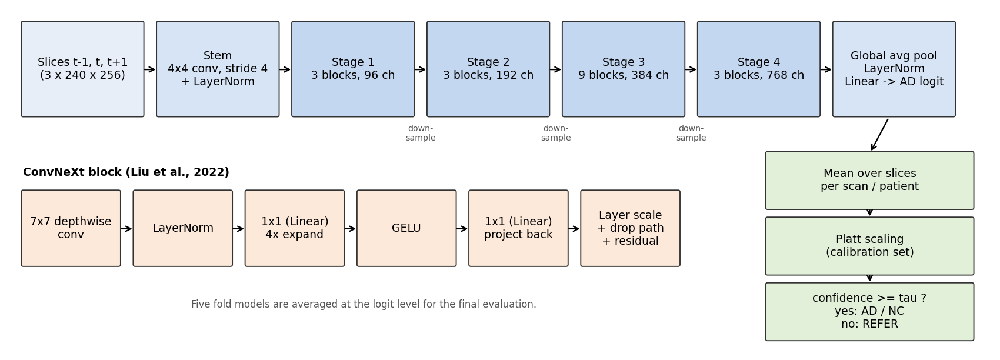

Each input is one slice stacked with its two neighbouring slices from the same
scan (three channels), so the 2D network sees some through-plane anatomy. The
stem cuts the image into 4x4 patches; four stages (Lite: 2-2-6-2 blocks with
48-384 channels; Tiny: 3-3-9-3 blocks with 96-768 channels) are separated by
LayerNorm + 2x2 stride-2 convolutions. Each block applies a 7x7 depthwise
convolution, LayerNorm, a 4x-expanded MLP with GELU, a learnable layer scale
(initialized to 1e-6) and stochastic depth on the residual branch. The model
outputs one AD logit per slice. Training uses class-weighted binary
cross-entropy, AdamW with warm-up and cosine decay, strong augmentation, and an
exponential moving average (EMA) of the weights. Training runs for a fixed
number of epochs and the final weights are kept, so validation patients are
only monitored, never used to pick a checkpoint. Slice probabilities are
averaged per scan and per patient; Platt scaling and a referral threshold are
fitted on calibration patients before the test patients are scored once.

## Feasibility review

One-page review for the project manager (tutor check-off). `TODO(owner)`:
check-off date and the tutor's feedback.

**1. User need, scope and acceptance criteria.** The user is a research
reviewer deciding whether an AD vs normal-control (NC) classifier for course
ADNI T1 MRI slices can automate confident cases and route uncertain ones to a
specialist. Clinical deployment is out of scope. Acceptance criteria:
(1) zero patient overlap between development, calibration and test patients,
and checkpoints that replay their predictions exactly; (2) test accuracy
>= 0.80 at slice level (the unit recommended by staff for 2D models, Ed #137),
with scan and patient level also reported; (3) ConvNeXt and the CNN baseline
compared on identical patients with per-class precision/recall, macro-F1, AUROC
and ECE before/after calibration; (4) a referral rule frozen on calibration
patients before the test set is scored once, reported as coverage, accuracy of
automated cases and number referred, plus 3-5 real failure cases; (5) training
and inference on one A100 GPU with parameter count, peak memory and latency
measured.

**2. Model choice and course concepts.** Hard band: ConvNeXt-Tiny [1]
implemented locally in PyTorch (4x4 patchify stem, 7x7 depthwise convolutions,
LayerNorm, inverted bottleneck, layer scale, stochastic depth [2]), with the
slice and its two neighbours as three input channels. The baseline is a
four-block convolutional network trained by the identical pipeline. Course
concepts: convolutional inductive bias, overfitting and regularisation
(augmentation, weight decay, EMA [5]), patient-level validation, and
probability calibration [4]. Data: frozen patient-level manifests (476
development patients in five folds, 68 calibration, 136 test). Models train
for a fixed number of epochs and keep the final weights, so validation
patients are only used to compare configurations, never to pick a checkpoint.
The project started from random initialisation as advised in Ed #137; after a
later staff answer allowing properly cited external resources, an
ImageNet-1k-initialised ConvNeXt-Tiny (official weights, checksum recorded)
was added as a cited comparison, and the scratch model is still reported.

**3. Feasibility evidence.** The source audit found 680 patients (1,050
development, 170 calibration and 306 test scans of 20 slices, 240x256
grayscale), with 21 manifest hashes verified and no patient in two roles.
Five-fold development results (validation patients, not test): scratch
ConvNeXt-Tiny slice accuracy 0.715, CNN 0.690, ImageNet-initialised
ConvNeXt-Tiny 0.798 (patient level 0.782 / 0.750 / 0.840). ConvNeXt-Tiny has
27.8 M parameters, a 4,656 MiB training peak and 5.19 ms single-image latency,
against 97.8 k, 727 MiB and 1.16 ms for the CNN.

**4. Risks, budget and fallback.** (a) Acquisition confound: every NC scan was
acquired 2017-2019, while 417 of 503 AD scans are older, so models can learn
scanner style instead of atrophy; results are therefore also reported on the
2017-2019 scans, and Grad-CAM [10] is used to check where the evidence lies.
(b) About 95 patients per validation fold, so differences below roughly 0.04
are within noise; comparisons are paired by fold. (c) Overfitting (training
accuracy 0.95-1.00). (d) The slice-level target is marginal on development
data. Budget: one Rangpur A100 job at a time; a five-fold run costs about
5 GPU hours (pretrained) to 8.5 GPU hours (scratch). Next step: freeze the
final pipeline, fit Platt scaling and the referral threshold on calibration
patients, then score the test patients once. Fallback: if the test target is
missed, report the measured result honestly, keep the CNN comparison and the
referral rule, and recommend external validation on data where acquisition
style does not predict the diagnosis before any deployment.

## Repository layout

```text
ConvNeXt_ADNI_s4983666/
├── modules.py            # Model interface (PyTorch only): models/convnext.py, models/cnn.py
├── dataset.py            # Data interface: dataset/ (splits, manifests, slices, augmentation)
├── train.py              # Training entry point (engine/training.py)
├── predict.py            # Inference, calibration and test entry point (engine/prediction.py)
├── adni_splits.py        # Audit / prepare / verify the patient-level split
├── audit_preprocessing.py
├── probe_acquisition.py  # Acquisition-style probe (docs/ACQUISITION_CONFOUND.md)
├── explain_gradcam.py    # Grad-CAM figures on validation patients
├── engine/               # Training loop, EMA, LR schedule, prediction
├── evaluation/           # Metrics, inference, calibration, reporting, resource profiling
├── utils/                # Runtime/seeding, output files, plots, training controls
├── slurm/                # Rangpur batch scripts and the experiment-plan runner
├── config/               # Requirements and experiment plans
├── docs/                 # Data protocol, preprocessing notes, development experiments
├── figures/              # README figures (plots of saved results)
│   └── adni/             # De-identified ADNI slices: test examples, failures, Grad-CAM
└── tests/                # Unit and end-to-end tests on synthetic data
```

## Dependencies and reproducibility

Rangpur runs used Python 3.11.15, PyTorch 2.13.0 (CUDA build 13.0), Pillow
12.3.0 and Matplotlib 3.11.1 on an NVIDIA A100-PCIE-40GB. The code needs no
torchvision, NumPy or scikit-learn; `config/requirements*.txt` list the minimal
packages (install a PyTorch build that matches your GPU driver).

```bash
python3 -m pip install -r config/requirements-train.txt
python3 -m unittest discover -s tests          # synthetic data only
```

**Optional pretrained weights.** `--model convnext_tiny_in1k` starts from the
authors' ImageNet-1k ConvNeXt-Tiny weights (Liu et al., 2022;
https://github.com/facebookresearch/ConvNeXt). The code never downloads them;
fetch the file once and pass its path:

```bash
curl -L -o convnext_tiny_1k_224_ema.pth https://dl.fbaipublicfiles.com/convnext/convnext_tiny_1k_224_ema.pth
sha256sum convnext_tiny_1k_224_ema.pth   # 14f3164e3ea6ac32ab3f574f528ce817696c9176fad4221e0a77a905a7360595
python train.py --model convnext_tiny_in1k --pretrained-weights convnext_tiny_1k_224_ema.pth --context-slices 3 ...
```

`models/pretrained.py` maps the official parameter names onto this
implementation, requires every backbone tensor to match, and leaves the
one-logit classifier random. A fixed input layer converts the [-1, 1] inputs to
ImageNet mean/std; the three context slices take the place of the RGB
channels. The file's SHA-256 and source are written to the run's
`config.json`. The weights are not committed.

Every run seeds Python and PyTorch (`seed + fold`), requests deterministic
algorithms and writes `config.json` (all options, package versions, GPU,
manifest and source-code hashes). Bit-exact results are only expected on the
same hardware and software versions.

## Data

The course copy at `/home/groups/comp3710/ADNI` has 680 patients, 1,526 scans
and 30,520 grayscale 256x240 JPEG slices (20 consecutive slices per scan). The
course's own train/test folders share 216 patients, so patients are re-split
once (seed 3710), keeping all scans of a patient together:

| Partition | Patients | Scans | Slices | Used for |
|---|---:|---:|---:|---|
| development (5 folds) | 476 | 1,050 | 21,000 | training and validation (model comparison) |
| calibration | 68 | 170 | 3,400 | Platt scaling and referral threshold of the frozen model |
| test | 136 | 306 | 6,120 | one final evaluation |

Within fold 1, 381 patients train the model (the fold's `train` and small
`early_stop` manifests) and 95 validation patients are scored after every
epoch; the checkpoint is always the last epoch. `adni_splits.py verify` (run automatically by `train.py` and `predict.py`)
fails if any patient, scan, file or pixel hash crosses a role boundary. See
[docs/DATA_PROTOCOL.md](docs/DATA_PROTOCOL.md).

**Preprocessing.** Slices keep their native 240x256 size and are mapped to
[-1, 1] with fixed constants, so no statistic is estimated from any split.
Optional per-scan intensity/crop standardisation is described in
[docs/INPUT_PREPROCESSING.md](docs/INPUT_PREPROCESSING.md); it did not help in
development and is off by default.

**Augmentation (training slices only).** Horizontal flip (AD atrophy is
bilateral), random-resized crop covering 85-100% of the area, rotation up to
10 degrees, translation up to 5%, and intensity gain/gamma within ±10%/±15%. All three context
channels receive the same transform. Vertical flips and large rotations are not
used because they never occur in this data.

## Usage

```bash
SPLITS="$HOME/comp3710/adni_splits_v1"
# Train (defaults: ConvNeXt-Lite, 3-slice context, strong augmentation, EMA 0.999,
# AdamW 1e-4 / wd 0.05, 3 warm-up epochs + cosine, 80 epochs, final-epoch weights).
python train.py --splits-dir "$SPLITS" --output runs/lite_fold1 --fold 1
python train.py --splits-dir "$SPLITS" --output runs/cnn_fold1 --model cnn --lr 1e-3 --weight-decay 1e-4

# Reproduce the validation result of a checkpoint.
python predict.py --checkpoint runs/lite_fold1/final.pt --splits-dir "$SPLITS" --role val --output runs/lite_fold1_val

# Final evaluation of the ONE chosen checkpoint (calibration first, then test once).
python predict.py --checkpoint runs/lite_fold1/final.pt --splits-dir "$SPLITS" --role calibration \
    --output runs/lite_fold1/final_calibration
python predict.py --checkpoint runs/lite_fold1/final.pt --splits-dir "$SPLITS" --role test \
    --calibration-file runs/lite_fold1/final_calibration/calibration.json --output runs/lite_fold1/final_test

# Optional: the five fold models as one ensemble (mean logit; calibration/test only).
python predict.py --checkpoint runs/cv/fold{1,2,3,4,5}/final.pt --splits-dir "$SPLITS" --role calibration \
    --output runs/cv_ensemble/calibration

# Grad-CAM of a checkpoint on its fold's validation patients (never calibration/test).
python explain_gradcam.py --checkpoint runs/lite_fold1/final.pt --splits-dir "$SPLITS" --output runs/lite_fold1/gradcam
```

When the metadata file names carry acquisition dates, `predict.py` also reports
scan/patient metrics and referral counts separately for scans acquired before
and from 2017 (`by_acquisition_period` in `metrics.json`; see
[docs/ACQUISITION_CONFOUND.md](docs/ACQUISITION_CONFOUND.md)).
`explain_gradcam.py` (Selvaraju et al., 2017) writes the most confident correct
and wrong cases per diagnosis x acquisition period, the mean map of each group
and the share of each map that falls outside the head.

On Rangpur, `sbatch slurm/run_plan.sbatch config/experiments_round3_cv.json --smoke`
checks every planned case for one epoch, `--cases <id> ...` runs selected cases,
and `sbatch slurm/final_eval.sbatch <output dir> <run dir> [<run dir> ...]` performs the
two final steps for one model or a fold ensemble.
After every case the runner reloads `final.pt` and checks that the re-scored
accuracy and AUROC equal the training run's (`replay_check.json`).
`python slurm/summarize_runs.py <plan dirs> --output <prefix> --baseline <group> --candidate <group>`
collects every completed run into `<prefix>.md`/`.csv`, averages seeds or folds,
and pairs ConvNeXt with the CNN baseline by fold and seed.

A training run writes `config.json`, `history.csv` (per-epoch losses, metrics,
time and peak GPU memory), `learning_curves.png`,
`final.pt`, per-slice and per-scan predictions, confidence plots and
`metrics.json`. The test step prints one line per patient, for example
(format only; values are placeholders):

```text
patient       true    p(AD)  decision
002_S_0000    NC      0.081  NC
002_S_0001    AD      0.552  REFER
...
test slice: accuracy=0.8667 AUROC=0.9429123028256317 (n=6120)
```

and saves `test_examples.png` (input slice, true label, p(AD), decision).
Example input and output of the final test (primary ensemble): the middle
slice of the patient's first scan, with the patient-level calibrated p(AD)
and the decision. Top row: the four most confident automated patients (all
correct); bottom row: the four least confident referred patients (patient and
scan IDs removed).

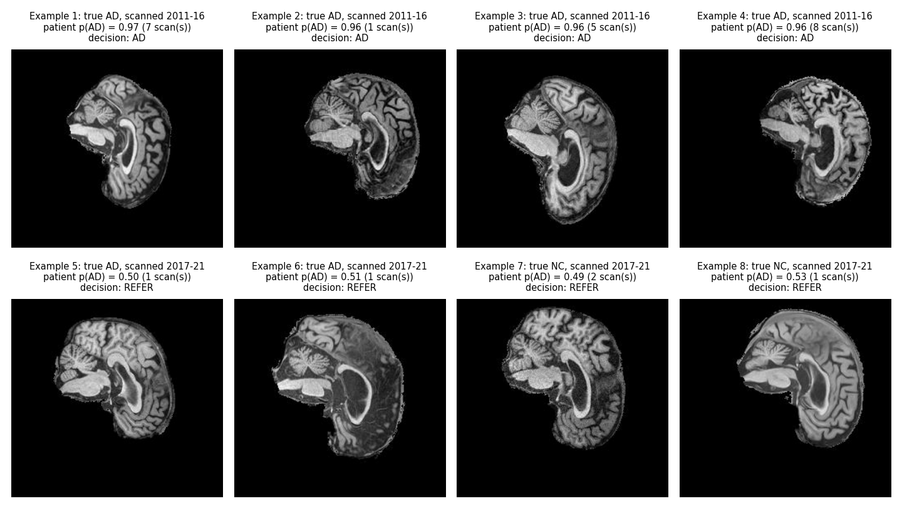

## Results

### Five-fold comparison (development patients)

[`config/experiments_round3_cv.json`](config/experiments_round3_cv.json), Slurm
jobs 649955 (ConvNeXt) and 649956 (CNN): both models use the identical pipeline
(three-slice context, strong augmentation, EMA 0.999, 80 epochs, final-epoch
weights, seed 3710) on the same five folds. Each fold is scored on its own ~95
validation patients, so together the folds cover all 476 development patients.
Mean ± sd over the five folds (`slurm/summarize_runs.py`):

| Model | Slice acc. | Scan acc. | Patient acc. | Slice AUROC | Scan AUROC | Patient AUROC |
|---|---:|---:|---:|---:|---:|---:|
| ConvNeXt-Tiny | 0.715 ± 0.028 | 0.748 ± 0.054 | 0.782 ± 0.032 | 0.799 ± 0.028 | 0.847 ± 0.035 | 0.851 ± 0.015 |
| SmallCNN (baseline) | 0.690 ± 0.032 | 0.701 ± 0.054 | 0.750 ± 0.032 | 0.800 ± 0.068 | 0.853 ± 0.072 | 0.840 ± 0.068 |

Per fold (ConvNeXt / CNN accuracy):

| Fold | Slice | Scan | Patient | Patient FP / FN (ConvNeXt; CNN) |
|---:|---|---|---|---|
| 1 | 0.739 / 0.665 | 0.815 / 0.630 | 0.789 / 0.737 | 11 / 9; 0 / 25 |
| 2 | 0.708 / 0.671 | 0.765 / 0.685 | 0.832 / 0.747 | 3 / 13; 6 / 18 |
| 3 | 0.693 / 0.716 | 0.721 / 0.699 | 0.768 / 0.789 | 12 / 10; 2 / 18 |
| 4 | 0.749 / 0.733 | 0.767 / 0.781 | 0.771 / 0.771 | 13 / 9; 5 / 17 |
| 5 | 0.685 / 0.664 | 0.672 / 0.708 | 0.747 / 0.705 | 6 / 18; 16 / 12 |

* Neither model reaches 0.80 on average at any level; ConvNeXt is closest at
  patient level (0.782).
* Paired by fold, ConvNeXt is ahead by +0.025 slice (4 of 5 folds), +0.047 scan
  and +0.032 patient accuracy, but a paired t-test over five folds does not
  reach significance (|t| = 1.2-1.7 against 2.78 at the 5% level).
* Discrimination is the same (slice AUROC 0.799 vs 0.800). The accuracy gap
  comes from where the 0.5 threshold falls: over all folds the CNN misses 90 AD
  patients and over-calls 29 NC patients, ConvNeXt 59 and 45.
* ConvNeXt overfits: final training slice accuracy 0.95-0.96 against 0.69-0.75
  on validation (CNN: 0.87-0.89).

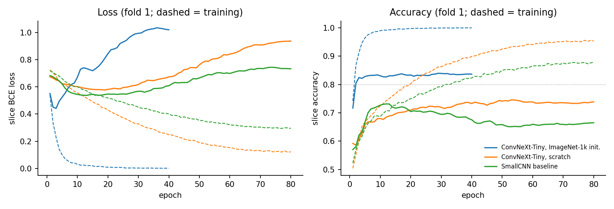

Fold 1 (dashed = training). The ImageNet-initialised model fits the training
slices within about five epochs; its validation accuracy then stays flat while
the validation loss rises, i.e. its wrong predictions become more confident.
The final-epoch weights are used for every model.

### Acquisition confound

The metadata file names show that acquisition period and scanner are entangled
with the diagnosis: all 417 development scans acquired 2011-2016 are AD, and
all 547 NC scans were acquired 2017-2019 with accelerated sequences. AD scans
acquired 2017-2019 are misclassified far more often (ConvNeXt scan error 0.67
vs 0.30 for earlier AD scans; CNN 0.84 vs 0.45). On the 633 scans acquired
2017-2019, where both classes share the same period, scan AUROC falls from
0.850 to 0.729 for ConvNeXt and from 0.839 to 0.654 for the CNN. A probe
network recognises the scanner vendor from pixels almost perfectly (scan AUROC
0.986 pooled over five folds, on NC scans of one period). Part of the development accuracy
therefore reflects acquisition style rather than anatomy. Details, probe
results and possible mitigations: [docs/ACQUISITION_CONFOUND.md](docs/ACQUISITION_CONFOUND.md).

### Final test (136 patients, scored once)

The model, the comparisons and the calibration procedure were declared before
the test job (Slurm 659813, `PREDECLARATION.txt` 2026-10-14T14:57+10:00):
primary model = the five round-6 fold models averaged at the logit level;
the scratch ConvNeXt-Tiny and CNN fold ensembles are reported alongside. Each
ensemble fits Platt scaling and its referral threshold on the 68 calibration
patients, then scores the test patients once. Accuracy and AUROC after Platt
scaling:

| Five-fold ensemble | Slice acc. | Scan acc. | Patient acc. | Slice AUROC | Scan AUROC | Patient AUROC |
|---|---:|---:|---:|---:|---:|---:|
| ConvNeXt-Tiny, ImageNet-1k init. (primary) | **0.867** | **0.889** | **0.882** | 0.943 | 0.964 | 0.944 |
| ConvNeXt-Tiny, scratch | 0.793 | 0.817 | 0.801 | 0.882 | 0.910 | 0.876 |
| SmallCNN | 0.826 | 0.873 | 0.875 | 0.908 | 0.947 | 0.927 |

Patient level, per class:

| Five-fold ensemble | AD precision / recall | NC precision / recall | Macro-F1 | Confusion [TN FP; FN TP] |
|---|---|---|---:|---|
| ConvNeXt-Tiny, ImageNet-1k init. | 0.818 / 0.818 | 0.913 / 0.913 | 0.866 | [84 8; 8 36] |
| ConvNeXt-Tiny, scratch | 0.655 / 0.818 | 0.901 / 0.793 | 0.786 | [73 19; 8 36] |
| SmallCNN | 0.800 / 0.818 | 0.912 / 0.902 | 0.858 | [83 9; 8 36] |

Scans by acquisition period (test: 122 AD scans 2011-2016; 27 AD and 157 NC
scans 2017-2019):

| Five-fold ensemble | 2011-16 scan acc. | 2017-19 scan acc. | 2017-19 scan AUROC | 2017-19 AD scans missed |
|---|---:|---:|---:|---:|
| ConvNeXt-Tiny, ImageNet-1k init. | 0.951 | 0.848 | 0.878 | 14/27 |
| ConvNeXt-Tiny, scratch | 0.893 | 0.766 | 0.777 | 9/27 |
| SmallCNN | 0.926 | 0.837 | 0.866 | 11/27 |

* The primary model meets the 0.80 target at all three levels on test.
* The fold ensembles score above the development means of single fold
  models (for example 0.867 against 0.798 slice accuracy for the pretrained
  model). The SmallCNN gains most (0.826 against 0.690); before Platt scaling
  its ensemble reaches 0.783 slice accuracy and misses 20 of 44 AD patients,
  so most of its gain comes from the calibration intercept moving the
  decision boundary.
* On 2017-2019 scans, where both classes share the acquisition period, the
  pretrained model still misses about half of the AD scans (14 of 27).

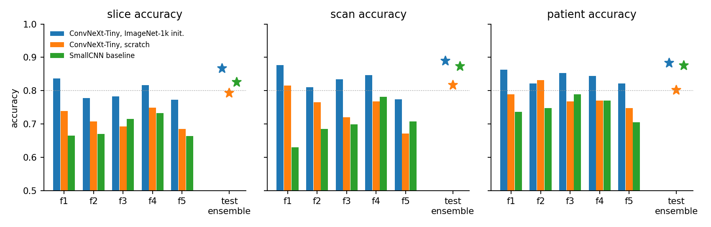

**How certain are these test differences?** 136 test patients is a small
sample. Patient-level 95% intervals from 10,000 stratified bootstrap
resamples (AD and NC patients resampled separately), paired differences on
the same resamples, and an exact McNemar test on per-patient correctness
(computed after the test run from the saved predictions;
`posthoc_patient_analysis.json`):

| Five-fold ensemble | Patient acc. [95% CI] | Balanced acc. [95% CI] | Patient AUROC [95% CI] |
|---|---|---|---|
| ConvNeXt-Tiny, ImageNet-1k init. | 0.882 [0.824, 0.934] | 0.866 [0.798, 0.927] | 0.944 [0.902, 0.977] |
| ConvNeXt-Tiny, scratch | 0.801 [0.728, 0.868] | 0.806 [0.733, 0.873] | 0.876 [0.812, 0.932] |
| SmallCNN | 0.875 [0.816, 0.926] | 0.860 [0.792, 0.921] | 0.927 [0.875, 0.968] |

| Comparison | Δ patient acc. [95% CI] | Δ AUROC [95% CI] | McNemar (only A right / only B right, p) |
|---|---|---|---|
| pretrained - SmallCNN | +0.007 [-0.029, +0.044] | +0.017 [-0.013, +0.047] | 4 / 3, p = 1.00 |
| pretrained - scratch ConvNeXt | +0.081 [+0.022, +0.140] | +0.067 [+0.029, +0.111] | 14 / 3, p = 0.013 |
| SmallCNN - scratch ConvNeXt | +0.074 [+0.015, +0.140] | +0.051 [+0.001, +0.106] | 15 / 5, p = 0.041 |

On the test patients the pretrained ConvNeXt and the CNN ensemble cannot be
told apart: they disagree on only 7 of 136 patients. Both are clearly better
than the scratch ConvNeXt. The development comparison (five folds, 476
patients) is the stronger evidence for the pretrained model's advantage over
the CNN.

### Fold 4-5 screens: scanner augmentation and ImageNet initialisation

Two attempts to weaken the acquisition shortcut were screened on folds 4 and 5
(one seed each; details in [docs/EXPERIMENTS.md](docs/EXPERIMENTS.md)).
Validation accuracy slice / scan / patient, and scan AUROC on the 2017-2019
validation scans:

| Run | Fold 4 | Fold 5 | 2017-19 scan AUROC (f4, f5) |
|---|---|---|---|
| ConvNeXt-Tiny scratch, strong aug. (round 3) | 0.749 / 0.767 / 0.771 | 0.685 / 0.672 / 0.747 | 0.818, 0.696 |
| SmallCNN, strong aug. (round 3) | 0.733 / 0.781 / 0.771 | 0.664 / 0.708 / 0.705 | 0.718, 0.560 |
| ConvNeXt-Tiny scratch, scanner aug. | 0.738 / 0.763 / 0.729 | 0.720 / 0.774 / 0.789 | 0.779, 0.725 |
| SmallCNN, scanner aug. | 0.758 / 0.828 / 0.823 | 0.756 / 0.764 / 0.768 | 0.752, 0.710 |
| ConvNeXt-Tiny ImageNet-1k, strong aug. | 0.817 / 0.847 / 0.844 | 0.773 / 0.774 / 0.821 | 0.770, 0.740 |
| ConvNeXt-Tiny ImageNet-1k, scanner aug. | 0.801 / 0.814 / 0.802 | 0.773 / 0.785 / 0.789 | 0.745, 0.719 |

* ImageNet initialisation (cited weights, 40 epochs) gives the best overall
  accuracy so far, but discrimination within 2017-2019 stays at the level of
  the scratch model: the gain comes mostly from scans whose acquisition style
  already identifies the class.
* Scanner-style augmentation helps the CNN, is mixed for scratch ConvNeXt and
  adds nothing to the pretrained model.
* Five folds (round 6, [`config/experiments_round6_pretrained_cv.json`](config/experiments_round6_pretrained_cv.json),
  Slurm 656072), same patients as the table above:

| Model | Slice acc. | Scan acc. | Patient acc. | Scan AUROC | 2017-19 scan AUROC |
|---|---:|---:|---:|---:|---:|
| ConvNeXt-Tiny, ImageNet-1k init. | **0.798 ± 0.028** | **0.828 ± 0.039** | **0.840 ± 0.019** | 0.920 ± 0.014 | 0.778 ± 0.047 |
| ConvNeXt-Tiny, scratch | 0.715 ± 0.028 | 0.748 ± 0.054 | 0.782 ± 0.032 | 0.847 ± 0.035 | 0.736 ± 0.048 |
| SmallCNN | 0.690 ± 0.032 | 0.701 ± 0.054 | 0.750 ± 0.032 | 0.853 ± 0.072 | 0.606 ± 0.081 |

  Paired by fold, the pretrained model is ahead of the scratch ConvNeXt by
  +0.083 slice / +0.080 scan / +0.059 patient accuracy (paired t 14.3 / 6.4 /
  3.4, 4 df) and of the CNN by +0.108 / +0.128 / +0.090. Within 2017-2019 its
  gain over the scratch model (+0.042 AUROC, t = 1.5) is not significant and it
  still misses 63 of 86 AD scans acquired then. Details: [docs/EXPERIMENTS.md](docs/EXPERIMENTS.md).

### Grad-CAM (folds 4 and 5, validation)

Share of the Grad-CAM mass outside the head on the middle slice of each
validation scan (background is 0.72 of the slice, so a uniform map scores
about 0.72): scratch ConvNeXt-Tiny 0.72-0.83, ImageNet-initialised
ConvNeXt-Tiny 0.36-0.46, SmallCNN 0.22-0.31, with little difference between
diagnosis/period groups. The scratch ConvNeXt's evidence is not localised to the
head. Tables and caveats:
[docs/ACQUISITION_CONFOUND.md](docs/ACQUISITION_CONFOUND.md#grad-cam-where-the-evidence-lies).

Mean input (top) and mean Grad-CAM (bottom) per diagnosis and acquisition
group, fold 5 validation scans:

| ConvNeXt-Tiny, scratch | ConvNeXt-Tiny, ImageNet init. | SmallCNN |
|---|---|---|
| 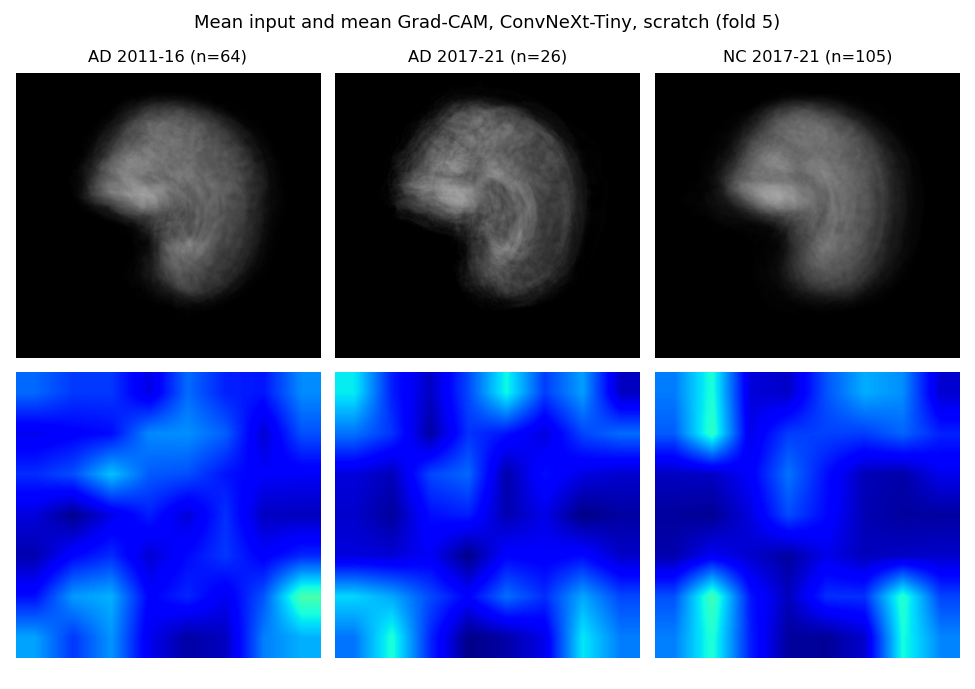 | 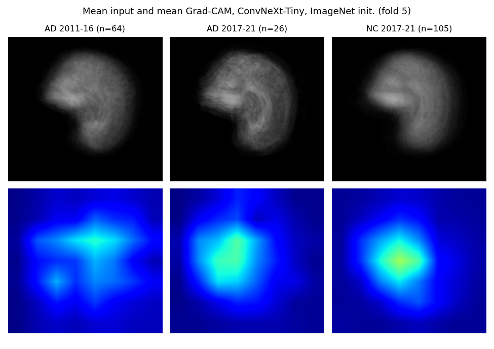 | 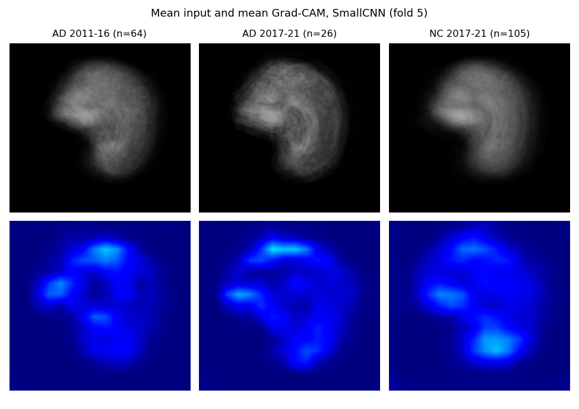 |

Individual scans for the ImageNet-initialised model (two most confident
correct and two most confident wrong per group; input slice, then Grad-CAM):

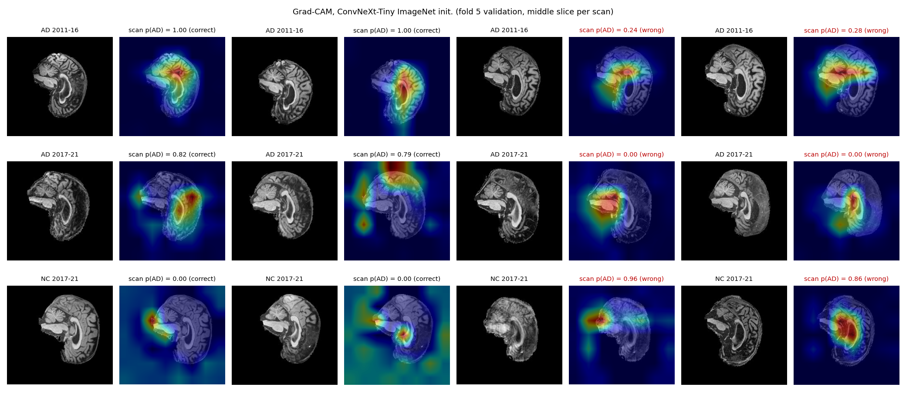

`TODO(owner)`: interpretation.

### Earlier development screens (fold 1)

Development results before the current recipe (from `metrics.json`; full table
in [docs/EXPERIMENTS.md](docs/EXPERIMENTS.md)), fold-1 outer validation, 95 patients:

| Model | Augmentation | Slice accuracy | Scan accuracy | Slice AUROC |
|---|---|---:|---:|---:|
| SmallCNN | none | 0.809 | 0.834 | 0.882 |
| ConvNeXt-Tiny | none | 0.634 | 0.668 | 0.693 |
| ConvNeXt-Tiny | light | 0.726 | 0.768 | 0.801 |

First run of the current recipe (`config/experiments_strong_aug.json`, two seeds,
same 95 patients): ConvNeXt-Lite with three-slice context reached slice accuracy
0.717 / 0.740 and scan accuracy 0.754 / 0.810; details in
[docs/EXPERIMENTS.md](docs/EXPERIMENTS.md). Slice accuracy is still below 0.80.

Second fold-1 screen (`config/experiments_round2.json`, 80 epochs, mean ± sd
over two seeds, same 95 patients):

| Model | Slice accuracy | Scan accuracy | Patient accuracy | Slice AUROC |
|---|---:|---:|---:|---:|
| SmallCNN, three-slice context | 0.735 ± 0.008 | 0.791 ± 0.020 | 0.779 ± 0.030 | 0.841 ± 0.048 |
| ConvNeXt-Lite, single slice | 0.714 ± 0.004 | 0.780 ± 0.010 | 0.753 ± 0.007 | 0.783 ± 0.004 |
| ConvNeXt-Lite, three-slice context | 0.728 ± 0.019 | 0.780 ± 0.030 | 0.742 ± 0.022 | 0.799 ± 0.022 |
| ConvNeXt-Tiny, three-slice context | 0.742 ± 0.001 | 0.799 ± 0.023 | 0.768 ± 0.030 | 0.812 ± 0.008 |

The scratch ConvNeXt memorised the training slices within a few epochs
(training accuracy 1.00) and optimizer/regularisation tweaks stayed within seed
noise; augmentation was the only clear improvement. This motivated the
stronger augmentation, slice context and EMA now used by default.

## Resource profiling

Development measurements (A100, FP32, batch 32, 224x224 single-slice input,
30 epochs on 14,900 training slices; forward latency over 100 runs after 10
warm-up runs, excluding data loading):

| Model | Parameters | Peak training memory | Training time | Latency batch 1 | Latency batch 64 |
|---|---:|---:|---:|---:|---:|
| SmallCNN | 97,521 | 594 MiB | 328 s | 1.02 ± 0.02 ms | 3.90 ± 0.13 ms |
| ConvNeXt-Tiny | 27,817,825 | 3,756 MiB | 1,629 s | 4.70 ± 0.14 ms | 53.56 ± 0.16 ms |

Five-fold runs (A100-PCIE-40GB, FP32, batch 32, 240x256 three-slice input,
80 epochs on 16,420-17,100 training slices per fold; latency of fold 1's model):

| Model | Parameters | Peak training memory | Training time per fold | Latency batch 1 | Latency batch 64 |
|---|---:|---:|---:|---:|---:|
| SmallCNN | 97,809 | 727 MiB | 3,078 s (3,024-3,143) | 1.16 ± 0.01 ms | 4.83 ± 0.42 ms |
| ConvNeXt-Tiny | 27,820,897 | 4,656 MiB | 6,038 s (5,897-6,138) | 5.19 ± 0.04 ms | 64.37 ± 0.17 ms |

ConvNeXt-Tiny has about 280 times the parameters, 6.4 times the training memory
and twice the training time of the CNN for a non-significant accuracy gain.

## Calibration and referral

Raw network confidence is not trusted. On the 68 calibration patients,
`predict.py --role calibration` fits Platt scaling, p = sigmoid(a * logit + b)
(Platt, 1999; Guo et al., 2017), by minimising the slice log loss. The slope a
corrects over- or under-confidence; the intercept b moves the decision boundary,
which matters here because development models over-called AD (for example 17
false-positive versus 6 false-negative outer-validation patients). It then picks the lowest patient
confidence threshold tau at which the automated calibration patients reach 90%
accuracy (`--target-accuracy`). Both values are frozen in `calibration.json`
and applied unchanged to the test patients, whose confidence below tau is
reported as `REFER`. The reports include ECE (15 bins), reliability diagrams,
confidence histograms of correct/incorrect predictions and risk-coverage curves.

Expected calibration error (15 bins, predicted-class confidence) on the test
patients before / after Platt scaling. The ECE before scaling was computed
afterwards from the saved test logits with the same function
(`ece_before_after_platt.json`):

| Five-fold ensemble | Platt slope a / intercept b | Slice ECE | Scan ECE | Patient ECE |
|---|---|---|---|---|
| ConvNeXt-Tiny, ImageNet-1k init. | 0.246 / 0.193 | 0.112 → 0.036 | 0.043 → 0.059 | 0.062 → 0.049 |
| ConvNeXt-Tiny, scratch | 0.354 / 0.500 | 0.144 → 0.022 | 0.076 → 0.057 | 0.076 → 0.070 |
| SmallCNN | 0.957 / 0.813 | 0.033 → 0.029 | 0.041 → 0.109 | 0.073 → 0.112 |

Referral rule (tau fitted on the 68 calibration patients for 90% accuracy of
automated patients, applied unchanged to the 136 test patients):

| Five-fold ensemble | tau | Calibration coverage | Test coverage | Test accuracy of automated patients | Test patients referred | AD 2017-19 patients automated as NC |
|---|---:|---:|---:|---:|---:|---:|
| ConvNeXt-Tiny, ImageNet-1k init. | 0.626 | 0.941 | 0.875 | 0.924 | 17 | 5 |
| ConvNeXt-Tiny, scratch | 0.836 | 0.397 | 0.346 | 0.915 | 89 | 0 |
| SmallCNN | 0.563 | 0.897 | 0.912 | 0.903 | 12 | 5 |

* All three ensembles keep the 90% target on test.
* The ImageNet-initialised ensemble is very over-confident at slice level
  (slope 0.246); Platt scaling cuts its slice ECE about threefold. Patient
  probabilities are averages over 20-160 slices (one to eight scans) and are
  already better calibrated; for the CNN, scaling fitted on slices makes
  patient and scan ECE worse.
* The scratch ConvNeXt needs a high threshold and refers 89 of 136 patients.
* For both deployable ensembles, 5 AD patients scanned 2017-2019 are still
  automated as NC: confident misses on the confounded group.

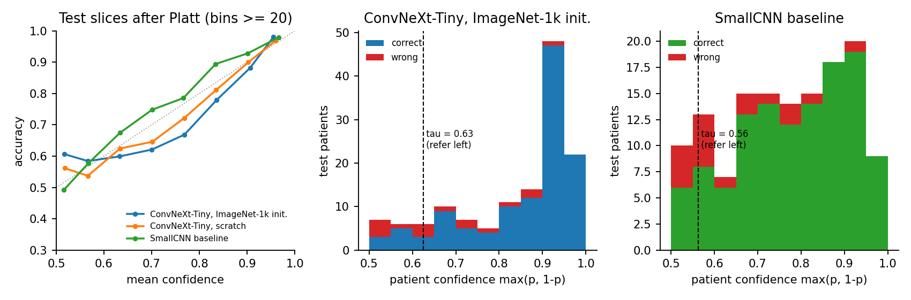

**Does confidence separate right from wrong?** Patient level, after Platt
scaling (`posthoc_patient_analysis.json`). AUROC of confidence = probability
that a correct patient receives higher confidence than a wrong one; AURC =
area under the risk-coverage curve (lower is better):

| Five-fold ensemble | Wrong patients | Mean confidence correct / wrong | Wrong with confidence >= 0.9 | AUROC of confidence | AURC [95% CI] |
|---|---:|---|---:|---:|---|
| ConvNeXt-Tiny, ImageNet-1k init. | 16 | 0.854 / 0.682 | 1 | 0.838 | 0.030 [0.012, 0.053] |
| ConvNeXt-Tiny, scratch | 27 | 0.772 / 0.678 | 1 | 0.702 | 0.101 [0.054, 0.159] |
| SmallCNN | 17 | 0.783 / 0.645 | 1 | 0.783 | 0.044 [0.018, 0.080] |

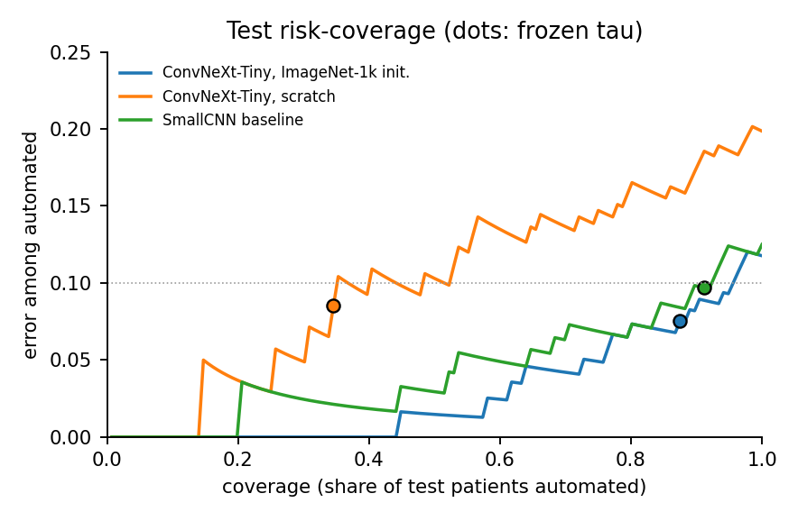

* The pretrained ensemble ranks its own errors best: most wrong patients sit
  at low confidence and fall below tau. Its AURC is lower than the CNN's in
  93% of bootstrap resamples (difference -0.015, 95% CI [-0.037, +0.004]).
* The exception is the confounded group: 7 of the 16 AD patients scanned
  2017-2019 are missed, with p(AD) 0.09-0.45, and 5 of them are confident
  enough to be automated as NC (CNN: 6 missed, 5 automated).

Single-model forward latency recorded by the test job (A100, FP32; the
ensemble runs five such passes): ConvNeXt-Tiny 5.37 ± 0.05 ms (batch 1) and
64.29 ± 0.23 ms (batch 64), SmallCNN 1.14 ± 0.01 ms and 4.74 ± 0.01 ms.

## Failure case autopsy

The five most confident slice-level errors of the primary ensemble on the
test set, as exported by `predict.py` (one slice per patient; titles give the
slice probability and the patient-level probability and decision; IDs removed).
All five come from scans acquired 2017-2019. The three false-positive slices
belong to NC patients that are also automated as AD at patient level; the two
false-negative slices belong to AD patients automated as NC, i.e. to the
confident misses in the AD 2017-2019 group described above.

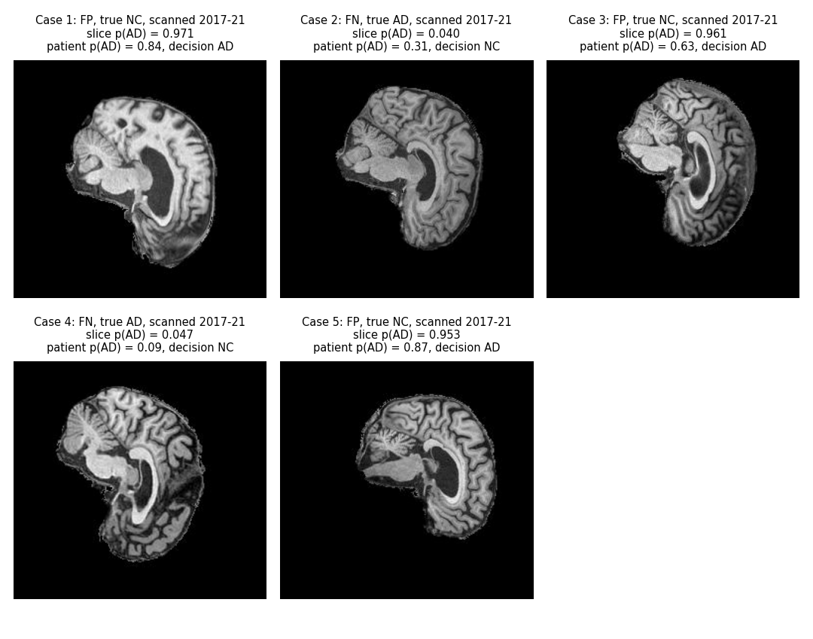

`TODO(owner)`: 3-5 failure autopsies (these cases and/or the referred
borderline cases in the test examples above), with their interpretation.

## Recommendation to the project manager

`TODO(owner)`.

## Artificial Intelligence Usage Disclosure

Two AI coding assistants were used throughout this project. A dated log of
every assisted task (what was generated and what I had to check) was kept
locally while working and is the source of this summary.

**Tools.** OpenAI Codex (26 September - 8 October 2026) and Claude Code with
Anthropic Claude models (9 - 16 October 2026). `TODO(owner)`: confirm whether
any AI tool was used before 26 September (initial split and data-loading
commits) and add exact model names if required.

**What the tools did.**

* *Codex:* the read-only data audit and the patient-level split checks; the
  migration to the current package layout; the CNN baseline and ConvNeXt
  implementations with their tests; the first training and evaluation code
  (metrics, calibration, resource profiling); Slurm launch scripts; feature and
  sampling diagnostics; monitoring of the early Rangpur runs; and a reading of
  the assignment specification against the code.
* *Claude Code:* review of the Rangpur logs and the decisions they led to
  (strong augmentation, three-slice context input, EMA, fixed-epoch training
  with final-epoch weights, merging the early-stop subset into training); the
  experiment-plan runner and summary scripts; the acquisition-period analysis
  and probe; scanner-style augmentation; loading the cited ImageNet-1k weights;
  Grad-CAM; the fold ensemble and the calibration/test workflow; post-hoc
  statistics (bootstrap, McNemar, risk-coverage) and the report figures,
  including removing patient IDs from the ADNI figures; drafting and editing
  this README and the documents in `docs/`.

**What I did and decided.** Choice of the project and of the evaluation units;
the frozen patient-level split; which experiments to run and which recipe to
carry forward; the decision to fit the threshold on a separate calibration set
and to score the test set once with a predeclared model; running all jobs on
Rangpur; every commit (the assistants never committed or pushed); and the
feasibility review, Grad-CAM interpretation, failure autopsy and
recommendation, which I wrote myself.

**How the output was verified.** Unit and end-to-end tests on synthetic data;
an assertion that no patient appears in two splits; each training run replays
its saved checkpoint and must reproduce its own validation metrics
(`replay_check.json`); the uncalibrated ECE recomputed from raw logits matched
the job's own calibrated values; every number in this README was checked
against the `metrics.json` or JSON summary it was copied from; and I read and
ran the code before each commit. AI output was wrong several times (for
example a wrong count of slices per patient and figure layouts that cut off
labels) and was corrected after review.
`TODO(owner)`: check that this matches your own account and rewrite it in your
own words.

## References

1. Z. Liu et al., "A ConvNet for the 2020s", CVPR 2022. https://arxiv.org/abs/2201.03545 ;
   reference implementation and ImageNet-1k weights (`convnext_tiny_1k_224_ema.pth`)
   https://github.com/facebookresearch/ConvNeXt
2. G. Huang et al., "Deep Networks with Stochastic Depth", ECCV 2016.
3. H. Zhang et al., "mixup: Beyond Empirical Risk Minimization", ICLR 2018. https://arxiv.org/abs/1710.09412
4. C. Guo et al., "On Calibration of Modern Neural Networks", ICML 2017. https://arxiv.org/abs/1706.04599 ;
   J. Platt, "Probabilistic Outputs for Support Vector Machines and Comparisons to Regularized Likelihood Methods", 1999.
5. B. Polyak and A. Juditsky, "Acceleration of Stochastic Approximation by Averaging", SIAM J. Control Optim., 1992.
6. C. Szegedy et al., "Going Deeper with Convolutions", CVPR 2015 (random-resized crop).
7. PyTorch reproducibility notes, https://docs.pytorch.org/docs/stable/notes/randomness.html
8. R. Geirhos et al., "Shortcut learning in deep neural networks", Nature Machine Intelligence, 2020. https://arxiv.org/abs/2004.07780
9. J. R. Zech et al., "Variable generalization performance of a deep learning model to detect pneumonia in chest radiographs: a cross-sectional study", PLOS Medicine, 2018.
10. R. R. Selvaraju et al., "Grad-CAM: Visual Explanations from Deep Networks via Gradient-based Localization", ICCV 2017. https://arxiv.org/abs/1610.02391
