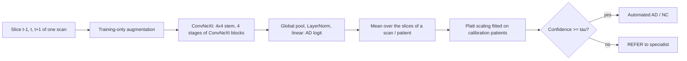

# ConvNeXt for Alzheimer's Disease Classification on ADNI Brain MRI

COMP3710 Pattern Recognition, recognition task: ConvNeXt (hard difficulty) on the
ADNI dataset, AD versus cognitively normal (NC). Student s4983666.

## Problem and algorithm

Alzheimer's disease (AD) causes progressive hippocampal and cortical atrophy and
ventricular enlargement that are visible on structural T1-weighted MRI. The task
is to classify 2D axial MRI slices of **previously unseen patients** as AD or NC,
while avoiding the main pitfall of this dataset: slices of one patient leaking
into both training and evaluation. The model is ConvNeXt (Liu et al., 2022), a
convolutional network that adopts design choices of vision transformers
(patchify stem, large 7x7 depthwise kernels, inverted bottlenecks, LayerNorm,
GELU and few activation/normalization layers). It is implemented from scratch in
PyTorch and trained either from random initialization or, as a cited
comparison, starting from the authors' ImageNet-1k ConvNeXt-Tiny weights
(allowed by the course staff when referenced). A four-block CNN is the baseline. Beyond accuracy, the project asks
whether the model's confidence can be trusted: a calibrated referral rule sends
low-confidence patients to a specialist instead of automating them.

## How it works



Each input is one slice stacked with its two neighbouring slices from the same
scan (three channels), so the 2D network sees some through-plane anatomy. The
stem cuts the image into 4x4 patches; four stages (Lite: 2-2-6-2 blocks with
48-384 channels; Tiny: 3-3-9-3 blocks with 96-768 channels) are separated by
LayerNorm + 2x2 stride-2 convolutions. Each block applies a 7x7 depthwise
convolution, LayerNorm, a 4x-expanded MLP with GELU, a learnable layer scale
(initialized to 1e-6) and stochastic depth on the residual branch. The model
outputs one AD logit per slice. Training uses class-weighted binary
cross-entropy, AdamW with warm-up and cosine decay, strong augmentation, and an
exponential moving average (EMA) of the weights. Training runs for a fixed
number of epochs and the final weights are kept, so validation patients are
only monitored, never used to pick a checkpoint. Slice probabilities are
averaged per scan and per patient; Platt scaling and a referral threshold are
fitted on calibration patients before the test patients are scored once.

## Feasibility review

`TODO(owner)`: the one-page feasibility review presented at the check-off.

## Repository layout

```text
ConvNeXt_ADNI_s4983666/
├── modules.py            # Model interface (PyTorch only): models/convnext.py, models/cnn.py
├── dataset.py            # Data interface: dataset/ (splits, manifests, slices, augmentation)
├── train.py              # Training entry point (engine/training.py)
├── predict.py            # Inference, calibration and test entry point (engine/prediction.py)
├── adni_splits.py        # Audit / prepare / verify the patient-level split
├── audit_preprocessing.py
├── probe_acquisition.py  # Acquisition-style probe (docs/ACQUISITION_CONFOUND.md)
├── explain_gradcam.py    # Grad-CAM figures on validation patients
├── engine/               # Training loop, EMA, LR schedule, prediction
├── evaluation/           # Metrics, inference, calibration, reporting, resource profiling
├── utils/                # Runtime/seeding, output files, plots, training controls
├── slurm/                # Rangpur batch scripts and the experiment-plan runner
├── config/               # Requirements and experiment plans
├── docs/                 # Data protocol, preprocessing notes, development experiments
└── tests/                # Unit and end-to-end tests on synthetic data
```

## Dependencies and reproducibility

Rangpur runs used Python 3.11.15, PyTorch 2.13.0 (CUDA build 13.0), Pillow
12.3.0 and Matplotlib 3.11.1 on an NVIDIA A100-PCIE-40GB. The code needs no
torchvision, NumPy or scikit-learn; `config/requirements*.txt` list the minimal
packages (install a PyTorch build that matches your GPU driver).

```bash
python3 -m pip install -r config/requirements-train.txt
python3 -m unittest discover -s tests          # synthetic data only
```

**Optional pretrained weights.** `--model convnext_tiny_in1k` starts from the
authors' ImageNet-1k ConvNeXt-Tiny weights (Liu et al., 2022;
https://github.com/facebookresearch/ConvNeXt). The code never downloads them;
fetch the file once and pass its path:

```bash
curl -L -o convnext_tiny_1k_224_ema.pth https://dl.fbaipublicfiles.com/convnext/convnext_tiny_1k_224_ema.pth
sha256sum convnext_tiny_1k_224_ema.pth   # 14f3164e3ea6ac32ab3f574f528ce817696c9176fad4221e0a77a905a7360595
python train.py --model convnext_tiny_in1k --pretrained-weights convnext_tiny_1k_224_ema.pth --context-slices 3 ...
```

`models/pretrained.py` maps the official parameter names onto this
implementation, requires every backbone tensor to match, and leaves the
one-logit classifier random. A fixed input layer converts the [-1, 1] inputs to
ImageNet mean/std; the three context slices take the place of the RGB
channels. The file's SHA-256 and source are written to the run's
`config.json`. The weights are not committed.

Every run seeds Python and PyTorch (`seed + fold`), requests deterministic
algorithms and writes `config.json` (all options, package versions, GPU,
manifest and source-code hashes). Bit-exact results are only expected on the
same hardware and software versions.

## Data

The course copy at `/home/groups/comp3710/ADNI` has 680 patients, 1,526 scans
and 30,520 grayscale 256x240 JPEG slices (20 consecutive slices per scan). The
course's own train/test folders share 216 patients, so patients are re-split
once (seed 3710), keeping all scans of a patient together:

| Partition | Patients | Scans | Slices | Used for |
|---|---:|---:|---:|---|
| development (5 folds) | 476 | 1,050 | 21,000 | training and validation (model comparison) |
| calibration | 68 | 170 | 3,400 | Platt scaling and referral threshold of the frozen model |
| test | 136 | 306 | 6,120 | one final evaluation |

Within fold 1, 381 patients train the model (the fold's `train` and small
`early_stop` manifests) and 95 validation patients are scored after every
epoch; the checkpoint is always the last epoch. `adni_splits.py verify` (run automatically by `train.py` and `predict.py`)
fails if any patient, scan, file or pixel hash crosses a role boundary. See
[docs/DATA_PROTOCOL.md](docs/DATA_PROTOCOL.md).

**Preprocessing.** Slices keep their native 240x256 size and are mapped to
[-1, 1] with fixed constants, so no statistic is estimated from any split.
Optional per-scan intensity/crop standardisation is described in
[docs/INPUT_PREPROCESSING.md](docs/INPUT_PREPROCESSING.md); it did not help in
development and is off by default.

**Augmentation (training slices only).** Horizontal flip (AD atrophy is
bilateral), random-resized crop covering 85-100% of the area, rotation up to
10 degrees, translation up to 5%, and intensity gain/gamma within ±10%/±15%. All three context
channels receive the same transform. Vertical flips and large rotations are not
used because they never occur in this data.

## Usage

```bash
SPLITS="$HOME/comp3710/adni_splits_v1"
# Train (defaults: ConvNeXt-Lite, 3-slice context, strong augmentation, EMA 0.999,
# AdamW 1e-4 / wd 0.05, 3 warm-up epochs + cosine, 80 epochs, final-epoch weights).
python train.py --splits-dir "$SPLITS" --output runs/lite_fold1 --fold 1
python train.py --splits-dir "$SPLITS" --output runs/cnn_fold1 --model cnn --lr 1e-3 --weight-decay 1e-4

# Reproduce the validation result of a checkpoint.
python predict.py --checkpoint runs/lite_fold1/final.pt --splits-dir "$SPLITS" --role val --output runs/lite_fold1_val

# Final evaluation of the ONE chosen checkpoint (calibration first, then test once).
python predict.py --checkpoint runs/lite_fold1/final.pt --splits-dir "$SPLITS" --role calibration \
    --output runs/lite_fold1/final_calibration
python predict.py --checkpoint runs/lite_fold1/final.pt --splits-dir "$SPLITS" --role test \
    --calibration-file runs/lite_fold1/final_calibration/calibration.json --output runs/lite_fold1/final_test

# Optional: the five fold models as one ensemble (mean logit; calibration/test only).
python predict.py --checkpoint runs/cv/fold{1,2,3,4,5}/final.pt --splits-dir "$SPLITS" --role calibration \
    --output runs/cv_ensemble/calibration

# Grad-CAM of a checkpoint on its fold's validation patients (never calibration/test).
python explain_gradcam.py --checkpoint runs/lite_fold1/final.pt --splits-dir "$SPLITS" --output runs/lite_fold1/gradcam
```

When the metadata file names carry acquisition dates, `predict.py` also reports
scan/patient metrics and referral counts separately for scans acquired before
and from 2017 (`by_acquisition_period` in `metrics.json`; see
[docs/ACQUISITION_CONFOUND.md](docs/ACQUISITION_CONFOUND.md)).
`explain_gradcam.py` (Selvaraju et al., 2017) writes the most confident correct
and wrong cases per diagnosis x acquisition period, the mean map of each group
and the share of each map that falls outside the head.

On Rangpur, `sbatch slurm/run_plan.sbatch config/experiments_round3_cv.json --smoke`
checks every planned case for one epoch, `--cases <id> ...` runs selected cases,
and `sbatch slurm/final_eval.sbatch <output dir> <run dir> [<run dir> ...]` performs the
two final steps for one model or a fold ensemble.
After every case the runner reloads `final.pt` and checks that the re-scored
accuracy and AUROC equal the training run's (`replay_check.json`).
`python slurm/summarize_runs.py <plan dirs> --output <prefix> --baseline <group> --candidate <group>`
collects every completed run into `<prefix>.md`/`.csv`, averages seeds or folds,
and pairs ConvNeXt with the CNN baseline by fold and seed.

A training run writes `config.json`, `history.csv` (per-epoch losses, metrics,
time and peak GPU memory), `learning_curves.png`,
`final.pt`, per-slice and per-scan predictions, confidence plots and
`metrics.json`. The test step prints one line per patient, for example
(format only; values are placeholders):

```text
patient       true    p(AD)  decision
002_S_0000    NC      0.081  NC
002_S_0001    AD      0.552  REFER
...
test slice: accuracy=TODO(result) AUROC=TODO(result) (n=6120)
```

and saves `test_examples.png` (input slice, true label, p(AD), decision).

## Results

### Five-fold comparison (development patients)

[`config/experiments_round3_cv.json`](config/experiments_round3_cv.json), Slurm
jobs 649955 (ConvNeXt) and 649956 (CNN): both models use the identical pipeline
(three-slice context, strong augmentation, EMA 0.999, 80 epochs, final-epoch
weights, seed 3710) on the same five folds. Each fold is scored on its own ~95
validation patients, so together the folds cover all 476 development patients.
Mean ± sd over the five folds (`slurm/summarize_runs.py`):

| Model | Slice acc. | Scan acc. | Patient acc. | Slice AUROC | Scan AUROC | Patient AUROC |
|---|---:|---:|---:|---:|---:|---:|
| ConvNeXt-Tiny | 0.715 ± 0.028 | 0.748 ± 0.054 | 0.782 ± 0.032 | 0.799 ± 0.028 | 0.847 ± 0.035 | 0.851 ± 0.015 |
| SmallCNN (baseline) | 0.690 ± 0.032 | 0.701 ± 0.054 | 0.750 ± 0.032 | 0.800 ± 0.068 | 0.853 ± 0.072 | 0.840 ± 0.068 |

Per fold (ConvNeXt / CNN accuracy):

| Fold | Slice | Scan | Patient | Patient FP / FN (ConvNeXt; CNN) |
|---:|---|---|---|---|
| 1 | 0.739 / 0.665 | 0.815 / 0.630 | 0.789 / 0.737 | 11 / 9; 0 / 25 |
| 2 | 0.708 / 0.671 | 0.765 / 0.685 | 0.832 / 0.747 | 3 / 13; 6 / 18 |
| 3 | 0.693 / 0.716 | 0.721 / 0.699 | 0.768 / 0.789 | 12 / 10; 2 / 18 |
| 4 | 0.749 / 0.733 | 0.767 / 0.781 | 0.771 / 0.771 | 13 / 9; 5 / 17 |
| 5 | 0.685 / 0.664 | 0.672 / 0.708 | 0.747 / 0.705 | 6 / 18; 16 / 12 |

* Neither model reaches 0.80 on average at any level; ConvNeXt is closest at
  patient level (0.782).
* Paired by fold, ConvNeXt is ahead by +0.025 slice (4 of 5 folds), +0.047 scan
  and +0.032 patient accuracy, but a paired t-test over five folds does not
  reach significance (|t| = 1.2-1.7 against 2.78 at the 5% level).
* Discrimination is the same (slice AUROC 0.799 vs 0.800). The accuracy gap
  comes from where the 0.5 threshold falls: over all folds the CNN misses 90 AD
  patients and over-calls 29 NC patients, ConvNeXt 59 and 45.
* ConvNeXt overfits: final training slice accuracy 0.95-0.96 against 0.69-0.75
  on validation (CNN: 0.87-0.89).

### Acquisition confound

The metadata file names show that acquisition period and scanner are entangled
with the diagnosis: all 417 development scans acquired 2011-2016 are AD, and
all 547 NC scans were acquired 2017-2019 with accelerated sequences. AD scans
acquired 2017-2019 are misclassified far more often (ConvNeXt scan error 0.67
vs 0.30 for earlier AD scans; CNN 0.84 vs 0.45). On the 633 scans acquired
2017-2019, where both classes share the same period, scan AUROC falls from
0.850 to 0.729 for ConvNeXt and from 0.839 to 0.654 for the CNN. A probe
network recognises the scanner vendor from pixels almost perfectly (scan AUROC
0.986 pooled over five folds, on NC scans of one period). Part of the development accuracy
therefore reflects acquisition style rather than anatomy. Details, probe
results and possible mitigations: [docs/ACQUISITION_CONFOUND.md](docs/ACQUISITION_CONFOUND.md).

`TODO(result)`: the one-time test result of the final pipeline at slice, scan
and patient level (target: accuracy >= 0.80), overall and for scans acquired
2017-2019.

### Fold 4-5 screens: scanner augmentation and ImageNet initialisation

Two attempts to weaken the acquisition shortcut were screened on folds 4 and 5
(one seed each; details in [docs/EXPERIMENTS.md](docs/EXPERIMENTS.md)).
Validation accuracy slice / scan / patient, and scan AUROC on the 2017-2019
validation scans:

| Run | Fold 4 | Fold 5 | 2017-19 scan AUROC (f4, f5) |
|---|---|---|---|
| ConvNeXt-Tiny scratch, strong aug. (round 3) | 0.749 / 0.767 / 0.771 | 0.685 / 0.672 / 0.747 | 0.818, 0.696 |
| SmallCNN, strong aug. (round 3) | 0.733 / 0.781 / 0.771 | 0.664 / 0.708 / 0.705 | 0.718, 0.560 |
| ConvNeXt-Tiny scratch, scanner aug. | 0.738 / 0.763 / 0.729 | 0.720 / 0.774 / 0.789 | 0.779, 0.725 |
| SmallCNN, scanner aug. | 0.758 / 0.828 / 0.823 | 0.756 / 0.764 / 0.768 | 0.752, 0.710 |
| ConvNeXt-Tiny ImageNet-1k, strong aug. | 0.817 / 0.847 / 0.844 | 0.773 / 0.774 / 0.821 | 0.770, 0.740 |
| ConvNeXt-Tiny ImageNet-1k, scanner aug. | 0.801 / 0.814 / 0.802 | 0.773 / 0.785 / 0.789 | 0.745, 0.719 |

* ImageNet initialisation (cited weights, 40 epochs) gives the best overall
  accuracy so far, but discrimination within 2017-2019 stays at the level of
  the scratch model: the gain comes mostly from scans whose acquisition style
  already identifies the class.
* Scanner-style augmentation helps the CNN, is mixed for scratch ConvNeXt and
  adds nothing to the pretrained model.
* `TODO(result)`: five-fold ImageNet-initialised ConvNeXt-Tiny
  (`config/experiments_round6_pretrained_cv.json`) against the round-3 table.

### Earlier development screens (fold 1)

Development results before the current recipe (from `metrics.json`; full table
in [docs/EXPERIMENTS.md](docs/EXPERIMENTS.md)), fold-1 outer validation, 95 patients:

| Model | Augmentation | Slice accuracy | Scan accuracy | Slice AUROC |
|---|---|---:|---:|---:|
| SmallCNN | none | 0.809 | 0.834 | 0.882 |
| ConvNeXt-Tiny | none | 0.634 | 0.668 | 0.693 |
| ConvNeXt-Tiny | light | 0.726 | 0.768 | 0.801 |

First run of the current recipe (`config/experiments_strong_aug.json`, two seeds,
same 95 patients): ConvNeXt-Lite with three-slice context reached slice accuracy
0.717 / 0.740 and scan accuracy 0.754 / 0.810; details in
[docs/EXPERIMENTS.md](docs/EXPERIMENTS.md). Slice accuracy is still below 0.80.

Second fold-1 screen (`config/experiments_round2.json`, 80 epochs, mean ± sd
over two seeds, same 95 patients):

| Model | Slice accuracy | Scan accuracy | Patient accuracy | Slice AUROC |
|---|---:|---:|---:|---:|
| SmallCNN, three-slice context | 0.735 ± 0.008 | 0.791 ± 0.020 | 0.779 ± 0.030 | 0.841 ± 0.048 |
| ConvNeXt-Lite, single slice | 0.714 ± 0.004 | 0.780 ± 0.010 | 0.753 ± 0.007 | 0.783 ± 0.004 |
| ConvNeXt-Lite, three-slice context | 0.728 ± 0.019 | 0.780 ± 0.030 | 0.742 ± 0.022 | 0.799 ± 0.022 |
| ConvNeXt-Tiny, three-slice context | 0.742 ± 0.001 | 0.799 ± 0.023 | 0.768 ± 0.030 | 0.812 ± 0.008 |

The scratch ConvNeXt memorised the training slices within a few epochs
(training accuracy 1.00) and optimizer/regularisation tweaks stayed within seed
noise; augmentation was the only clear improvement. This motivated the
stronger augmentation, slice context and EMA now used by default.

## Resource profiling

Development measurements (A100, FP32, batch 32, 224x224 single-slice input,
30 epochs on 14,900 training slices; forward latency over 100 runs after 10
warm-up runs, excluding data loading):

| Model | Parameters | Peak training memory | Training time | Latency batch 1 | Latency batch 64 |
|---|---:|---:|---:|---:|---:|
| SmallCNN | 97,521 | 594 MiB | 328 s | 1.02 ± 0.02 ms | 3.90 ± 0.13 ms |
| ConvNeXt-Tiny | 27,817,825 | 3,756 MiB | 1,629 s | 4.70 ± 0.14 ms | 53.56 ± 0.16 ms |

Five-fold runs (A100-PCIE-40GB, FP32, batch 32, 240x256 three-slice input,
80 epochs on 16,420-17,100 training slices per fold; latency of fold 1's model):

| Model | Parameters | Peak training memory | Training time per fold | Latency batch 1 | Latency batch 64 |
|---|---:|---:|---:|---:|---:|
| SmallCNN | 97,809 | 727 MiB | 3,078 s (3,024-3,143) | 1.16 ± 0.01 ms | 4.83 ± 0.42 ms |
| ConvNeXt-Tiny | 27,820,897 | 4,656 MiB | 6,038 s (5,897-6,138) | 5.19 ± 0.04 ms | 64.37 ± 0.17 ms |

ConvNeXt-Tiny has about 280 times the parameters, 6.4 times the training memory
and twice the training time of the CNN for a non-significant accuracy gain.

## Calibration and referral

Raw network confidence is not trusted. On the 68 calibration patients,
`predict.py --role calibration` fits Platt scaling, p = sigmoid(a * logit + b)
(Platt, 1999; Guo et al., 2017), by minimising the slice log loss. The slope a
corrects over- or under-confidence; the intercept b moves the decision boundary,
which matters here because development models over-called AD (for example 17
false-positive versus 6 false-negative outer-validation patients). It then picks the lowest patient
confidence threshold tau at which the automated calibration patients reach 90%
accuracy (`--target-accuracy`). Both values are frozen in `calibration.json`
and applied unchanged to the test patients, whose confidence below tau is
reported as `REFER`. The reports include ECE (15 bins), reliability diagrams,
confidence histograms of correct/incorrect predictions and risk-coverage curves.

`TODO(result)`: ECE before/after Platt scaling, tau, coverage, accuracy of
automated patients and number of referrals on the test set.

## Failure case autopsy

`TODO(owner)`: 3-5 test failures (confident false positives/negatives and
referred borderline cases) exported by `predict.py`, with their interpretation.

## Recommendation to the project manager

`TODO(owner)`.

## Artificial Intelligence Usage Disclosure

AI coding assistants (OpenAI ChatGPT/Codex and Anthropic Claude) were used as
programming, debugging, plotting and language-polishing utilities during
development, in accordance with course policy.

**Scope of AI assistance.**

* *Boilerplate and tooling:* Assisting with CLI argument parsing, configuration
  serialisation, Slurm batch-script templates, and Matplotlib figure formatting
  (`figures/*.png`).
* *Testing and refactoring:* Generating synthetic-data unit test scaffolding
  under `tests/` and assisting with modularising the codebase into the package
  layout behind `modules.py`, `dataset.py`, `train.py` and `predict.py`.
* *Documentation polish:* Proofreading English grammar and formatting Markdown
  tables from the saved `metrics.json` and summary files.

**Author's work and engineering decisions.**

* Problem formulation, selection of the ConvNeXt-Tiny and SmallCNN architectures,
  and design of the three-slice 2.5D input representation.
* Identifying the 216-patient overlap in the course's default directories and
  establishing the frozen patient-level split (`development`, `calibration`,
  `test`).
* Designing the experimental progression (six pre-declared rounds plus the
  post-hoc control), discovering the 2011-2016 vs 2017-2021 acquisition-period
  confound in `meta_data_with_label.json`, and formulating the non-diagnostic
  scanner/period probe, Grad-CAM attribution check, five-fold logit ensemble and
  Platt-calibrated referral rule.
* Running all training, calibration and evaluation jobs on the Rangpur A100
  cluster, and writing the feasibility review, Grad-CAM interpretation, failure
  case autopsy and project-manager recommendation.

**Verification.** Every piece of code was reviewed and executed against the
synthetic test suite (`python3 -m unittest discover -s tests`) and checked for
zero patient leakage (`adni_splits.py verify`) before use. Every trained
checkpoint was reloaded and verified to reproduce its own validation metrics
(`replay_check.json`), uncalibrated and calibrated ECE values were cross-checked
directly from raw logits, and every number in this report was verified against
the corresponding `metrics.json` output. Initial AI suggestions that contained
errors—such as assuming a fixed number of slices per patient, describing the
slices as axial rather than sagittal, or clipping figure labels—were identified
during code and visual review and corrected.

## References

1. Z. Liu et al., "A ConvNet for the 2020s", CVPR 2022. https://arxiv.org/abs/2201.03545 ;
   reference implementation and ImageNet-1k weights (`convnext_tiny_1k_224_ema.pth`)
   https://github.com/facebookresearch/ConvNeXt
2. G. Huang et al., "Deep Networks with Stochastic Depth", ECCV 2016.
3. H. Zhang et al., "mixup: Beyond Empirical Risk Minimization", ICLR 2018. https://arxiv.org/abs/1710.09412
4. C. Guo et al., "On Calibration of Modern Neural Networks", ICML 2017. https://arxiv.org/abs/1706.04599 ;
   J. Platt, "Probabilistic Outputs for Support Vector Machines and Comparisons to Regularized Likelihood Methods", 1999.
5. B. Polyak and A. Juditsky, "Acceleration of Stochastic Approximation by Averaging", SIAM J. Control Optim., 1992.
6. C. Szegedy et al., "Going Deeper with Convolutions", CVPR 2015 (random-resized crop).
7. PyTorch reproducibility notes, https://docs.pytorch.org/docs/stable/notes/randomness.html
8. R. Geirhos et al., "Shortcut learning in deep neural networks", Nature Machine Intelligence, 2020. https://arxiv.org/abs/2004.07780
9. J. R. Zech et al., "Variable generalization performance of a deep learning model to detect pneumonia in chest radiographs: a cross-sectional study", PLOS Medicine, 2018.
10. R. R. Selvaraju et al., "Grad-CAM: Visual Explanations from Deep Networks via Gradient-based Localization", ICCV 2017. https://arxiv.org/abs/1610.02391
