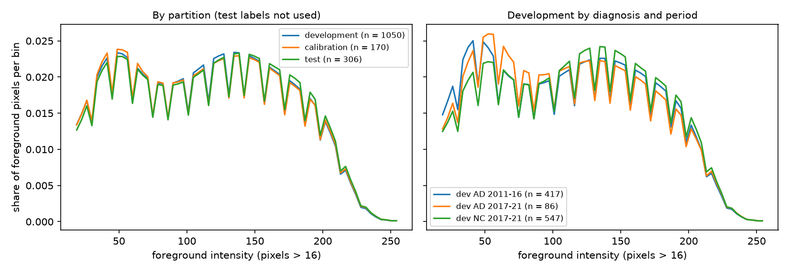
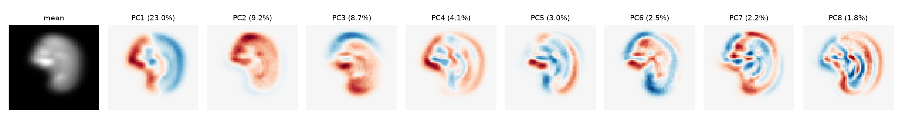
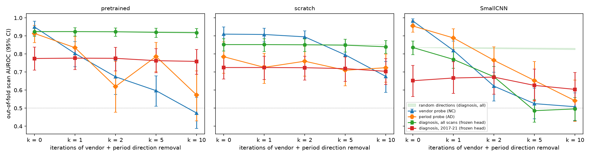
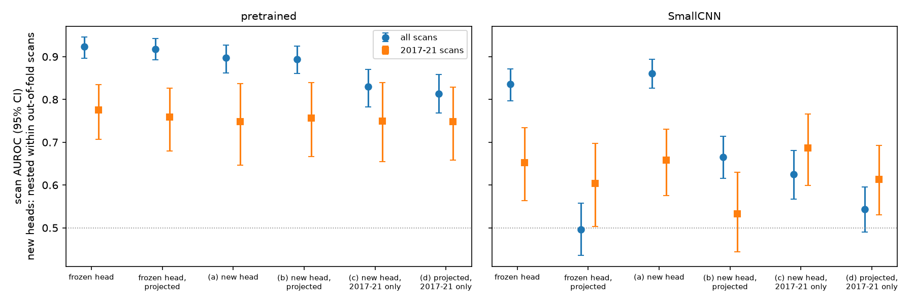
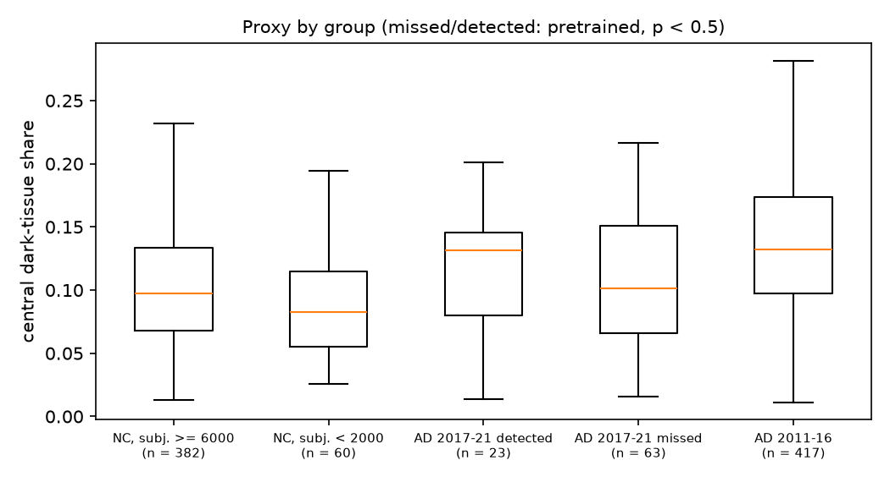

# Acquisition period and scanner are entangled with the diagnosis

The five-fold runs left two questions: why accuracy varies so much between
folds, and why most errors are AD patients called NC. Fold composition does not
explain either. The folds have the same AD share (0.32-0.33), number of scans
per patient (2.05-2.41) and mean JPEG size (6.08-6.20 KB), and JPEG size is
unrelated to the error rate. The supplied metadata does explain it.

## What the metadata contains

`meta_data_with_label.json` has 2,189 records with the same fields: `label`
(0 CN, 1 MCI, 2 AD), `raw`, `masked` and `c1`-`c5` (paths of the original
NIfTI, an N4-corrected skull-stripped volume and SPM tissue maps). There is
no age, sex, site or scanner field. The `raw` file name, however, contains the
**sequence name** and the **acquisition date**, for example
`ADNI_<NNN_S_NNNN>_MR_Accelerated_Sagittal_MPRAGE__br_raw_<YYYYMMDD...>_I<scan ID>.nii`.
All 1,050 development scans could be matched to a parsed record.

## The confound

Development scans by acquisition period and diagnosis:

| Acquired | AD scans | NC scans |
|---|---:|---:|
| 2011-2016 | 417 | 0 |
| 2017-2021 | 86 | 547 |

By sequence family (IR-SPGR/FSPGR = GE, SENSE = Philips, other MPRAGE mostly
Siemens; "accelerated" = GRAPPA/SENSE/"Accelerated" in the name):

| Sequence family | AD scans | NC scans |
|---|---:|---:|
| Siemens/other, non-accelerated | 144 | 0 |
| GE, non-accelerated | 63 | 0 |
| Philips, accelerated | 47 | 0 |
| Siemens/other, accelerated | 159 | 438 |
| GE, accelerated | 90 | 109 |

In the development split, every NC scan was acquired in 2017-2021 with an
accelerated sequence, and any scan acquired before 2017, or with a
non-accelerated or Philips sequence, is AD. A classifier that recognises the
acquisition style therefore separates more than 80% of the development AD scans
from all NC scans without looking at atrophy.

## Errors follow the confound

Round-3 out-of-fold predictions (each scan scored by the fold model that never
trained on its patient), scan error rate:

| Group | ConvNeXt-Tiny | SmallCNN |
|---|---:|---:|
| AD acquired 2011-2016 (style unique to AD) | 0.30 (n = 417) | 0.45 |
| AD acquired 2017-2021 (same style as NC) | **0.67** (n = 86) | **0.84** |
| NC (all 2017-2021) | 0.15 (n = 547) | 0.10 |

Restricting the evaluation to the 633 scans acquired in 2017-2021, where both
classes share the same acquisition period, shows how much of the
discrimination remains:

| Scans | Model | AUROC | Balanced accuracy | Accuracy |
|---|---|---:|---:|---:|
| all 1,050 | ConvNeXt-Tiny | 0.850 | 0.744 | 0.749 |
| 2017-2021 only (86 AD, 547 NC) | ConvNeXt-Tiny | **0.729** | 0.589 | 0.780 |
| all 1,050 | SmallCNN | 0.839 | 0.692 | 0.701 |
| 2017-2021 only (86 AD, 547 NC) | SmallCNN | **0.654** | 0.532 | 0.801 |

(Plain accuracy rises on the subset only because 86% of it is NC.) Part of the
headline AUROC comes from the acquisition period. Under the Round-3
`strong`-augmentation recipe, scratch ConvNeXt keeps higher discrimination on
this subset than SmallCNN (0.729 vs 0.654 pooled scan AUROC), though adding
`scanner` augmentation to SmallCNN narrows that gap in five-fold development
(0.726 ± 0.090 vs 0.736 ± 0.048 for scratch ConvNeXt and 0.778 ± 0.047 for
pretrained ConvNeXt; see [EXPERIMENTS.md](EXPERIMENTS.md)).

The fold-to-fold spread follows the same pattern: the folds differ mainly in
how many AD patients acquired in 2017-2021 land in validation (5 to 14 of 31),
and fold 5, the weakest for ConvNeXt, missed 12 of its 13 such patients.
(Those counts use the subject number, >= 6000 for ADNI-3 enrolment, which
coincides with this group: all 2017-2021 AD scans belong to subject
numbers >= 6000 except one.)

NC patients with older subject numbers (< 2000, enrolled in ADNI-1 but scanned
in 2017-2021) are also called AD more often (scan error 0.35 against 0.11 for
NC with subject numbers >= 6000). Their acquisition period is the same as the
other NC scans, so age-related atrophy is a more likely explanation there than
acquisition style.

## Probe: can the network see the acquisition style?

The model input never contains metadata, but sequence, vendor and acquisition
period change image contrast, noise texture and intensity inhomogeneity.
[`probe_acquisition.py`](../probe_acquisition.py) trains the same SmallCNN
(three-slice context, strong augmentation, EMA, 30 epochs, final-epoch
weights, same five folds) on a non-diagnostic target **with the diagnosis held
fixed**, and scores each fold once on its validation patients (Slurm job
652758):

* `era_within_ad`: AD scans only, acquired 2017-2021 vs 2011-2016.
* `vendor_within_nc`: NC scans only (all 2017-2021), GE IR-SPGR vs other sequences.

| Fold | era_within_ad scan AUROC (2017-21 / 2011-16 val scans) | vendor_within_nc scan AUROC (GE / other val scans) |
|---:|---|---|
| 1 | 0.956 (10 / 89) | 1.000 (24 / 88) |
| 2 | 0.966 (17 / 70) | 0.979 (23 / 90) |
| 3 | 0.626 (9 / 114) | 1.000 (14 / 92) |
| 4 | 0.598 (24 / 80) | 0.972 (27 / 84) |
| 5 | 0.936 (26 / 64) | 0.973 (21 / 84) |
| pooled out-of-fold | 0.807 (slice 0.754) | **0.986** (slice 0.931) |

* With the diagnosis and period fixed, the vendor/sequence is recognised with
  very high accuracy from pixels (pooled scan AUROC 0.986): the scanner
  signature is more easily separable from pixels than the disease signal itself
  (diagnosis scan AUROC 0.85).
* The acquisition period within AD patients is recognised with pooled AUROC
  0.81, but unevenly (0.60-0.97 by fold). This probe is itself partly
  confounded: 2017-2021 AD patients are newer ADNI-3 enrolments and may differ
  in disease stage, not only in acquisition.

## Grad-CAM: where the evidence lies

[`explain_gradcam.py`](../explain_gradcam.py) (Selvaraju et al. 2017; Slurm
job 656034) explains the middle slice of every validation scan of folds 4 and 5
for three checkpoints, using the last feature stage and the predicted class.
"Outside head" is the share of the map's mass on background pixels. As a
reference, background covers 0.72 of these slices on average (pixels exactly 0
in the source JPEGs, 410 slices), so a map spread uniformly over the image
would score about 0.72 and a map confined to the head would score near 0.

| Checkpoint (fold 4 / fold 5) | Outside head: AD 2011-16 | AD 2017-21 | NC 2017-21 |
|---|---|---|---|
| ConvNeXt-Tiny scratch (round 3) | 0.716 / 0.720 | 0.823 / 0.776 | 0.830 / 0.771 |
| ConvNeXt-Tiny ImageNet-1k (round 5, strong aug.) | 0.378 / 0.447 | 0.398 / 0.464 | 0.357 / 0.404 |
| SmallCNN (round 3) | 0.230 / 0.272 | 0.222 / 0.267 | 0.308 / 0.273 |

Scan accuracy and mean p(AD) of the same groups (fold 4 / fold 5):

| Checkpoint | AD 2011-16 acc. (mean p) | AD 2017-21 acc. (mean p) | NC 2017-21 acc. (mean p) |
|---|---|---|---|
| ConvNeXt-Tiny scratch | 0.762 (0.74) / 0.625 (0.64) | 0.583 (0.54) / 0.077 (0.24) | 0.811 (0.21) / 0.848 (0.18) |
| ConvNeXt-Tiny ImageNet-1k | 0.887 (0.85) / 0.797 (0.79) | 0.417 (0.39) / 0.154 (0.23) | 0.910 (0.12) / 0.914 (0.11) |
| SmallCNN | 0.775 (0.63) / 0.812 (0.71) | 0.083 (0.26) / 0.385 (0.40) | 0.937 (0.15) / 0.724 (0.36) |

Observations (descriptive only):

* The scratch ConvNeXt-Tiny maps are not concentrated on the head: their
  outside share is at or above the uniform reference, and the group means show
  a block pattern at the 1/32 resolution of the last stage rather than a
  head-shaped region.
* The ImageNet-initialised model and the CNN put most of the map inside the
  head (0.36-0.46 and 0.22-0.31). The CNN maps follow the head outline; the
  pretrained maps form one central region.
* Within each checkpoint the outside share hardly differs between the groups,
  including the AD 2017-2021 scans that are mostly missed, so the maps alone do
  not show *which* cue separates the acquisition periods.
* Caveats: the last ConvNeXt stage has a 7x8 grid, so its maps are coarse; a
  large receptive field can carry head information into background cells;
  middle slices are not registered, so group means are indicative only.

Anatomical and spatial interpretation of the maps (`gradcam_group_means.png` and
`gradcam_cases.png` in `outputs/experiment_logs/gradcam_20261013/` and
`figures/adni/`):

* **Scratch ConvNeXt-Tiny (`gradcam_means_scratch_fold5.png`)**: Across all three
  cohort groups (`AD 2011-16`, `AD 2017-21`, `NC 2017-21`), the mean heatmaps
  exhibit a coarse 7×8 checkerboard/border pattern concentrated along the
  top, bottom-left and bottom-right black background margins (`0.716-0.830` of
  attribution mass outside the skull, with only 1% of validation scans placing
  more than half of their attribution inside the head). While outside-head
  attribution alone does not explain lower accuracy (SmallCNN places `98-99%` of
  scans' majority attribution inside the head yet scores similarly to or below
  scratch ConvNeXt in single-fold development), it shows that training a
  27.8M-parameter network from scratch on 381 patients allows global
  field-of-view border artifacts and background padding statistics carried by
  large 7×7 depthwise receptive fields to dominate the final-stage features.
* **ImageNet-1k–initialised ConvNeXt-Tiny (`gradcam_means_pretrained_fold5.png`,
  `gradcam_cases_pretrained_fold5.png`)**: Pretrained initialisation pulls the
  attribution into the intracranial vault for 82% (fold 4) and 72% (fold 5) of
  validation scans (`0.357-0.464` outside-head mass). On these unregistered
  mid-sagittal slices at 7×8 final-stage resolution, the group-mean and
  individual-case maps form a broad central intracranial region (roughly
  overlapping the mid-sagittal ventricular/callosal and deep parenchymal zone).
  However, in `gradcam_cases_pretrained_fold5.png`, confident false negatives in
  `AD 2017-21` (scan p(AD) = 0.00) and confident false positives in `NC 2017-21`
  (scan p(AD) = 0.86–0.96) highlight this same central brain region as correct
  predictions. Paired with the `vendor_within_nc` probe (`0.986` scan AUROC),
  this is consistent with the classifier reading global intracranial contrast
  and protocol signatures alongside gross ventricular morphology.
* **SmallCNN (`gradcam_means_cnn_fold5.png`)**: SmallCNN confines `98-99%` of
  scans' majority attribution inside the head (`0.222-0.308` outside), with its
  smaller receptive field distributing weight along high-contrast tissue
  boundaries—the superior frontoparietal cortical rim, occipital/cerebellar
  contour and brainstem edge.

## Post-hoc checks: distribution shift, PCA, feature probes and a morphology proxy

Five post-hoc checks, run on 2026-10-28 after the locked test evaluation, ask
where the acquisition signal lives, whether the trained models use it, and
what else they might read. Each plan, including its reading criteria, was
written and hashed before the data were read (`results/<check>/PLAN.md`; Slurm
706974, 707090, 707307 and 707297). No backbone was trained or re-scored on
held-out data; test images entered only the first check, without their
labels.

### Development, calibration and test share one pixel distribution

Nine per-scan statistics (foreground mean, SD, 5th/50th/95th percentiles,
foreground fraction, head centroid row and column, whole-image mean; foreground
= pixels > 16, all 20 slices) were fed to a logistic-regression domain
classifier with patient-grouped five-fold cross-validation:

| Separating | Scan AUROC [95% CI] |
|---|---|
| Development vs test | 0.497 [0.437, 0.553] |
| Development vs calibration | 0.491 [0.411, 0.570] |
| Positive control: AD 2011-2016 vs 2017-2021 (development) | 0.73 [0.633, 0.818] |
| Positive control: NC GE vs Siemens/other (development) | 0.886 [0.845, 0.922] |

* The same statistics separate acquisition period and vendor inside the
  development set but cannot tell development from test or calibration scans.
  The largest single differences are small: test foreground mean, SMD 0.152;
  calibration head centroid row, SMD -0.284.
* The test set therefore carries the same internal confound as development
  and no additional shift. A new site or scanner, where acquisition does not
  predict diagnosis, is the shift that matters for deployment.

*Supplementary Figure 7. Mean foreground intensity histogram by partition
(left; test labels not used) and by development diagnosis and acquisition
period (right).*

### Leading principal components are head position and brightness

PCA (50 components) of the middle slice of the 1,050 development scans
(downsampled to 64 x 60):

| Component | Variance | Strongest Spearman correlation | AUROC: GE vs Siemens/other (NC) | AUROC: diagnosis within 2017-2021 |
|---|---|---|---|---|
| PC1 | 23.0% | head centroid column, -0.969 | 0.661 | 0.597 |
| PC2 | 9.2% | whole-image mean, 0.587 | 0.282 | 0.484 |
| PC3 | 8.7% | head centroid row, 0.828 | 0.365 | 0.412 |

* PC2 separates vendor (AUROC 0.282, i.e. 0.718 in the other direction) but
  not diagnosis within 2017-2021 (pre-declared reading C1 met).
* A PCA + logistic-regression control on the project folds shows how far
  removing leading components goes. Dropping the top 10 components lowers the
  vendor probe from 0.781 to 0.596, but it stays above chance and the diagnosis
  AUROC also falls (-0.038 [-0.067, -0.008]). Dropping only the components
  flagged as nuisance lowers the vendor probe by 0.05 (reading C2 not met).
  The vendor signal is spread over many small components.
* The linear control carries little diagnosis signal (2017-2021 AUROC 0.531
  [0.433, 0.627]), so it cannot show how much disease signal a filtered input
  would keep.

*Supplementary Figure 8. Mean middle slice and the first eight principal
components (red brighter, blue darker) with their share of variance.*

### The pretrained ConvNeXt encodes acquisition but does not decide by it

Each fold model (unchanged weights) was run on its training and validation
scans; the scan feature is the mean input of the final linear layer (768-d for
ConvNeXt, 128-d for SmallCNN). Logistic-regression probes fitted on training
scans predicted vendor (GE vs Siemens/other within NC) and period (2017-2021 vs
2011-2016 within AD) on the out-of-fold scans. The probe directions were then
removed iteratively (one vendor and one period direction per iteration, 10
iterations) and the unchanged head re-scored the projected features.
Recomputed slice logits matched the saved predictions (max absolute
difference 2.1e-4, 2.5e-5 and 0.005).

| Model | Vendor probe, before -> after | Period probe, before -> after | Diagnosis AUROC, all scans | Diagnosis AUROC, 2017-2021 |
|---|---|---|---|---|
| Pretrained ConvNeXt (primary) | 0.95 -> 0.473 | 0.914 -> 0.573 | 0.924 -> 0.918 | 0.775 -> 0.759 |
| Scratch ConvNeXt | 0.91 -> 0.676 | 0.785 -> 0.724 | 0.852 -> 0.840 | 0.725 -> 0.704 |
| SmallCNN | 0.983 -> 0.508 | 0.955 -> 0.541 | 0.836 -> 0.496 | 0.652 -> 0.604 |

(Diagnosis AUROC here uses the scan's mean slice logit.)

* **Pretrained ConvNeXt.** Its features encode vendor and period strongly
  (reading P1 met), and ten iterations remove what a linear probe can find
  (P2 met). The unchanged head then loses almost nothing: all-scan AUROC
  changes by -0.005 [-0.010, 0.000] (P3 not met). Because the head is linear,
  it cannot use the removed directions, so its decisions do not rest on them.
* **SmallCNN.** Removing two iterations (four directions) drops all-scan AUROC
  from 0.836 to 0.674 while 2017-2021 AUROC stays at 0.672; after five
  iterations all-scan AUROC is 0.486. Its discrimination on the confounded
  part of the data runs almost entirely through acquisition directions, and
  its within-period discrimination is the weaker signal left.
* **Scratch ConvNeXt** lies in between (-0.012 [-0.019, -0.006]), and its
  vendor signal is not fully removed by ten iterations.
* This ordering matches the error breakdown, where errors follow the sequence
  family robustly for the scratch ConvNeXt and SmallCNN but not significantly
  for the pretrained ensemble ([FAILURE_ANALYSIS.md](FAILURE_ANALYSIS.md)).
* Limits: the random-direction control is weak, because random directions are
  nearly orthogonal to the head (control range about +/-0.0003); the period
  label may also carry disease stage, as 2017-2021 AD patients are mostly newer
  ADNI-3 enrolments; the test applies to the final layer of the existing
  models and does not show what a model trained on de-confounded inputs would
  learn. The pretrained model's misses on 2017-2021 AD scans are therefore
  not explained by these acquisition directions.

*Supplementary Figure 9. Out-of-fold scan AUROC of the vendor and period
probes and of the unchanged head (all scans, 2017-2021 scans) as acquisition
directions are removed; shaded band: random directions.*

### A retrained head gains nothing from removing acquisition directions

A frozen head cannot show whether the disease information that remains after
projection would be usable by a head trained without the acquisition
directions. A pre-declared check (`results/head_retrain_20261028/PLAN.md`,
Slurm 707307) therefore fitted new logistic-regression heads (C = 1, fixed) on
the frozen features of each fold's out-of-fold validation scans. To keep every
score blind, each fold's validation patients were split into five inner
patient-grouped folds, and each inner fold was scored by a head fitted on the
other four; the projection used the directions estimated on the fold's
training scans, as above. The resulting AUROCs are cross-validated estimates
for new heads trained on about 170 scans per fold, comparable with each other
but not with the frozen head. Calibration and test data were not read.

| New head (nested out-of-fold) | Pretrained, all scans | Pretrained, 2017-2021 | SmallCNN, all scans | SmallCNN, 2017-2021 |
|---|---|---|---|---|
| (a) original features | 0.897 | 0.748 | 0.861 | 0.658 |
| (b) acquisition directions removed | 0.894 | 0.756 | 0.665 | 0.533 |
| (b) - (a), 2017-2021 [95% CI] | | +0.008 [-0.024, 0.040] | | -0.124 [-0.199, -0.043] |
| (c) original features, fitted on 2017-2021 scans only | 0.83 | 0.75 | 0.625 | 0.687 |
| (d) directions removed, 2017-2021 scans only | 0.814 | 0.748 | 0.543 | 0.613 |
| (d) - (c), 2017-2021 [95% CI] | | -0.002 [-0.028, 0.025] | | -0.074 [-0.138, -0.009] |

* **Pretrained ConvNeXt.** Neither pre-declared reading is met (H1, H2). A head
  trained without the acquisition directions separates 2017-2021 AD from NC
  as well as one trained with them, and almost as well overall. The disease
  information in these features lies outside the acquisition directions, and
  retraining the head alone would not improve within-period discrimination.
* **SmallCNN.** Removing the directions also costs a retrained head
  within-period discrimination (-0.124), so in its 128-d features the
  acquisition directions and the diagnosis information are entangled; a
  de-confounded SmallCNN would need different features, not a new head.

*Supplementary Figure 10. Scan AUROC (all scans and 2017-2021 scans) of the
frozen head and of new heads fitted within out-of-fold scans, with and without
the acquisition directions.*

### A dark-tissue proxy is too crude to test what the model reads

With the acquisition directions ruled out, the remaining candidate is gross
morphology in the central region highlighted by Grad-CAM. A pre-declared check
(`results/atrophy_proxy_20261028/PLAN.md`, Slurm 707297) compared the saved
out-of-fold scan p(AD) with a pixel proxy for cerebrospinal fluid. In each
slice the head mask (pixels > 16, closed and hole-filled) was intersected with
a central box (40% of the mask's height and width, centred on its centroid),
and the proxy is the share of mask pixels in the box darker than 0.4 x the
scan's median foreground intensity, pooled over the 20 slices.

| Check | Result |
|---|---|
| Proxy AUROC, AD vs NC, 2017-2021 scans (pre-declared validity check, >= 0.60) | 0.5407 [0.4355, 0.6403] |
| Proxy AUROC, AD vs NC, all development scans | 0.6502 [0.5926, 0.7046] |
| Mean proxy: NC / AD 2017-2021 / AD 2011-2016 | 0.1033 / 0.1084 / 0.1378 |
| Spearman, proxy vs pretrained p(AD), within NC | 0.2384 [0.1311, 0.3423] |
| Spearman, proxy vs pretrained p(AD), within AD 2017-2021 | 0.1769 [-0.0774, 0.4161] |
| Proxy, missed minus detected AD 2017-2021 (pretrained) | -0.0083 [-0.0364, 0.0168] |

* The proxy separates AD from NC only across acquisition periods: it is higher
  in 2011-2016 AD scans and similar in 2017-2021 AD and NC scans. It fails the
  pre-declared validity check, so the correlation and miss tests are
  inconclusive by plan, and the parameters were not tuned afterwards.
* Descriptively, among NC scans the pretrained model's p(AD) rises with the
  proxy (unchanged after controlling for head area, 0.2397 [0.1349, 0.3419]).
  NC patients with subject numbers below 2000 do not have a higher proxy than
  those at 6000 or above (difference 0.0002 [-0.0258, 0.0300]).
* What the pretrained model relies on in the 2017-2021 scans therefore remains
  open: these checks exclude global intensity style, head position and the
  linearly decodable acquisition directions, but do not identify the cue.

*Supplementary Figure 11. Central dark-tissue proxy by group; 2017-2021 AD
scans split by the pretrained model's out-of-fold call (p < 0.5 = missed).*

## Consequences

* Development accuracy and AUROC overstate how well the models detect
  AD-related anatomy. The 2017-2021 subset is the least confounded estimate
  available.
* The test patients come from the same pool, so the test score inherits the
  same confound. Test results should be reported overall and for the
  2017-2021 subset.
* A deployed model would likely degrade on sites, scanners or protocols where
  acquisition style does not predict diagnosis.

## Possible mitigations

| Option | Idea | Cost / caveat |
|---|---|---|
| Report by acquisition period | Overall and 2017-2021-only metrics, here and on test | Free; does not change the model |
| Scanner-robust augmentation | Random bias field, noise, blur/sharpening, stronger contrast/gamma so texture and contrast stop identifying the scanner | Implemented as the `scanner` profile. Screened on folds 4-5 (Slurm 653053): CNN 2017-21 scan AUROC 0.718 / 0.560 -> 0.752 / 0.710; scratch ConvNeXt 0.818 / 0.696 -> 0.779 / 0.725; no gain with ImageNet initialisation. Completed across all five folds for SmallCNN post-hoc (Round 7, Slurm 681962/681963): development 2017-21 scan AUROC rises from 0.606 ± 0.081 to 0.726 ± 0.090 (patient acc. 0.750 -> 0.811), though on test its 2017-21 scan AUROC is 0.805 (vs 0.866 for `strong` SmallCNN and 0.878 for pretrained ConvNeXt) ([EXPERIMENTS.md](EXPERIMENTS.md)) |
| ImageNet initialisation | Generic pretrained features instead of features learnt only from this confounded data (round 5) | Overall accuracy up (fold 4 slice 0.817), 2017-21 scan AUROC unchanged (0.770 / 0.740); does not remove the shortcut |
| Train only on 2017-2021 scans | Removes the period cue completely | Only 86 AD scans left; likely too few |
| Re-weight by period x diagnosis | Up-weight 2017-2021 AD scans | Cannot balance cells that are empty (no NC before 2017) |
| Adversarial removal of the scanner signal | Gradient reversal on a vendor/period head, conditioned on diagnosis | More complex; risk of removing disease signal |
| Harmonised inputs | Use the N4-corrected, skull-stripped `masked` volumes | Not part of the supplied JPEG data |

Scripts used for the tables: `probe_acquisition.py` and the per-scan
predictions in each run's `val_scan_predictions.csv`; acquisition year and
sequence were parsed from the metadata `raw` paths.

## References

* R. Geirhos et al., "Shortcut learning in deep neural networks", Nature Machine Intelligence, 2020 [8].
* J. R. Zech et al., "Variable generalization performance of a deep learning model to detect pneumonia in chest radiographs: a cross-sectional study", PLOS Medicine, 2018 [9].
