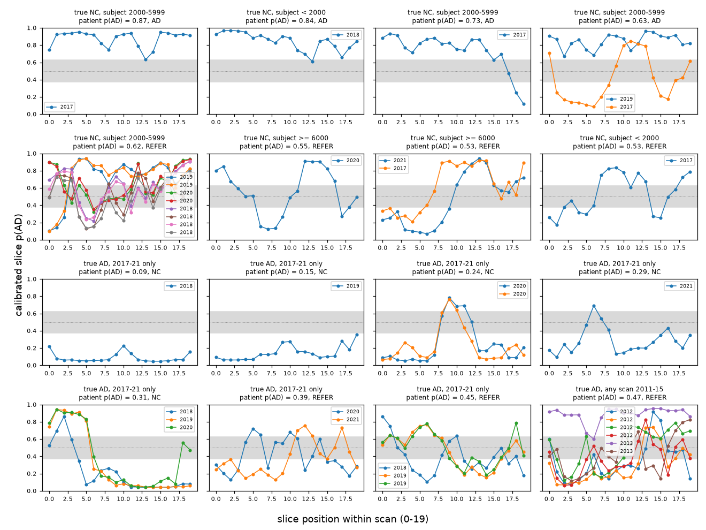
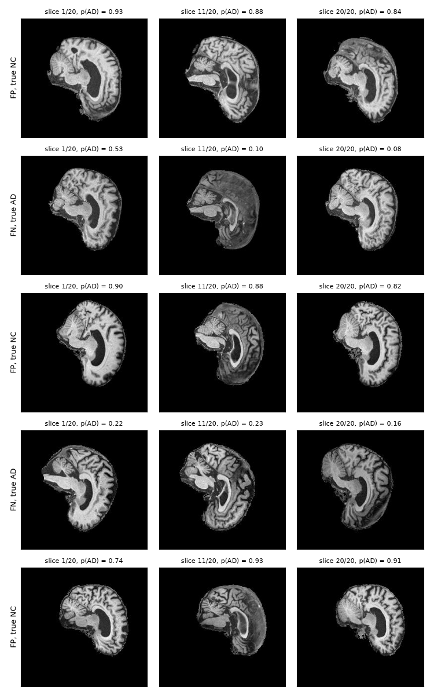

# Supplementary failure analysis and slice profiles

This document provides supplementary whole-cohort error analyses, through-scan slice probability trajectories, multi-slice visual inspections, and detailed case autopsies for supplementary test cases (Cases 6–10).

## 1. Cohort-wide acquisition confound (development OOF Fisher exact test)

The test subgroups are small (6 of 25 vs 2 of 67), so the same grouping was
repeated on the 476 development patients. Each was scored out-of-fold by the
fold model that never trained on it, at the raw 0.5 threshold. These patients
were never used to choose this analysis. Patient error rate, with Wilson 95%
CI and Fisher's exact test (`results/failure_evidence_20261026/`, stored on Rangpur outside Git):

| Group | Dev. OOF, pretrained | Dev. OOF, scratch | Dev. OOF, SmallCNN | Test, pretrained ensemble |
|---|---|---|---|---|
| AD, any scan 2011-15 | 21/108 = 0.19 [0.13, 0.28] | 31/108 = 0.29 | 51/108 = 0.47 | 1/28 = 0.04 [0.01, 0.18] |
| AD, 2017-21 only | **31/47 = 0.66** [0.52, 0.78] | 28/47 = 0.60 | 39/47 = 0.83 | **7/16 = 0.44** [0.23, 0.67] |
| Fisher p (AD rows) | 4 × 10⁻⁸ | 5 × 10⁻⁴ | 4 × 10⁻⁵ | 0.002 |
| NC, subject < 6000 | **12/88 = 0.14** [0.08, 0.22] | 22/88 = 0.25 | 15/88 = 0.17 | **6/25 = 0.24** [0.11, 0.43] |
| NC, subject ≥ 6000 | 12/233 = 0.05 [0.03, 0.09] | 23/233 = 0.10 | 14/233 = 0.06 | 2/67 = 0.03 [0.01, 0.10] |
| Fisher p (NC rows) | 0.016 | 0.001 | 0.004 | 0.005 |

The test findings repeat in development for all three models, so they are not
an artefact of the 16 test errors.

* **Missed AD patients are mostly from 2017-2021.** In development, every
  model has about 2-3 times the error rate on AD patients scanned only in
  2017-2021. Cases 2 and 4 belong
  to this group, as do 117 of the 120 AD scans from 2017-2021. The acquisition-confound section gives
  the two explanations that the data cannot separate: an acquisition style
  shared with NC, or a milder disease stage.
* **False positives are mostly earlier-enrolled NC subjects.** Cases 1, 3 and 5
  all have subject numbers below 6000. These subjects joined ADNI before ADNI-3
  and were rescanned in 2017-2021. They are called AD 2-3 times as often as
  ADNI-3 controls in development. All NC patients share the 2017-2021 acquisition period, so
  acquisition style does not explain this difference. A plausible explanation
  is that earlier-enrolled controls are older and show more age-related
  atrophy. The metadata has no age field, so this is a hypothesis, not a
  finding.

## 2. Through-scan slice profiles and multislice analysis

**What the images can and cannot show.** *Figure 10* shows the single slice
with the most confident wrong prediction for each patient, not a
representative slice. Two further views reduce that selection bias.

* *Supplementary Figure 1* plots the calibrated p(AD) of every slice of every scan for all
  16 wrong test patients.
  * Some errors are consistent across the whole scan. Case 4 stays below 0.25
    on all 20 slices, and two NC false positives stay above 0.6 on almost every
    slice.
  * Other errors swing across the scan, from below 0.2 to above 0.8.
  * Within Case 3, the 2019 scan is AD-like throughout, while the 2017 scan
    swings between NC-like and AD-like slices.
  * Such swings are common. In 98 of the 306 test scans (32%), some slices fall
    on each side of 0.5 (median within-scan range 0.22). One slice therefore
    says little about the patient, and averaging over all slices is what makes
    patient-level decisions more stable.
* *Supplementary Figure 2* shows the first, middle and last slice of the scan behind each
  confident error. The 20 slices appear to cross the midline, so the outer slices show
  the lateral ventricle of each hemisphere and the middle slice shows the
  midline. Apparent ventricle size therefore changes with slice position as
  much as between patients.

No ventricle or cortical measurement was made, so the report draws no
anatomical conclusion from these images. Testing the atrophy explanation would
need registered 3D volumes and a measured quantity, such as ventricular volume,
compared between correct and wrong patients.

*Supplementary Figure 1. Calibrated slice p(AD) along each scan (one line per scan, legend
= acquisition year) for all 16 test patients the primary ensemble gets wrong
before referral. Grey band: patient-level referral band; titles: group,
patient p(AD) and decision.*

*Supplementary Figure 2. First, middle and last of the 20 slices of the scan behind each of
the five confident errors in Figure 10 (same order as Cases 1-5), with slice
p(AD). IDs removed.*

## 3. Case notes for supplementary cases (Cases 6–10)

* **Cases 6-9 (2017-2021, referred).** Patient p(AD) is 0.49-0.53, so all four
  are referred. Their images were not examined for a specific cause.
* **Case 10 (the only misclassified 2011-2016 AD patient).** Among the 122
  2011-2016 AD test scans (28 patients), the primary ensemble misses 6 scans.
  One is a borderline scan (`p(AD) = 0.48`) from a patient who is correct at
  patient level. The other five are 5 of the 6 longitudinal scans of Case 10
  (`scan p(AD) = 0.29, 0.35, 0.37, 0.42, 0.49`; the sixth scores `0.89`).
  Averaging the calibrated probabilities of all 120 slices (equivalently, of
  its six 20-slice scans) gives patient `p(AD) = 0.47` (`0.466`, confidence
  `0.53 < τ`), so the primary ensemble refers Case 10. SmallCNN gives
  `p(AD) = 0.31` and automates it as NC. This is a single patient and does not
  amount to evidence that one model is better.
