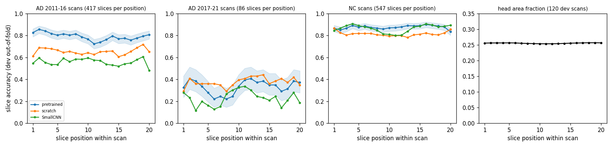
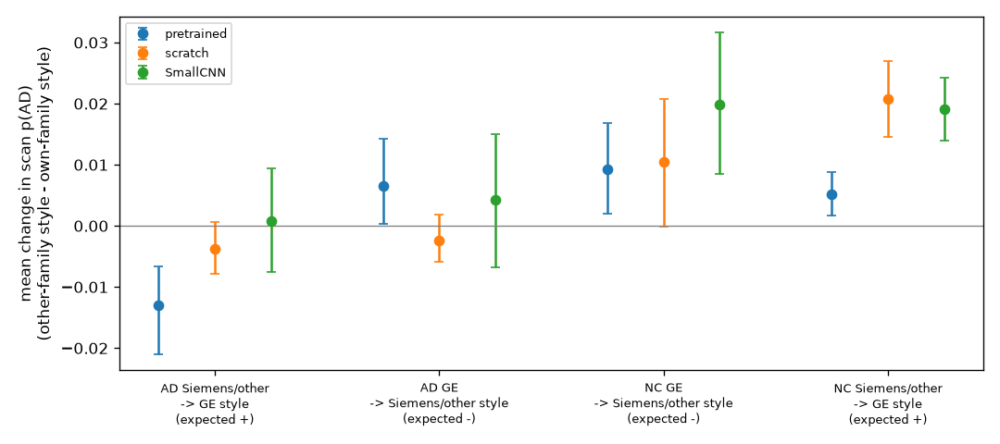
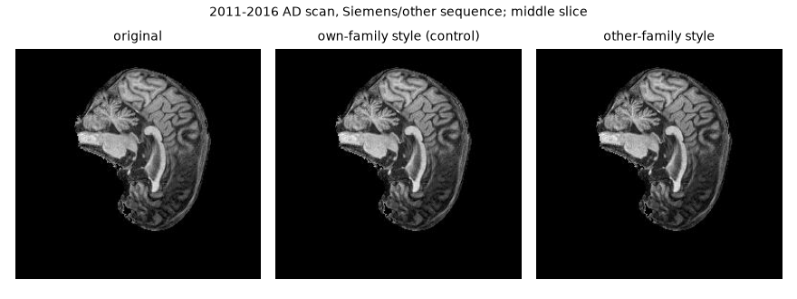

# Supplementary failure analysis and slice profiles

This document provides supplementary whole-cohort error analyses, through-scan slice probability trajectories, multi-slice visual inspections, and detailed case autopsies for supplementary test cases (Cases 6–10). Section 4 breaks the development errors down by slice position, sequence family and number of scans per patient.

## 1. Cohort-wide acquisition confound (development OOF Fisher exact test)

The test subgroups are small (6 of 25 vs 2 of 67), so the same grouping was
repeated on the 476 development patients. Each was scored out-of-fold by the
fold model that never trained on it, at the raw 0.5 threshold. These patients
were never used to choose this analysis. Patient error rate, with Wilson 95%
CI and Fisher's exact test (`results/failure_evidence_20261026/`, stored on Rangpur outside Git):

| Group | Dev. OOF, pretrained | Dev. OOF, scratch | Dev. OOF, SmallCNN | Test, pretrained ensemble |
|---|---|---|---|---|
| AD, any scan 2011-15 | 21/108 = 0.19 [0.13, 0.28] | 31/108 = 0.29 | 51/108 = 0.47 | 1/28 = 0.04 [0.01, 0.18] |
| AD, 2017-21 only | **31/47 = 0.66** [0.52, 0.78] | 28/47 = 0.60 | 39/47 = 0.83 | **7/16 = 0.44** [0.23, 0.67] |
| Fisher p (AD rows) | 4 × 10⁻⁸ | 5 × 10⁻⁴ | 4 × 10⁻⁵ | 0.002 |
| NC, subject < 6000 | **12/88 = 0.14** [0.08, 0.22] | 22/88 = 0.25 | 15/88 = 0.17 | **6/25 = 0.24** [0.11, 0.43] |
| NC, subject ≥ 6000 | 12/233 = 0.05 [0.03, 0.09] | 23/233 = 0.10 | 14/233 = 0.06 | 2/67 = 0.03 [0.01, 0.10] |
| Fisher p (NC rows) | 0.016 | 0.001 | 0.004 | 0.005 |

The test findings repeat in development for all three models, so they are not
an artefact of the 16 test errors.

* **Missed AD patients are mostly from 2017-2021.** In development, every
  model has about 2-3 times the error rate on AD patients scanned only in
  2017-2021. Cases 2 and 4 belong
  to this group, as do 117 of the 120 AD scans from 2017-2021. The acquisition-confound section gives
  the two explanations that the data cannot separate: an acquisition style
  shared with NC, or a milder disease stage.
* **False positives are mostly earlier-enrolled NC subjects.** Cases 1, 3 and 5
  all have subject numbers below 6000. These subjects joined ADNI before ADNI-3
  and were rescanned in 2017-2021. They are called AD 2-3 times as often as
  ADNI-3 controls in development. All NC patients share the 2017-2021 acquisition period, so
  acquisition style does not explain this difference. A plausible explanation
  is that earlier-enrolled controls are older and show more age-related
  atrophy. The metadata has no age field, so this is a hypothesis, not a
  finding.

## 2. Through-scan slice profiles and multislice analysis

**What the images can and cannot show.** *Figure 10* shows the single slice
with the most confident wrong prediction for each patient, not a
representative slice. Two further views reduce that selection bias.

* *Supplementary Figure 1* plots the calibrated p(AD) of every slice of every scan for all
  16 wrong test patients.
  * Some errors are consistent across the whole scan. Case 4 stays below 0.25
    on all 20 slices, and two NC false positives stay above 0.6 on almost every
    slice.
  * Other errors swing across the scan, from below 0.2 to above 0.8.
  * Within Case 3, the 2019 scan is AD-like throughout, while the 2017 scan
    swings between NC-like and AD-like slices.
  * Such swings are common. In 98 of the 306 test scans (32%), some slices fall
    on each side of 0.5 (median within-scan range 0.22). One slice therefore
    says little about the patient, and averaging over all slices is what makes
    patient-level decisions more stable.
* *Supplementary Figure 2* shows the first, middle and last slice of the scan behind each
  confident error. The 20 slices appear to cross the midline, so the outer slices show
  the lateral ventricle of each hemisphere and the middle slice shows the
  midline. Apparent ventricle size therefore changes with slice position as
  much as between patients.

No ventricle or cortical measurement was made, so the report draws no
anatomical conclusion from these images. Testing the atrophy explanation would
need registered 3D volumes and a measured quantity, such as ventricular volume,
compared between correct and wrong patients.

*Supplementary Figure 1. Calibrated slice p(AD) along each scan (one line per scan, legend
= acquisition year) for all 16 test patients the primary ensemble gets wrong
before referral. Grey band: patient-level referral band; titles: group,
patient p(AD) and decision.*

*Supplementary Figure 2. First, middle and last of the 20 slices of the scan behind each of
the five confident errors in Figure 10 (same order as Cases 1-5), with slice
p(AD). IDs removed.*

## 3. Case notes for supplementary cases (Cases 6–10)

* **Cases 6-9 (2017-2021, referred).** Patient p(AD) is 0.49-0.53, so all four
  are referred. Their images were not examined for a specific cause.
* **Case 10 (the only misclassified 2011-2016 AD patient).** Among the 122
  2011-2016 AD test scans (28 patients), the primary ensemble misses 6 scans.
  One is a borderline scan (`p(AD) = 0.48`) from a patient who is correct at
  patient level. The other five are 5 of the 6 longitudinal scans of Case 10
  (`scan p(AD) = 0.29, 0.35, 0.37, 0.42, 0.49`; the sixth scores `0.89`).
  Averaging the calibrated probabilities of all 120 slices (equivalently, of
  its six 20-slice scans) gives patient `p(AD) = 0.47` (`0.466`, confidence
  `0.53 < τ`), so the primary ensemble refers Case 10. SmallCNN gives
  `p(AD) = 0.31` and automates it as NC. This is a single patient and does not
  amount to evidence that one model is better.

## 4. Error breakdown by slice position, sequence family and scans per patient (post-hoc)

This is a post-hoc re-analysis (2026-10-27) of saved prediction files. No
model was retrained or re-scored, and nothing here changed the model, τ or the
recommendation. The primary data are the out-of-fold predictions of the 476
development patients (1,050 scans, 21,000 slices) from the three five-fold
models at the raw 0.5 threshold. The frozen test ensembles (306 scans) are only
a secondary check. Recomputed overall slice accuracy matches the reported
values (development `0.798 / 0.715 / 0.691`, test `0.867 / 0.793 / 0.826` for
pretrained ConvNeXt / scratch ConvNeXt / SmallCNN). Aggregates and the script:
`results/error_breakdown_20261027/` (stored outside Git).

### 4.1 Slice position

Every scan has 20 consecutive sagittal slices; position 1-20 is the rank of the
slice index within its scan. The mean head-area fraction (pixels > 16) of 120
random development scans changes by only about 1% across the 20 positions
(`0.254-0.257`), with a shallow minimum in the middle. The window is therefore
a narrow band, consistent with Supplementary Figure 2, where it appears to
cross the midline.

Accuracy of the central 10 versus the outer 10 positions, compared within each
scan (Wilcoxon signed-rank test over scans):

| Development OOF | Central 10 positions | Outer 10 positions | p |
|---|---:|---:|---:|
| Pretrained ConvNeXt-Tiny | 0.792 | 0.804 | 0.17 |
| Scratch ConvNeXt-Tiny | 0.705 | 0.725 | 0.013 |
| SmallCNN | 0.684 | 0.698 | 0.16 |

* No position holds most of the errors. Central and outer slices differ by at
  most 0.02, and where the difference is significant (scratch ConvNeXt) the
  outer slices are slightly better.
* AD scans acquired 2017-2021 are poorly classified at every position
  (pretrained: `0.22-0.41` per position, against `0.72-0.86` for 2011-2016 AD
  scans). Their errors are spread over the whole scan rather than tied to
  particular slices.
* On test, the pretrained ensemble's accuracy on 2017-2021 AD slices falls from
  `0.67` at position 1 to `0.37` at position 20. Each position holds only 27
  scans from 16 patients and development shows no such trend, so this is not
  interpreted.

*Supplementary Figure 3. Development out-of-fold slice accuracy at each of the
20 slice positions for 2011-2016 AD, 2017-2021 AD and NC scans (shaded: Wilson
95% CI for the pretrained models), and the mean head-area fraction per position
(right).*

### 4.2 Sequence family

Sequence families are parsed from the metadata file names as in
[ACQUISITION_CONFOUND.md](ACQUISITION_CONFOUND.md). Scan error rates
(development OOF), compared within one acquisition period and one diagnosis:

| Scan error rate | Pretrained ConvNeXt-Tiny | Scratch ConvNeXt-Tiny | SmallCNN |
|---|---|---|---|
| AD 2011-2016, Siemens/other | 54/239 = 0.23 | 107/239 = 0.45 | 139/239 = 0.58 |
| AD 2011-2016, GE or Philips | 18/178 = 0.10 | 18/178 = 0.10 | 49/178 = 0.28 |
| Fisher p | 0.001 | 2 × 10⁻¹⁵ | 5 × 10⁻¹⁰ |
| NC, GE | 15/109 = 0.14 | 22/109 = 0.20 | 23/109 = 0.21 |
| NC, Siemens/other | 29/438 = 0.07 | 59/438 = 0.13 | 31/438 = 0.07 |
| Fisher p | 0.019 | 0.096 | 5 × 10⁻⁵ |

* Earlier AD scans from Siemens/other sequences are missed more often than
  earlier AD scans from GE or Philips sequences, in all three models. NC scans
  from GE sequences are called AD more often than NC scans from Siemens/other
  sequences (significant for two of the three models).
* The direction follows how common each family is in the other class. In
  development, 438 of the 547 NC scans use Siemens/other accelerated sequences,
  while GE non-accelerated and Philips scans occur only in AD. Scans whose
  sequence family is typical of the other class are misclassified more often.
  This fits the acquisition-shortcut explanation, and the probe shows that the
  vendor is recognisable from pixels (scan AUROC 0.986).
* Limits: the counts are per scan, and scans of one patient are not
  independent, so the p-values are optimistic. Section 4.3 checks this, and
  checks site and acquisition year. On test, the AD direction repeats
  (Siemens/other 6/61 vs GE or Philips 0/61) but the NC direction does not (GE
  1/28 vs Siemens/other 13/129).

*Supplementary Figure 4. Development out-of-fold scan error rate by diagnosis,
acquisition period and sequence family for the three models (two 2017-2021 AD
scans without a parsable sequence name are omitted).*

### 4.3 Is it the sequence family, or something that travels with it?

The sequence family is tied to other variables: the acquisition year, the
site (an ADNI site mostly keeps one scanner) and the patients themselves
(several scans per patient). Each was checked on the same development
out-of-fold predictions (`results/error_breakdown_20261027/vendor_checks.json`,
stored outside Git). Sites are identified by the three-digit prefix of the
subject ID and are not named here.

2011-2016 AD scans, Siemens/other vs GE or Philips:

| Check | Pretrained ConvNeXt-Tiny | Scratch ConvNeXt-Tiny | SmallCNN |
|---|---|---|---|
| Scan level (table in 4.2) | p = 0.001 | p = 2 × 10⁻¹⁵ | p = 5 × 10⁻¹⁰ |
| Patient level: majority of the patient's scans wrong (90 patients with one family; 18 with both dropped) | 13/54 vs 3/36, p = 0.09 | 21/54 vs 2/36, p = 0.0004 | 33/54 vs 11/36, p = 0.005 |
| Site level: median site error rate, sites with ≥ 3 scans as units (25 vs 17 sites), Mann-Whitney | 0.11 vs 0.00, p = 0.13 | 0.47 vs 0.00, p = 2 × 10⁻⁵ | 0.59 vs 0.00, p = 0.004 |
| Leave one site out: largest Fisher p | 0.004 | 2 × 10⁻¹³ | 5 × 10⁻⁸ |
| Within the 10 sites that used both families (44 vs 46 scans): Mantel-Haenszel odds ratio | 1.5, p = 0.78 | 4.6, p = 0.039 | 2.9, p = 0.089 |

NC scans, GE vs Siemens/other:

| Check | Pretrained ConvNeXt-Tiny | Scratch ConvNeXt-Tiny | SmallCNN |
|---|---|---|---|
| Scan level (table in 4.2) | p = 0.019 | p = 0.096 | p = 5 × 10⁻⁵ |
| Patient level (320 patients with one family) | 5/65 vs 16/255, p = 0.78 | 10/65 vs 30/255, p = 0.41 | 12/65 vs 13/255, p = 0.001 |
| Site level (11 vs 38 sites) | 0.17 vs 0.00, p = 0.012 | 0.39 vs 0.13, p = 0.13 | 0.17 vs 0.00, p = 0.032 |
| Leave one site out: largest Fisher p | 0.065 | 0.51 | 0.021 |

* **Acquisition year is not the explanation.** Within 2011-2016, the two AD
  family groups have the same year distribution (mostly 2012-2013; Mann-Whitney
  p = 0.48). Siemens/other is worse within each year that has enough scans
  (pretrained: 2011 9/22 vs 0/12, 2012 24/100 vs 13/72, 2013 18/96 vs 5/81).
* **A single site is not the explanation.** The Siemens/other AD errors come
  from 16 (pretrained) to 27 (scratch, SmallCNN) different sites. Removing any
  one site keeps the AD contrast significant for all three models.
* **Repeated scans do not explain it for the scratch models.** For scratch
  ConvNeXt and SmallCNN, the AD contrast holds when each patient or each site
  counts once. For the primary pretrained ensemble it does not: p = 0.09 at
  patient level and p = 0.13 at site level. Its dependence on the sequence
  family is therefore weaker and not established. The NC contrast is robust
  only for SmallCNN.
* **Family and site can only partly be separated.** Within-site comparison is
  the only way to separate the two. It is possible for AD in 10 sites (90
  scans), and not for NC, where only two sites used both families. In those 10
  sites, all three models point the same way (odds ratio 1.5-4.6), but only the
  scratch ConvNeXt is significant. Differences in the patients of different
  sites, such as disease stage, are therefore not ruled out. The metadata has
  no clinical scores to test this.

In summary, for the scratch ConvNeXt and SmallCNN the errors follow the
sequence family beyond acquisition year, any single site and repeated scans.
This supports, but does not prove, that these models use acquisition style.
For the primary pretrained ensemble the evidence is weak. None of these checks
is causal; section 4.4 intervenes on the input.

### 4.4 Intervention: changing only the intensity style

This is a post-hoc experiment, declared in advance in
`results/style_intervention_20261027/PLAN.md` (written 2026-10-27 before the
job ran; Slurm 704381; stored outside Git). It used development out-of-fold
scans only, and no model was trained. Each validation scan was scored by its
fold model under three conditions:

* `original`: the scan as acquired;
* `same`: foreground intensities (pixels > 16) histogram-matched to the mean
  intensity distribution of the scan's own family;
* `cross`: foreground intensities matched to the other family.

Each reference came from up to 60 training scans of the same fold with the
same diagnosis and period, so anatomy and background are unchanged. The
effect is `p(cross) - p(same)`, which removes the effect of matching itself.
The `original` condition reproduced the saved validation logits on all 55,020
slices (largest difference 0.005, floating-point precision).

| Mean change in scan p(AD) [95% patient-bootstrap CI] | Expected | Pretrained ConvNeXt-Tiny | Scratch ConvNeXt-Tiny | SmallCNN |
|---|:-:|---|---|---|
| AD 2011-2016, Siemens/other → GE style (239 scans) | + | −0.013 [−0.021, −0.007] | −0.004 [−0.008, +0.001] | +0.001 [−0.008, +0.009] |
| AD 2011-2016, GE → Siemens/other style (131 scans) | − | +0.007 [+0.000, +0.014] | −0.002 [−0.006, +0.002] | +0.004 [−0.007, +0.015] |
| NC, GE → Siemens/other style (109 scans) | − | +0.009 [+0.002, +0.017] | +0.010 [−0.000, +0.021] | +0.020 [+0.009, +0.032] |
| NC, Siemens/other → GE style (438 scans) | + | +0.005 [+0.002, +0.009] | +0.021 [+0.015, +0.027] | +0.019 [+0.014, +0.024] |
| Directions supported / significantly opposite | | 1 / 3 | 1 / 0 | 1 / 1 |

* By the pre-declared rule (at least 2 of 4 directions supported and none
  significantly opposite), **none of the three models responds to the
  intensity style**.
* The changes are small: at most 0.021 in mean scan p(AD), with at most 12
  decisions at 0.5 flipping in any group. In comparison, the error rates of
  the two families differ by 0.07-0.35 (section 4.2).
* The changes do not follow the family-class association. NC scans gain p(AD)
  whichever family's style they receive. The only direction supported for all
  three models (NC Siemens/other → GE) is therefore not specific.
* Overall brightness and contrast are thus not how the family-related errors
  arise. Two explanations remain:
  * the models use style cues this experiment left unchanged (noise texture,
    sharpness, artefacts), which the vendor probe shows are recognisable from
    pixels;
  * the association comes from differences between the patients of different
    sites.

  The available data cannot separate them.
* Limits: the change in style is mild. The two families' intensity
  distributions are already similar in the supplied JPEGs, and the example
  below is hard to tell apart by eye. A null result for this intervention
  therefore does not mean that the models ignore acquisition style.

*Supplementary Figure 5. Mean change in scan p(AD) when a scan's intensity
distribution is matched to the other sequence family instead of its own (95%
patient-bootstrap CI), for the four pre-declared directions and three models.*

*Supplementary Figure 6. Middle slice of one 2011-2016 AD Siemens/other scan:
original, matched to its own family, and matched to the GE family. IDs removed.*

### 4.5 Scans per patient

AD patients with a single scan look harder at first: the pretrained models miss
22 of 42 such patients, against 19 of 82 with three or more scans. Split by
acquisition period, the difference disappears:

| AD patient error (development OOF) | 1 scan | 2 scans | 3+ scans |
|---|---|---|---|
| 2017-2021 only, pretrained | 18/26 = 0.69 | 6/11 = 0.55 | 7/10 = 0.70 |
| 2017-2021 only, scratch | 13/26 = 0.50 | 8/11 = 0.73 | 7/10 = 0.70 |
| 2017-2021 only, SmallCNN | 22/26 = 0.85 | 9/11 = 0.82 | 8/10 = 0.80 |
| Any scan 2011-2015, pretrained | 4/16 = 0.25 | 5/20 = 0.25 | 12/72 = 0.17 |
| Any scan 2011-2015, scratch | 3/16 = 0.19 | 7/20 = 0.35 | 21/72 = 0.29 |
| Any scan 2011-2015, SmallCNN | 6/16 = 0.38 | 11/20 = 0.55 | 34/72 = 0.47 |

* 26 of the 47 AD patients scanned only in 2017-2021 have a single scan, against
  16 of the 108 with earlier scans. The apparent effect of the number of scans
  therefore comes from the acquisition period.
* Within each period, there is no consistent trend across the three models,
  and the groups are small.
* NC patients show no trend either (pretrained: 1 scan 12/159, 2 scans 9/119,
  3+ scans 3/43).
